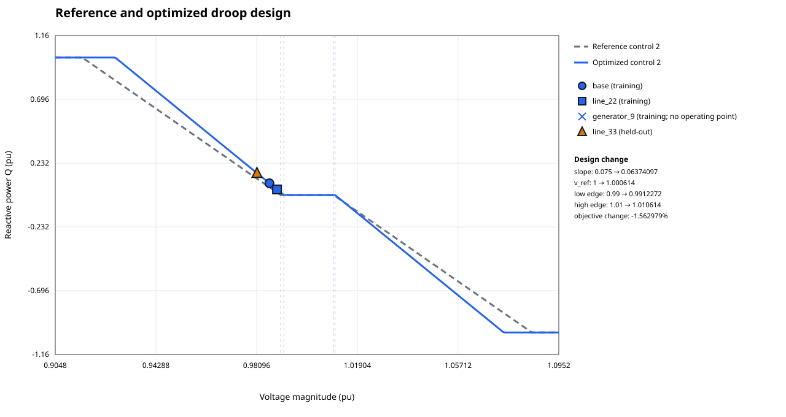
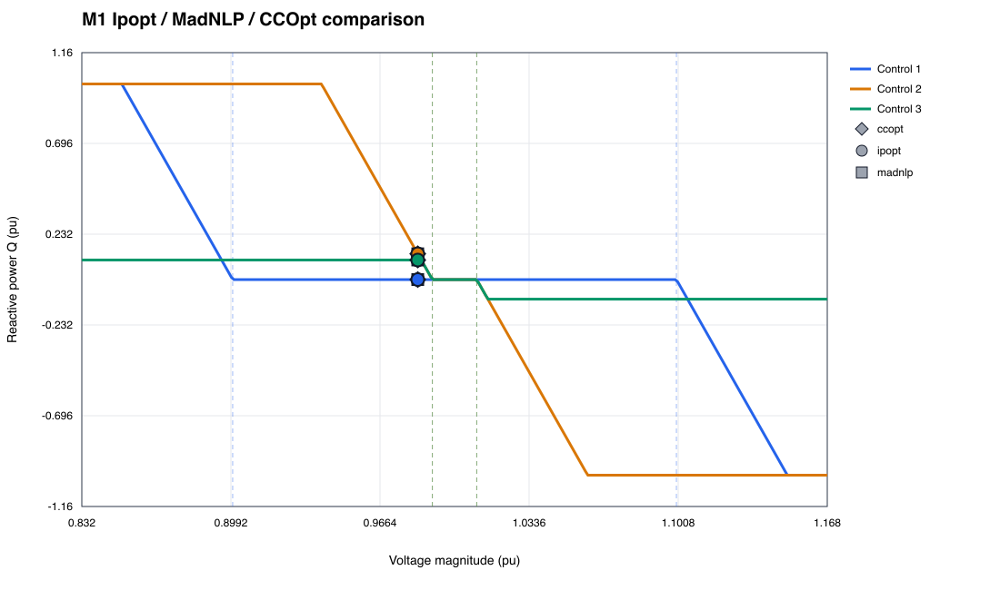

# DroopOPF.jl

[](https://github.com/frederikgeth/DroopOPF.jl/actions/workflows/CI.yml)
[](https://github.com/frederikgeth/DroopOPF.jl/actions/workflows/Documentation.yml)
[](https://frederikgeth.github.io/DroopOPF.jl/dev/)
[](LICENSE)

DroopOPF.jl is a Julia library for equilibrium-aware AC optimal power flow.
It supports smooth nonlinear and exact-complementarity representations of
generator reactive controls, independently validates returned operating points,
and retains failed numerical attempts as evidence rather than treating solver
status as physical feasibility.

Before accepting new fixed droops for S1, use the
[feasibility precursor](docs/src/feasibility_gate.md). It verifies the calibration
point and every required demand condition, records feasible / certified
infeasible / unresolved outcomes, and blocks acceptance without validated
operating points. The [14-bus example](examples/s1_arpae14_feasibility_gate.jl)
preserves the source OPF data and keeps fixed/free equipment scopes separate.
Optional [global escalation](docs/src/global_feasibility.md) adds sparse,
independently verified LP certificates, proved voltage-bound tightening and
budgeted global search while preserving the same three outcomes.

## Current release: v0.9.0

M9 adds equipment-aware SCOPF with explicit preventive/corrective tap and shunt
timing, per-device corrective movement budgets, shared automatic reactive
assignments, independent scenario replay, and paired immediate/settled
steady-state assessment. Ipopt and MadNLP provide smooth formulations, while
CCOpt provides the separately reported exact-complementarity lane.

| Release gate | Result |
|---|---:|
| Package tests | 2319/2319 pass |
| Documentation build | Pass |
| M9 preventive/corrective example | Pass |

| Release | Milestone | Scope and evidence |
|---|---|---|
| `v0.4.0` | M4 | Robustness, public-case regressions, and scale-up evidence |
| `v0.5.0` | M5 | Transformer data, fixed transformer physics, and validation |
| `v0.6.0` | M6 | Fixed shunts and simple-bank physics, accounting, and validation |
| `v0.7.0` | M7 | Continuous tap, simple-bank, and joint droop design in the declared base-case scope |
| `v0.8.0` | M8 | Explicit reactive-control modes, AVR, and qualified AVR-aware base-case joint design |
| `v0.9.0` | M9 | Equipment-aware SCOPF timing, movement budgets, paired response stages, and bounded public qualification |

The [free-droop companion study](docs/src/s1_free_droop_results.md) adds bounded slope/reference design and frozen-design verification for both 14 and 500 buses, with explicit failed and recovered tables.

Run the M2 workflow with `julia --project=. examples/m2_workflow.jl`.
Run the first M3 validation slice with
`julia --project=. examples/m3_slope_sweep.jl /tmp/droopopf-m3`.
Run the complete bounded-design workflow with
`julia --project=. examples/m3_workflow.jl /tmp/droopopf-m3-design`.
Run the first M4 robustness slice with
`julia --project=. examples/m4_robustness_workflow.jl /tmp/droopopf-m4`.
Run M3 parameter multi-start validation with
`julia --project=. examples/m4_design_multistart.jl /tmp/droopopf-m4-design`.
Run the pinned public-case and M2 measurements with
`julia --project=. examples/m4_benchmark_workflow.jl /tmp/droopopf-m4-benchmark`.
Run the staged M9.1 preventive/corrective equipment workflow with
`julia --project=. examples/m9_1_equipment_scopf.jl /tmp/droopopf-m9-1`.



## Documentation and milestone reports

Start with [Milestones and S1 status](docs/src/milestones.md), then use the
[current S1 decision report](docs/src/s1_summary.md) for the authoritative
scorecards, failure classification, evidence provenance, and M9 entry gate.

| Topic | Documentation | Retained report |
|---|---|---|
| M1–M4 | [Getting started](docs/src/getting_started.md), [SCOPF](docs/src/scopf.md), [M3](docs/src/droop_optimization.md), [M4](docs/src/robustness.md) | [M4 scale-up decision](docs/src/scale_up_decision.md) |
| M5 transformers | [Data model](docs/src/data_model.md#fixed-transformer-electrical-model-m52m54) | [M5 report](artifacts/m5/report.md) and [M5.1 report](artifacts/m5_1/report.md) |
| M6 shunts and banks | [Data model](docs/src/data_model.md#fixed-bus-shunts-m61) | [M6 report](artifacts/m6/report.md) and [M6.1 report](artifacts/m6_1/report.md) |
| M7 continuous equipment | [Equipment optimization](docs/src/equipment_optimization.md) | [M7.1](artifacts/m7_1/report.md), [M7.2](artifacts/m7_2/report.md), [M7.3](artifacts/m7_3/report.md), and [CCOpt comparison](artifacts/m7_ccopt_comparison/report.md) |
| M8 reactive controls and AVR | [Data model](docs/src/data_model.md#explicit-reactive-control-modes) | [reactive-control roadmap](REACTIVE_CONTROL_ROADMAP.md) |

The S1 reports retain the 14/500-bus results, numerical failures, recovery paths and closeout measurements. See the [closeout](docs/src/s1_closeout.md) for the accepted scope and remaining limitations.

## M8 quick start

Reactive behavior is explicit and opt-in. An AVR assignment names both the
generator and the voltage location it regulates:

```julia
using DroopOPF

assignments = [
    ReactiveControlAssignment(
        7,
        AVR(1.02),
        RegulatedLocation(:generator_terminal, 10),
    ),
]

result = solve_opf(case; reactive_assignments=assignments)
report = validate_equilibrium(case, result;
    reactive_assignments=assignments,
    power_tolerance=1e-5,
)
@assert report.valid
```

Use `optimize_joint_design` with the same `reactive_assignments` to coordinate
continuous taps or simple-bank settings in the base case. For SCOPF, pass those
policies to `Study` and declare timing explicitly:

```julia
participation = default_participation(case) # or measured response weights
seed_study = Study(case;
    contingencies,
    participation,
    reactive_assignments = assignments,
)
seed = solve_scopf(seed_study)

study = Study(case;
    contingencies,
    participation,
    reactive_assignments = assignments,
    tap_controls = [TapControl(11; lower=0.95, upper=1.05)],
    shunt_controls = [ShuntControl(201)],
    control_policy = SCOPFControlPolicy(
        taps=:preventive, shunts=:preventive), # shared across scenarios
)
result = solve_scopf(study; initial_states=seed.states)
@assert equilibrium_report(study, result).valid
```

Use `taps=:corrective` or `shunts=:corrective` only when that post-contingency
movement is physically justified. Reactive assignments and their setpoints
remain shared and respond automatically to scenario physics.

## Installation

From a checkout:

```julia
import Pkg
Pkg.activate(".")
Pkg.instantiate()
```

Or install the public repository directly:

```julia
import Pkg
Pkg.add(url = "https://github.com/frederikgeth/DroopOPF.jl.git")
```

The project currently includes the solver integrations used by the test suite:
Ipopt, MadNLP, CCOpt, MathOptComplements, and NLPModelsJuMP.

## Quick start

Cases are assembled from typed network, generator, load, and droop-control
objects. The complete small case is in
[`examples/m1_regime_case_study.jl`](examples/m1_regime_case_study.jl).

```julia
using DroopOPF

# `case` is a Case containing an ACNetwork and generator-control attachments.
result = solve_opf(case; smooth_epsilon = 1.0e-3)
report = equilibrium_report(case, result)
println(markdown_report(report))
```

The default smooth solver is Ipopt. MadNLP uses the same smooth model:

```julia
using MadNLP

madnlp_result = solve_opf(
    case;
    optimizer_factory = MadNLP.Optimizer,
    smooth_epsilon = 1.0e-3,
)
```

For the exact piecewise-linear droop graph, use CCOpt:

```julia
ccopt_result = solve_opf_complementarity(case)
```

Always inspect the independent equilibrium report, especially when a solver
returns an acceptable-but-not-fully-converged status:

```julia
equilibrium_report(case, ccopt_result).valid
```

## Droop curves and plots

Operating points can be extracted and plotted directly:

```julia
points = droop_operating_points(case, result.state)
write_droop_plot("droop_operating_points.svg", case, result.state)
```

The reproducible three-solver comparison prints numerical residuals and writes
a figure:

```sh
julia --project=. examples/m1_solver_comparison.jl
```



The plot uses curve colours for controls and marker shapes for solvers. The
comparison example exercises deadband, proportional, and reactive saturation
operation in the same case.

## Numerical formulation

The smooth model replaces positive-part terms with the stable
`LogExpFunctions.log1pexp` implementation. Voltage smoothing is specified in
per-unit voltage. Reactive smoothing is scaled per control as a fraction of the
smaller distance from the deadband reactive reference to either reactive limit;
an absolute reactive smoothing width can be supplied when needed.

The complementarity model represents voltage hinges with nonnegative
complementarity pairs and reactive clipping with the KKT conditions for
projection onto the reactive capability interval. It is exposed through
`solve_opf_complementarity` and uses the CCOpt JuMP integration via
MathOptComplements. For fixed zero deadband, it uses the affine raw response
directly and keeps only the two Q-saturation pairs per controller.

Solver comparison guidance and starting tolerances are documented in
[`SOLVER_COMPATIBILITY.md`](SOLVER_COMPATIBILITY.md). Architecture and the
development plan are in [`ARCHITECTURE.md`](ARCHITECTURE.md) and
[`ROADMAP.md`](ROADMAP.md).

## Testing

```sh
julia --project=. -e 'using Pkg; Pkg.test()'
```

The test suite includes small AC network tests, equilibrium validation,
plotting checks, and compatibility smoke tests for Ipopt, MadNLP, and CCOpt.

## License

DroopOPF.jl is released under the BSD 3-Clause license. See
[`LICENSE`](LICENSE).

## S1 closeout

The [14/500-bus S1 study is closed](docs/src/s1_closeout.md) for the declared Pmin-zero, symmetric-Q, sampled-demand scope. The closeout retains native solver failures, independent physical checks, bounded recoveries, serial warmed profiling and the original-limit limitations.

The [zero-deadband follow-up](docs/src/s1_zero_deadband.md) passed 3,042 regression checks and recovered all 12 selected previously failed S1 combinations: 11 primary passes plus one historical-policy bounded retry. Historical campaign scores and the selected frozen baseline remain separate.

The separate [native 14-bus S2 study](docs/src/s2_14bus.md) qualifies 24 connected eligible outages at nominal demand with corrective taps and continuous banks. All nine solver runs passed; independent replay checked 157 states with zero discrepancies. One islanding line outage remains excluded, so complete N-1 security is not claimed.

The [S1 14-bus free-control figures](docs/src/s1_14bus_control_figures.md) compare
matched Ipopt/MadNLP/CCOpt designs at five sampled demands. All
[S2 operating and control-comparison figures](docs/src/s2_14bus_figures.md) are
embedded in the documentation as well. S1 remains closed for its declared scope.

The [S2 frozen-demand follow-up](docs/src/s2_14bus_followup.md) retains the
selected nominal controller: 100/105/110% pass on all three solvers, while
90/95% remain unqualified after bounded retries. The line 7–8 outage is
validated on the retained main network under the explicit G5-trip assumption;
no protection or dynamic security claim is made.

<!-- S2_MULTIDEMAND -->
## Shared multi-demand design follow-up

**1 accepted shared design; 27/27 frozen solver–demand combinations accepted.** The new campaign shares one controller across five demand training points and 24 connected outages, with four additional held-out demands and corrective equipment within the confirmed bounds. See the [multi-demand report](docs/src/s2_14bus_multidemand.md). Historical scores and S1 closure are unchanged.
<!-- /S2_MULTIDEMAND -->

<!-- S2_SOLVER_DESIGNS -->
## Independent MadNLP and CCOpt shared-design follow-up

Accepted free multi-demand designs: **ipopt, madnlp**. The new backends optimize their own shared slopes/references from the accepted Ipopt full witness; accepted designs are independently replayed and compared with Ipopt. See the [solver design comparison](docs/src/s2_14bus_solver_designs.md). Original campaign scores, rejected attempts and S1 closure remain unchanged.
<!-- /S2_SOLVER_DESIGNS -->


<!-- S2_CCOPT_RECOVERY -->
## Targeted CCOpt convergence recovery

**CCOpt recovered an accepted free multi-demand design.** The recovery starts from the accepted MadNLP full primal witness and tests proportional/scheduled relaxation without changing the physical contract. See the [CCOpt recovery report](docs/src/s2_14bus_ccopt_recovery.md) for diagnostics, updated curves and held-out outcomes. Historical attempts and S1 closure remain unchanged.
<!-- /S2_CCOPT_RECOVERY -->

<!-- S2_14BUS_REVIEW -->
## 14-bus S2 review decision

The declared sampled 14-bus scope is closed. See the [14-bus review](docs/src/s2_14bus_review.md). Broader S2 remains open; S1 remains closed.
<!-- /S2_14BUS_REVIEW -->

<!-- S2_CURRENT_ACCEPTED -->
## Consolidated S2 14-bus accepted results

The [main S2 14-bus report](docs/src/s2_14bus.md) and [complete gallery](docs/src/s2_14bus_figures.md) now lead with accepted free Ipopt, MadNLP and recovered CCOpt multi-demand designs. Fourteen current figures cover 675 connected-state records and 27 conditional projections; all pass independent replay. The original 18 nominal-campaign figures and failed attempts remain historical. No numerical optimisation was run for consolidation; S1 and the declared sampled 14-bus scope remain closed, while broader S2 remains open.
<!-- /S2_CURRENT_ACCEPTED -->

## 500-bus S2 qualification outcome

The [500-bus report and figures](docs/src/s2_500bus.md) qualify all 389 connected
outages at nominal demand with MadNLP (22.609398136 MW base loss) and the
recovered Ipopt design (22.609456649 MW). Independent 90% and 95% designs also
qualify with both solvers. Each design has its own controller and preventive
dispatch, verified across 390 selected states; this is not a shared multi-demand
solution. The required 110% demand/G60 outage is
certified infeasible by an active-loss outer LP, with exact rational Python
replay and a positive gap after allowing acceptance tolerances. Therefore the
five-demand target cannot pass under the original normal limits and full demand. CCOpt remains
unqualified; 171 loaded islands also prevent an all-loads-served full N-1 claim.
Overall 500-bus S2 remains open. S1 and the declared sampled 14-bus S2 scope
remain closed; no release was published.


The confirmed [500-bus emergency/loadability follow-up](docs/src/s2_500bus.md#confirmed-emergency-operation-and-loadability-follow-up) retains corrective equipment and permits penalised N−1 voltage/thermal departures, 1% DR and 10 MW shedding. One shared controller passes the three critical outages across nine sampled demands; the 110% point uses 17.465465 MW DR and zero shedding. The full 110% connected scan passes 387/389; broader qualification remains open. Exact necessary-condition upper samples and island relief-budget obstructions are documented separately from local solver failures. No physical remedies were investigated.


The [500-bus exact network-reduction tests](docs/src/s2_500bus.md#exact-electrical-network-reduction-tests) compare 377- and 430-bus voltage models while retaining every original branch rating, voltage/angle bound and original outage identity. Candidates are reconstructed and independently checked on the original 500-bus network; native convergence and full-network physical acceptance are reported separately. This is a study adapter, with no physical equipment changes or full-security closure implied.

The [500-bus continuation follow-up](docs/src/s2_500bus.md#demand-continuation-and-response-policy-diagnostics) advances the accepted expanded master and tests bounded active-response relaxation with exact-rule restoration. Accepted points require native convergence and original-network validation with zero response relaxation. The retained controller is fixed for this diagnostic; sampled five-outage feasibility does not imply exhaustive qualification or a multi-demand optimum.

The subsequent [free-droop continuation](docs/src/s2_500bus.md#free-droop-continuation-with-exact-active-response) frees the 51 slopes and reference voltages while retaining exact active response and the confirmed corrective equipment bounds. It records scaling/anchor recoveries, original 500-bus operating plots, all droop-curve comparisons and a constructive DR-first allocation check. Physical acceptance does not establish minimum relief or full-security closure.

The [solver and independent-demand follow-up](docs/src/s2_500bus.md#solver-qualification-and-independent-demand-designs) retains all 51 free slope/reference pairs, original-network validation, qualified droop/operating/equipment plots and failed recoveries. Under original normal limits, the best 105% controller passes 387/389; that normal-limit target remains unresolved. CCOpt remains unqualified after bounded recoveries, and the 110% normal-limit/full-demand certificate is unchanged.

The [targeted demand diagnosis and emergency-design follow-up](docs/src/s2_500bus.md#targeted-diagnosis-and-independent-emergency-designs) qualifies independent emergency-policy connected-outage designs at 105%. The 110% emergency target and CCOpt remain unresolved; normal-limit results and full N−1/islanding gates stay separate. The reports retain stage snapshots, exact joint-relaxation replay, all-generator parameter comparisons and original-network checks.

The [capped 500-bus follow-up](docs/src/s2_500bus.md#capped-continuation-and-shared-multi-demand-attempts) reaches new native critical-outage feasibility points through 106.25%, and validates one common-controller witness across 90%, 95%, 100%, 105% and 106.25%. The joint three-solver optimization and 389-outage gates are reported separately. The new 105% priority-polishing controller is not qualified; the preceding 389/389 emergency controller remains retained.

The [expanded-master and incremental shared-demand recovery](docs/src/s2_500bus.md#expanded-outage-master-and-incremental-shared-demand-recovery) qualifies a new Ipopt 105% feasible controller against all 389 connected outages with zero shedding. An equivalent direct-relief formulation and implied-Q-bound cleanup recover native three-demand feasibility and resource minimization with Ipopt and MadNLP. Final loss optimization, higher-demand expansion and the CCOpt gate retain separate status.

### Automatic active response

Preventive SCOPF uses limit-aware participation: generators follow weighted
requests up to their effective power/movement limits, allowing remaining units
to take over. Defaults use nonzero effective active-capability ranges; actual
governor/AGC weights can be supplied. This steady-state rule is not a dynamic
frequency model. See [response policy and saved-file migration](docs/src/scopf.md).
Historical P2 fixed-participation evidence needs requalification for this policy.

The [P2 staged preventive-control study](docs/src/p2_preventive_controls.md) records
shared droop/equipment design, held-out freezing and the remaining capacity gates.

The current [P2 500-bus benchmark](docs/src/p2_s2_500.md) uses the exact saved S2
data and control policy. [Fresh implementation and bounded runs](docs/src/p2_s2_implementation.md)
pass the 14-bus five-demand comparison and the 500-bus 105% feasibility pilot.
[The 500-bus multi-demand continuation](docs/src/p2_s2_multidemand.md) validates one
shared controller at 90/95/100/105% with zero shedding and another through
106.25% with S2 relief, all 389 connected outages per demand.
[Remaining qualification attempts](docs/src/p2_remaining_qualification.md) add
four held-out demands per network, three exhaustive 500-bus repetitions, paired
performance comparisons and local Julia 1.10/1.12 checks. Warm recovery is
qualified in the tested scope; pure 500-bus flat starts, broader predictive
filtering and full resource-objective qualification remain open.
