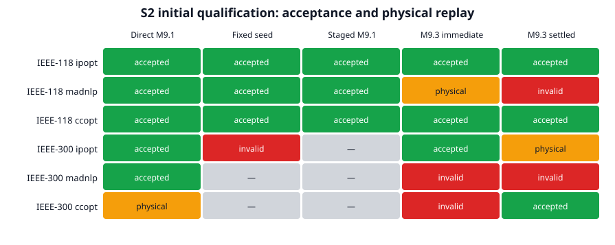
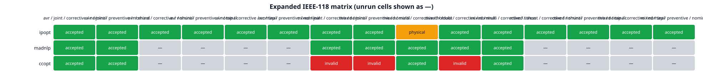
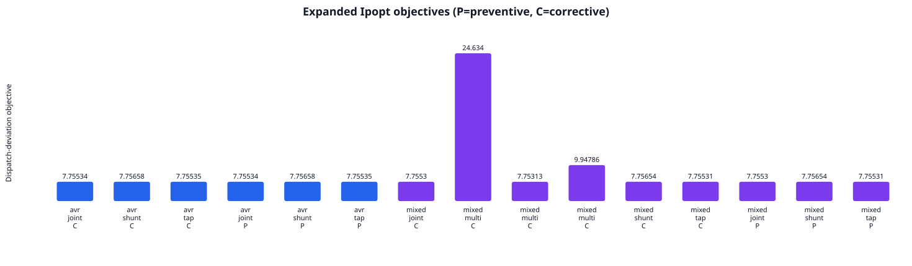
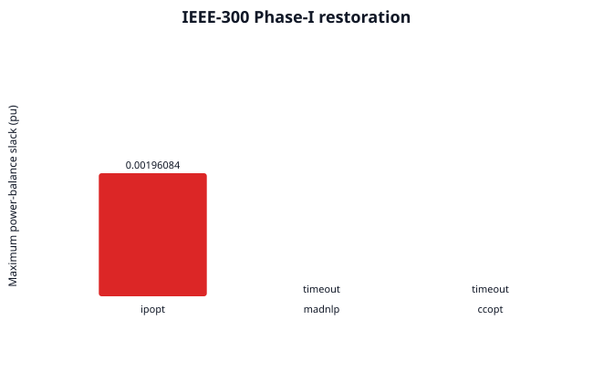

# S2 frozen initial scorecard and expansion

This report is generated from retained JSON artifacts. Solver acceptance and independent physical replay are kept separate; an elastic Phase-I result never counts as an accepted SCOPF result.

## Core matrix

| Network | Solver | Direct M9.1 | Fixed seed | Staged M9.1 | M9.3 immediate | M9.3 settled | M9.3 lineage |
|---:|---|---|---|---|---|---|---|
| 118 | ipopt | accepted (`LOCALLY_SOLVED`) | accepted (`LOCALLY_SOLVED`) | accepted (`LOCALLY_SOLVED`) | accepted (`LOCALLY_SOLVED`) | accepted (`LOCALLY_SOLVED`) | staged M9.1 anchor |
| 118 | madnlp | accepted (`LOCALLY_SOLVED`) | accepted (`LOCALLY_SOLVED`) | accepted (`LOCALLY_SOLVED`) | physical only (`ITERATION_LIMIT`) | invalid (`ITERATION_LIMIT`) | staged M9.1 anchor |
| 118 | ccopt | accepted (`LOCALLY_SOLVED`) | accepted (`LOCALLY_SOLVED`) | accepted (`LOCALLY_SOLVED`) | accepted (`LOCALLY_SOLVED`) | accepted (`LOCALLY_SOLVED`) | staged M9.1 anchor |
| 300 | ipopt | accepted (`LOCALLY_SOLVED`) | invalid (`TIME_LIMIT`) | not run | accepted (`ALMOST_LOCALLY_SOLVED`) | physical only (`ITERATION_LIMIT`) | direct M9.1 anchor |
| 300 | madnlp | accepted (`LOCALLY_SOLVED`) | not run | not run | invalid (`ITERATION_LIMIT`) | invalid (`ITERATION_LIMIT`) | direct M9.1 anchor |
| 300 | ccopt | physical only (`SLOW_PROGRESS`) | not run | not run | invalid (`ITERATION_LIMIT`) | accepted (`ALMOST_LOCALLY_SOLVED`) | direct M9.1 anchor |

## Expanded IEEE-118 matrix

The public case retains its supplied electrical state. Fixed shunt 34 at bus 34 (B=0.14 pu) is represented by an equivalent one-step bank at its supplied state, then continuously bounded to ±10% for this explicitly labelled overlay. Tap movement is limited to 0.005 pu and shunt movement to 0.014 pu in corrective cells. Mixed control replaces one of three AVRs with a Volt–VAr controller using a ±0.005 pu deadband, slope 0.05, and the FreeQ anchor output.

| Solver | Reactive | Equipment | Timing | Profile | Load | Status | Physical | Accepted | Warm retry | Objective |
|---|---|---|---|---|---:|---|---|---|---|---:|
| ccopt | avr | joint | corrective | nominal | 1.0 | `LOCALLY_SOLVED` | True | True | — | 7.755343400521127 |
| ccopt | avr | joint | preventive | nominal | 1.0 | `LOCALLY_SOLVED` | True | True | — | 7.755343510192887 |
| ccopt | mixed | joint | corrective | nominal | 1.0 | `ALMOST_LOCALLY_SOLVED` | False | False | retained failure (`ALMOST_LOCALLY_SOLVED`) | 7.755304850301201 |
| ccopt | mixed | joint | preventive | nominal | 1.0 | `ALMOST_LOCALLY_SOLVED` | False | False | retained failure (`ALMOST_LOCALLY_SOLVED`) | 7.755304853026502 |
| ccopt | mixed | multi | corrective | holdout | 1.0 | `ALMOST_LOCALLY_SOLVED` | True | True | — | 24.51822357783226 |
| ccopt | mixed | multi | corrective | nominal | 1.0 | `ALMOST_LOCALLY_SOLVED` | False | False | retained failure (`ALMOST_LOCALLY_SOLVED`) | 7.753125897666564 |
| ccopt | mixed | multi | corrective | stress | 1.03 | `ALMOST_LOCALLY_SOLVED` | True | True | — | 9.947859470112974 |
| ipopt | avr | joint | corrective | nominal | 1.0 | `LOCALLY_SOLVED` | True | True | — | 7.755343502711181 |
| ipopt | avr | joint | preventive | nominal | 1.0 | `LOCALLY_SOLVED` | True | True | — | 7.7553435102129935 |
| ipopt | avr | shunt | corrective | nominal | 1.0 | `LOCALLY_SOLVED` | True | True | — | 7.756575571320846 |
| ipopt | avr | shunt | preventive | nominal | 1.0 | `LOCALLY_SOLVED` | True | True | — | 7.756575576326489 |
| ipopt | avr | tap | corrective | nominal | 1.0 | `LOCALLY_SOLVED` | True | True | — | 7.755346451810832 |
| ipopt | avr | tap | preventive | nominal | 1.0 | `LOCALLY_SOLVED` | True | True | — | 7.755346454316549 |
| ipopt | mixed | joint | corrective | nominal | 1.0 | `LOCALLY_SOLVED` | True | True | — | 7.755304964261257 |
| ipopt | mixed | joint | preventive | nominal | 1.0 | `LOCALLY_SOLVED` | True | True | — | 7.755304971764289 |
| ipopt | mixed | multi | corrective | holdout | 1.0 | `ITERATION_LIMIT` | True | False | accepted | 24.63395350083352 |
| ipopt | mixed | multi | corrective | nominal | 1.0 | `LOCALLY_SOLVED` | True | True | — | 7.753126014861068 |
| ipopt | mixed | multi | corrective | stress | 1.03 | `LOCALLY_SOLVED` | True | True | — | 9.947859572592813 |
| ipopt | mixed | shunt | corrective | nominal | 1.0 | `LOCALLY_SOLVED` | True | True | — | 7.756537646883105 |
| ipopt | mixed | shunt | preventive | nominal | 1.0 | `LOCALLY_SOLVED` | True | True | — | 7.7565376518793485 |
| ipopt | mixed | tap | corrective | nominal | 1.0 | `LOCALLY_SOLVED` | True | True | — | 7.755307939856861 |
| ipopt | mixed | tap | preventive | nominal | 1.0 | `LOCALLY_SOLVED` | True | True | — | 7.7553079423625375 |
| madnlp | avr | joint | corrective | nominal | 1.0 | `LOCALLY_SOLVED` | True | True | — | 7.755343502711642 |
| madnlp | avr | joint | preventive | nominal | 1.0 | `LOCALLY_SOLVED` | True | True | — | 7.755343510212939 |
| madnlp | mixed | joint | corrective | nominal | 1.0 | `LOCALLY_SOLVED` | True | True | — | 7.75530496426132 |
| madnlp | mixed | joint | preventive | nominal | 1.0 | `LOCALLY_SOLVED` | True | True | — | 7.755304971764505 |
| madnlp | mixed | multi | corrective | holdout | 1.0 | `LOCALLY_SOLVED` | True | True | — | 24.617703752920306 |
| madnlp | mixed | multi | corrective | nominal | 1.0 | `LOCALLY_SOLVED` | True | True | — | 7.753126014860975 |
| madnlp | mixed | multi | corrective | stress | 1.03 | `LOCALLY_SOLVED` | True | True | — | 9.94785957259275 |

Frozen direct acceptance: **25/29** completed cells: Ipopt **14/15**, MadNLP **7/7**, CCOpt **4/7**. A bounded same-model warm retry accepts **1** additional cell, for **26/29** with declared retries. The Ipopt holdout reaches `LOCALLY_SOLVED` from its retained scenario-state witness. Three stricter CCOpt retries remain invalid on exact-droop replay in the generator-outage scenario; its holdout and +3% stress multi-location direct cells pass.

## Phase-I restoration

Ipopt returned a positive-slack local point (total slack 0.5464 pu, maximum component 0.001961 pu); its exact retry remained invalid. MadNLP and CCOpt reached the external 180-second wall limit without an artifact. These outcomes classify numerical paths only and are not infeasibility certificates.

## Critical interpretation

The initial scorecard is now frozen and reproducible, but it is not a universal SCOPF reliability claim. IEEE-300 staged M9.1 remains unresolved. The expansion is IEEE-118 only and uses a declared continuous shunt overlay. It now includes a second transformer, independent holdout outages, and +3% fixed-control stress, but it is still a targeted matrix rather than full N-1 enumeration.
