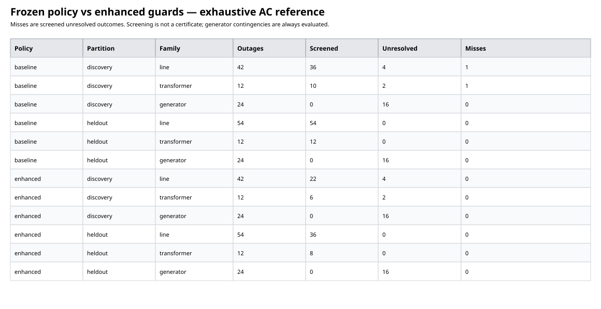
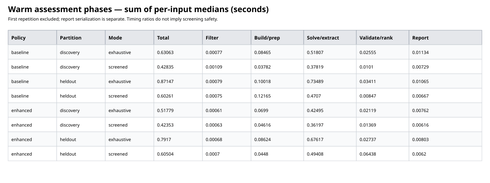

# Held-out filtering qualification and performance

Verification snapshot: full regression passed **2,626/2,626 tests** in 3m35.0s. Documentation build passed (API-page size warning only). Both SVG figures were rendered and visually inspected; report links resolved. No large reliability networks were used in unit tests.

## Protocol and interpretation

Twelve discovery networks (3/5 buses) and twelve predeclared held-out networks (4/6 buses), with ring/chord topology, line/transformer identity, tap ratios, load level, reactive demand, and generation location/capability varied. Base points are selected with AVR targets; post-outage Q is free within declared bounds. The partitions and operating inputs were defined before evaluating the held-out results.

Frozen legacy policy: loading threshold 0.8, voltage margin 0.02 pu. Enhanced policy adds a 0.1 aggregate bidirectional reactive-reserve fraction guard and impedance/apparent-flow redistribution guards. Settings were frozen after the discovery failure and before held-out evaluation; no held-out threshold tuning was performed. Generators always receive exact AC evaluation. These guards are conservative heuristics, NOT solved AC states or security certificates.

Unresolved includes physical failure, solver rejection, and errors—not proof of infeasibility. Zero misses on this finite set is not a deployment guarantee. Per-network comparison.json files retain complete inputs, base states, thresholds, exact states and validation/ranking evidence.

## Coverage and misses by device family

| Policy | Partition | Family | Outages | Screened | Unresolved | Missed unresolved |
|---|---|---|---:|---:|---:|---:|
| baseline | discovery | line | 42 | 36 | 4 | 1 |
| baseline | discovery | transformer | 12 | 10 | 2 | 1 |
| baseline | discovery | generator | 24 | 0 | 16 | 0 |
| baseline | heldout | line | 54 | 54 | 0 | 0 |
| baseline | heldout | transformer | 12 | 12 | 0 | 0 |
| baseline | heldout | generator | 24 | 0 | 16 | 0 |
| enhanced | discovery | line | 42 | 22 | 4 | 0 |
| enhanced | discovery | transformer | 12 | 6 | 2 | 0 |
| enhanced | discovery | generator | 24 | 0 | 16 | 0 |
| enhanced | heldout | line | 54 | 36 | 0 | 0 |
| enhanced | heldout | transformer | 12 | 8 | 0 | 0 |
| enhanced | heldout | generator | 24 | 0 | 16 | 0 |

## Warm runtime and phase attribution

Three paired repetitions per input, alternating screened/exhaustive execution order. Repetition 1 is excluded from warm statistics. Final policy runs were executed sequentially, without another Julia workload launched by this task. Host scheduling, garbage collection and system load remain possible noise sources; these are small-network measurements, not scale forecasts.

Each row sums per-input median seconds over repetitions 2–3. Speedup is exhaustive total / screened total for that policy and partition. End-to-end assessment includes validation and routing; report serialization is measured separately in memory (Markdown + JSON), excludes disk I/O and plotting. Preparation/build includes study construction and base checks; optimize/extract includes solver and result extraction. Independent validation/ranking follows extraction. Remaining overhead is outside those measured phases.

| Policy | Partition | Mode | Total s | Filter s | Prepare/build s | Optimize/extract s | Validate/rank s | Report s |
|---|---|---|---:|---:|---:|---:|---:|---:|
| baseline | discovery | exhaustive | 0.63063 | 0.00077 | 0.08465 | 0.51807 | 0.02555 | 0.01134 |
| baseline | discovery | screened | 0.42835 | 0.00109 | 0.03782 | 0.37819 | 0.0101 | 0.00729 |
| baseline | heldout | exhaustive | 0.87147 | 0.00079 | 0.10018 | 0.73489 | 0.03411 | 0.01065 |
| baseline | heldout | screened | 0.60261 | 0.00075 | 0.12165 | 0.4707 | 0.00847 | 0.00667 |
| enhanced | discovery | exhaustive | 0.51779 | 0.00061 | 0.0699 | 0.42495 | 0.02119 | 0.00762 |
| enhanced | discovery | screened | 0.42353 | 0.00063 | 0.04616 | 0.36197 | 0.01369 | 0.00616 |
| enhanced | heldout | exhaustive | 0.7917 | 0.00068 | 0.08624 | 0.67617 | 0.02737 | 0.00803 |
| enhanced | heldout | screened | 0.60504 | 0.0007 | 0.0448 | 0.49408 | 0.06438 | 0.0062 |

- Warm assessment speedup (baseline, discovery): **1.47×**.
- Warm assessment speedup (baseline, heldout): **1.45×**.
- Warm assessment speedup (enhanced, discovery): **1.22×**.
- Warm assessment speedup (enhanced, heldout): **1.31×**.

## Cold-call and exclusions

- baseline: first comparison 10.187 s; reported JIT compilation 10.162772455 s; invalid bases 0: .
- enhanced: first comparison 8.995 s; reported JIT compilation 8.975157832 s; invalid bases 0: .

First-comparison wall time includes JIT, exact evaluation and validation. The runtime-provided compile counter is diagnostic (not a disjoint phase); process startup, package loading/precompilation and base construction are excluded. Every input's base-construction and first-comparison time is retained in results.json.

## Assessment

The discovery misses arose in the reactive-stressed three-bus ring: two screened branch outages failed AC balance. The reserve guard escalates these. All held-out branch outages were accepted by the exhaustive reference; therefore branch-failure recall cannot be estimated from this held-out set. Its unresolved outcomes were generator outages, which always receive exact evaluation. This demonstrates non-regression, not superiority on unseen branch failures. Enhanced guards deliberately trade screening savings for caution; review family counts and timing together. Additional independently designed stress families and S1/S2 scale qualification remain necessary.
