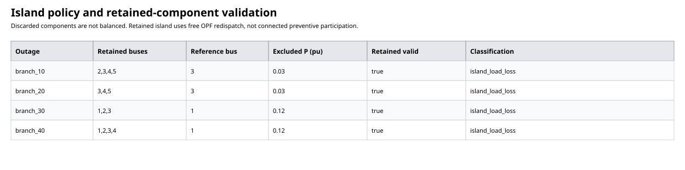

# SCOPF validation evidence

Follow-up: [held-out filtering qualification, guard enhancements, and phase timing](../scopf_filter_qualification/evaluation.md).

All networks here contain two, three or five buses. This evaluates steady-state AC security, not dynamic security or global optimality.

## SCOPF solves and negative controls

Negative controls deliberately alter saved outputs. Changed-input cases are genuine solves; a local solver rejection is unresolved evidence, not a general infeasibility proof.

- [accepted](accepted/evaluation.md)
- [invalid-outaged-generator](invalid-outaged-generator/evaluation.md)
- [missing-state](missing-state/evaluation.md)
- [invalid-voltage](invalid-voltage/evaluation.md)
- [invalid-active-balance](invalid-active-balance/evaluation.md)
- [tight-thermal](tight-thermal/evaluation.md)
- [insufficient-post-outage-capacity](insufficient-post-outage-capacity/evaluation.md)

## Screening compared with exhaustive AC evaluation

Every available line, transformer and generator outage is evaluated in the reference run. A screened unresolved outcome is a miss, including solver failures. Recall is undefined when there are no unresolved outcomes; budget plots therefore report counts, not a fabricated 100% recall.

| Input case | Device family | Total | Screened | Unresolved | Screened unresolved | Screened physical failures |
|---|---|---:|---:|---:|---:|---:|
| benign | line | 1 | 1 | 0 | 0 | 0 |
| benign | transformer | 1 | 1 | 0 | 0 | 0 |
| benign | generator | 2 | 0 | 0 | 0 | 0 |
| thermal | line | 1 | 0 | 1 | 0 | 0 |
| thermal | transformer | 1 | 0 | 1 | 0 | 0 |
| thermal | generator | 2 | 0 | 0 | 0 | 0 |
| voltage | line | 1 | 0 | 1 | 0 | 0 |
| voltage | transformer | 1 | 0 | 1 | 0 | 0 |
| voltage | generator | 2 | 0 | 0 | 0 | 0 |
| reactive | line | 1 | 1 | 0 | 0 | 0 |
| reactive | transformer | 1 | 1 | 0 | 0 | 0 |
| reactive | generator | 2 | 0 | 2 | 0 | 0 |
| transformer | line | 1 | 1 | 0 | 0 | 0 |
| transformer | transformer | 1 | 1 | 0 | 0 | 0 |
| transformer | generator | 2 | 0 | 0 | 0 | 0 |
| voltage_guard_disabled | line | 1 | 1 | 1 | 1 | 1 |
| voltage_guard_disabled | transformer | 1 | 1 | 1 | 1 | 1 |
| voltage_guard_disabled | generator | 2 | 0 | 0 | 0 | 0 |

## Expected behavior versus observed outcomes

PASS below means the experiment matched its expectation, not that the operating point was secure.

| Input | Expected behavior | Experiment check |
|---|---|---|
| benign | All outages accepted; both branch outages screened | PASS |
| thermal | Both branch outages unresolved and escalated | PASS |
| voltage | Both branch outages unresolved and escalated | PASS |
| reactive | Both generator outages unresolved | PASS |
| transformer | All outages accepted; both branch outages screened | PASS |
| voltage_guard_disabled | Disabled guard causes two detected false screens | PASS |

## Per-case ranking and validation details

- [benign pipeline](qualification-benign/pipeline.md); [evaluation-budget plot](qualification-benign/ranking-budget.svg). Outage-specific input/output bundles are in that directory.
- [thermal pipeline](qualification-thermal/pipeline.md); [evaluation-budget plot](qualification-thermal/ranking-budget.svg). Outage-specific input/output bundles are in that directory.
- [voltage pipeline](qualification-voltage/pipeline.md); [evaluation-budget plot](qualification-voltage/ranking-budget.svg). Outage-specific input/output bundles are in that directory.
- [reactive pipeline](qualification-reactive/pipeline.md); [evaluation-budget plot](qualification-reactive/ranking-budget.svg). Outage-specific input/output bundles are in that directory.
- [transformer pipeline](qualification-transformer/pipeline.md); [evaluation-budget plot](qualification-transformer/ranking-budget.svg). Outage-specific input/output bundles are in that directory.
- [voltage_guard_disabled pipeline](qualification-voltage_guard_disabled/pipeline.md); [evaluation-budget plot](qualification-voltage_guard_disabled/ranking-budget.svg). Outage-specific input/output bundles are in that directory.

The voltage_guard_disabled run is a deliberate unsafe-policy control: its false screens demonstrate why the guard is required. Zero observed misses in the guarded fixtures is not a general screening certificate.

## Island policy and campaign replay

[Island campaign](islands/campaign.md). Reused 7 checkpoints; executed 0 routes on replay.

Largest-component selection, lost-load accounting, and largest-generator reference reassignment are checked separately from retained-component electrical feasibility. See campaign-inputs.json for full inputs, source fingerprint and numerical settings.
