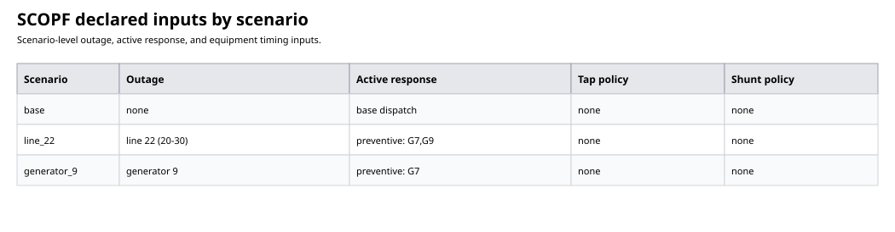
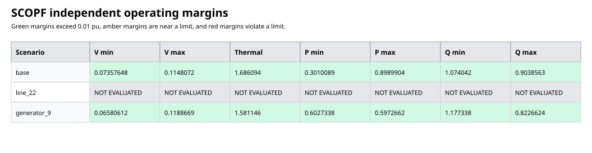
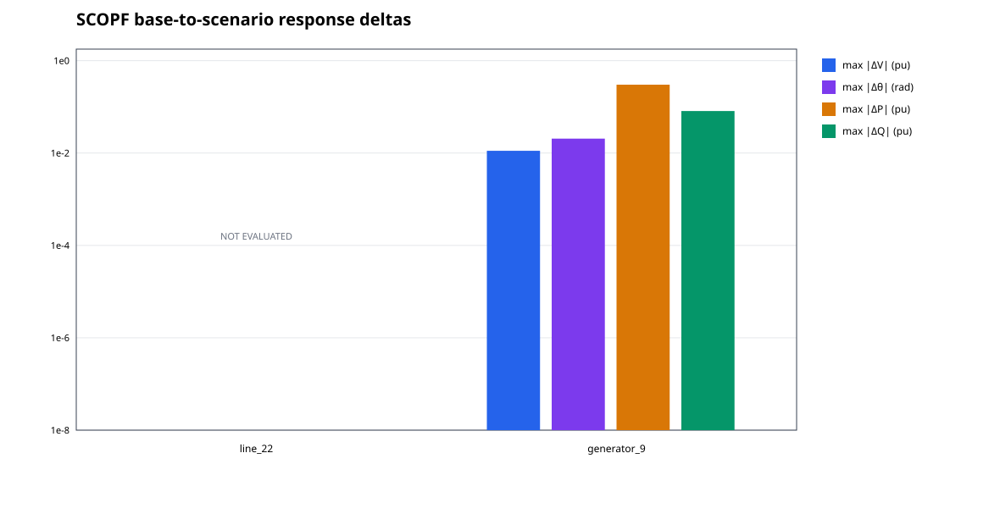
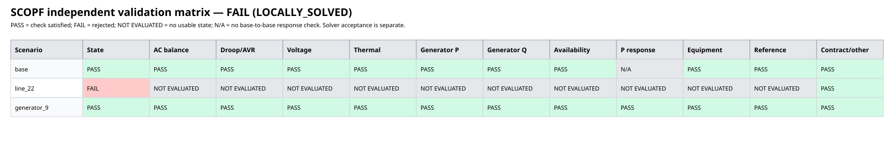
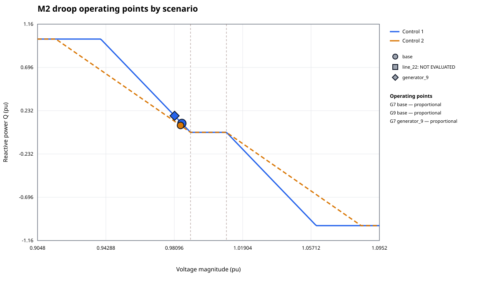
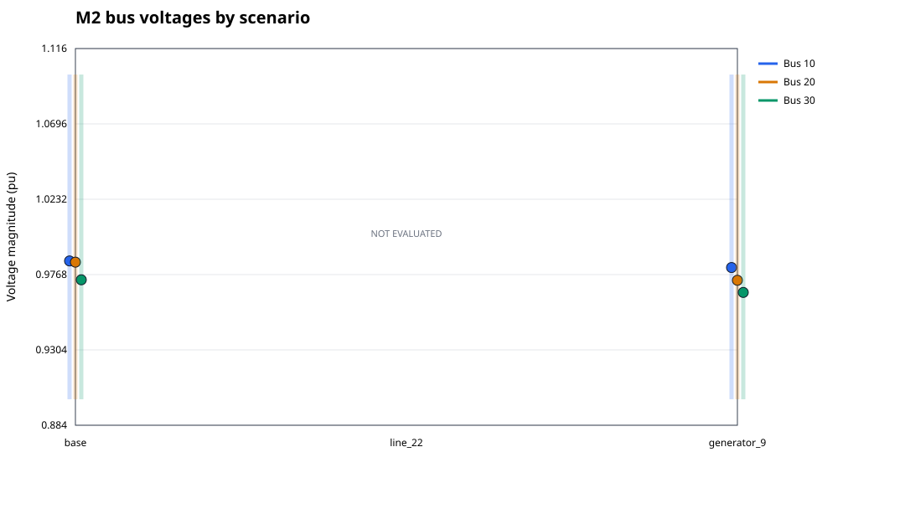
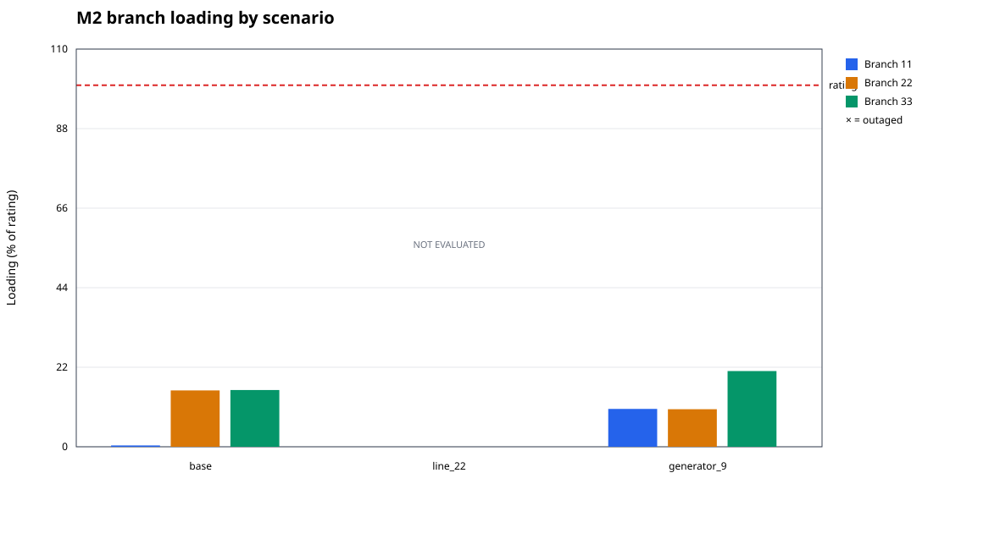
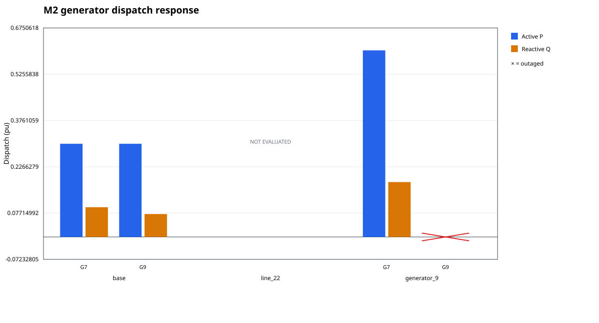
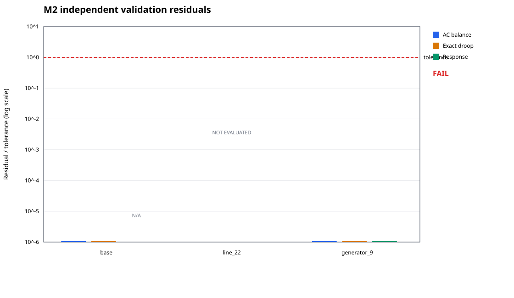

# SCOPF input/output evaluation

Deliberate negative control: a contingency state was removed to test incomplete-result reporting.

- Case: `m2-three-bus`
- Response mode: `preventive`
- Scenarios: 3
- Solver status: `LOCALLY_SOLVED`
- Independently valid and solver-accepted: `false`

- Exact physical validation: `false`
- Encoded physical validation: `false`
- Primal status: `FEASIBLE_POINT`
- Objective: `1.676309943232809e-5`

## Assumptions and interpretation

Steady-state AC equations with the declared demand, topology, generator limits and reactive controls. Power and voltage are per-unit; angles are radians. Preventive response uses surviving participation weights; corrective response uses the declared redispatch bounds. Equipment follows the declared timing and movement limits.

A solver success flag alone is not validation. Checks independently replay the saved states and solved tap/shunt settings against the declared study. PASS applies only to these scenarios and tolerances; it is not a dynamic-security, global-optimality or all-contingency certificate. Missing or malformed states are NOT EVALUATED, never physical passes. Response-delta plots include outage changes, are descriptive rather than pass/fail, and floor values at 1e-8.

## Reproducible inputs, outputs and tolerances

The accompanying evaluation-inputs.json and evaluation-outputs.json contain the complete declared study and saved solution, including network data, controls, limits, policy and scenario states. evaluation-validation.json contains the independently recomputed checks.

- Participation weights: `Dict(7 => 1.0, 9 => 1.0)`
- Redispatch limits (pu): `Dict{Int64, Float64}()`
- Base power: `100.0`; base frequency: `50.0`
- Demand by load (id, bus, P pu, Q pu): `[(1, 30, 0.6, 0.15)]`
- Generator bounds (id, Pmin, Pmax, Qmin, Qmax pu): `[(7, 0.0, 1.2, -1.0, 1.0), (9, 0.0, 1.2, -1.0, 1.0)]`
- Branch ratings (id, kind, apparent-power limit pu): `[(11, :line, 2.0), (22, :line, 2.0), (33, :line, 2.0)]`
- Bus voltage bounds (id, Vmin, Vmax pu): `[(10, 0.9, 1.1), (20, 0.9, 1.1), (30, 0.9, 1.1)]`
- Reactive response: declared legacy droop controls
- Validation tolerances: `(power_tolerance = 1.0e-6, droop_tolerance = 1.0e-5, limit_tolerance = 1.0e-6, unavailable_tolerance = 1.0e-8, coupling_tolerance = 1.0e-6)`

## Declared inputs and cross-scenario checks

## Detailed operating plots

## Numerical validation

# SCOPF report: m2-three-bus

- Valid: `false`; exact-curve feasible: `false`; encoded-model feasible: `false`
- Solver: Ipopt; termination: `LOCALLY_SOLVED`; primal: `FEASIBLE_POINT`
- Mode: `preventive`; encoding: `smooth`
- Base dispatch objective: 1.676309943232809e-5
- Tolerances (p.u., reference angle in radians): `(power_tolerance = 1.0e-6, droop_tolerance = 1.0e-5, limit_tolerance = 1.0e-6, unavailable_tolerance = 1.0e-8, coupling_tolerance = 1.0e-6)`

| Scenario | AC residual | Exact droop residual | Encoded droop residual | Smooth/exact gap | Branch margin | P-response violation | Equipment violation | Failures |
|---|---:|---:|---:|---:|---:|---:|---:|---|
| base | 2.6645352591003757e-15 | 1.1657341758564144e-15 | 1.0547118733938987e-15 | 1.1102230246251565e-16 | 1.6860943472078245 | 0.0 | 0.0 | none |
| line_22 | — | — | — | — | — | — | — | missing_state |
| generator_9 | 2.6922908347160046e-15 | 4.163336342344337e-16 | 3.0531133177191805e-16 | 1.1102230246251565e-16 | 1.581146216752789 | 0.0 | 0.0 | none |

Controls and network limits are checked independently in each scenario. Active-power response follows the declared policy; this report makes no dynamic or frequency-stability claim.
