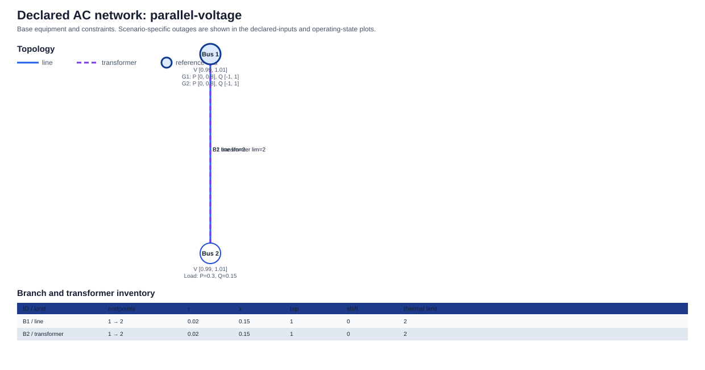
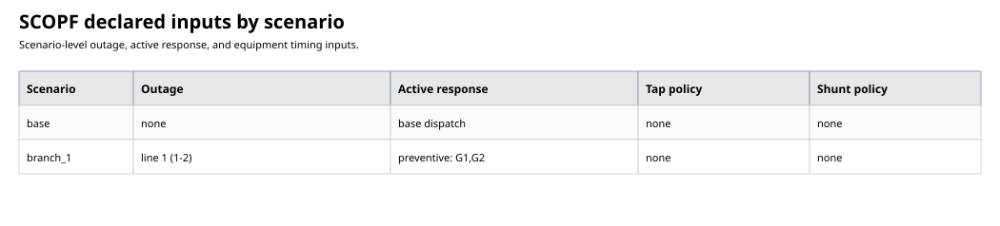
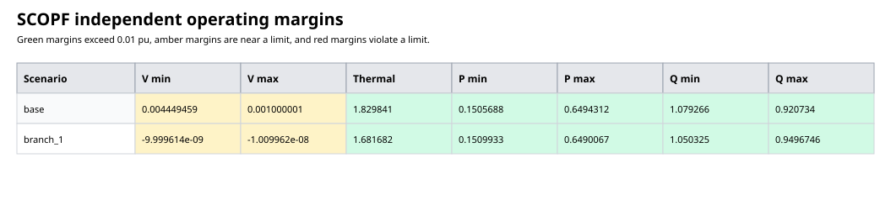
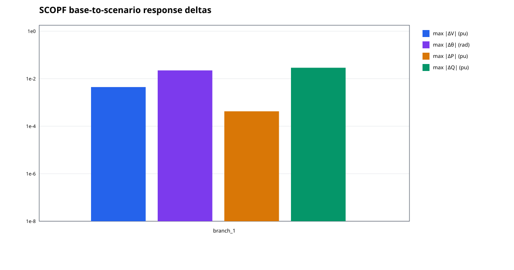
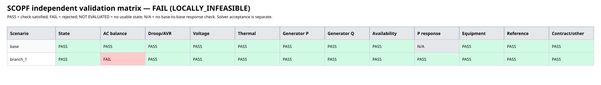
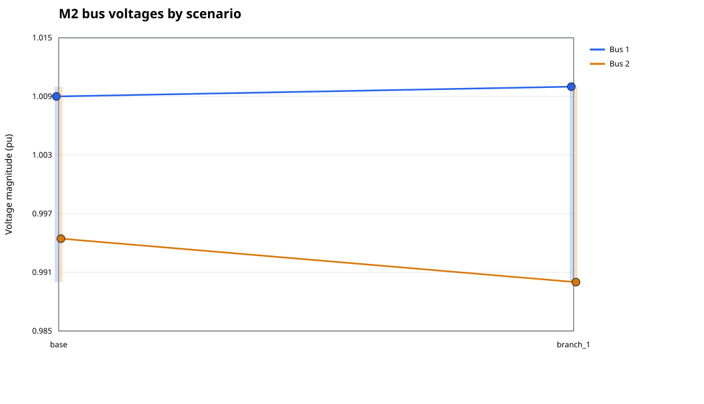
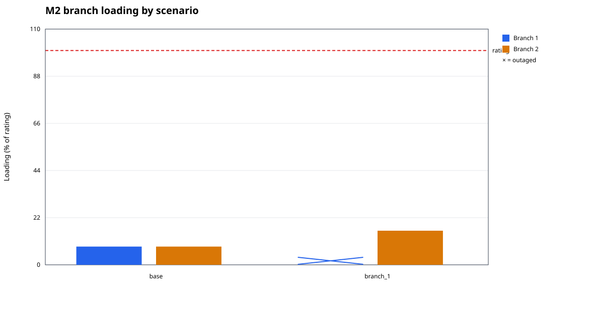
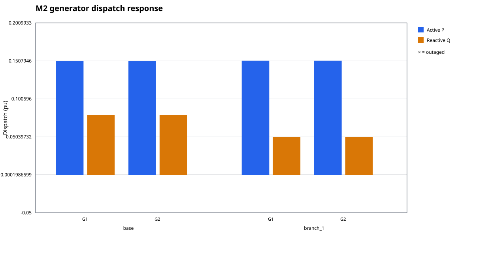
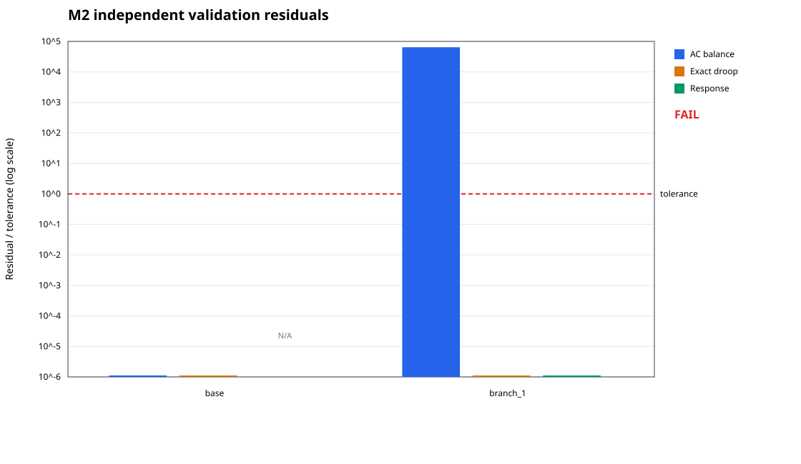

# SCOPF input/output evaluation

Fixed-base exhaustive AC reference for voltage; independent outcome: invalid. Base chosen with AVR voltage targets (1.009 pu for the voltage fixture, including the disabled-guard run; 1.0 otherwise); post-outage Q is free within declared bounds.

- Case: `parallel-voltage`
- Response mode: `preventive`
- Scenarios: 2
- Solver status: `LOCALLY_INFEASIBLE`
- Independently valid and solver-accepted: `false`

- Exact physical validation: `false`
- Encoded physical validation: `false`
- Primal status: `INFEASIBLE_POINT`
- Objective: `6.834565471803777e-7`

## Assumptions and interpretation

Steady-state AC equations with the declared demand, topology, generator limits and reactive controls. Power and voltage are per-unit; angles are radians. Preventive response uses surviving participation weights; corrective response uses the declared redispatch bounds. Equipment follows the declared timing and movement limits.

A solver success flag alone is not validation. Checks independently replay the saved states and solved tap/shunt settings against the declared study. PASS applies only to these scenarios and tolerances; it is not a dynamic-security, global-optimality or all-contingency certificate. Missing or malformed states are NOT EVALUATED, never physical passes. Response-delta plots include outage changes, are descriptive rather than pass/fail, and floor values at 1e-8.

## Reproducible inputs, outputs and tolerances

The accompanying evaluation-inputs.json and evaluation-outputs.json contain the complete declared study and saved solution, including network data, controls, limits, policy and scenario states. evaluation-validation.json contains the independently recomputed checks.

- Participation weights: `Dict(2 => 1.0, 1 => 1.0)`
- Redispatch limits (pu): `Dict{Int64, Float64}()`
- Base power: `100.0`; base frequency: `50.0`
- Demand by load (id, bus, P pu, Q pu): `[(1, 2, 0.3, 0.15)]`
- Generator bounds (id, Pmin, Pmax, Qmin, Qmax pu): `[(1, 0.0, 0.8, -1.0, 1.0), (2, 0.0, 0.8, -1.0, 1.0)]`
- Branch ratings (id, kind, apparent-power limit pu): `[(1, :line, 2.0), (2, :transformer, 2.0)]`
- Bus voltage bounds (id, Vmin, Vmax pu): `[(1, 0.99, 1.01), (2, 0.99, 1.01)]`
- Reactive response: free Q within generator limits
- Validation tolerances: `(power_tolerance = 1.0e-6, droop_tolerance = 1.0e-5, limit_tolerance = 1.0e-6, unavailable_tolerance = 1.0e-8, coupling_tolerance = 1.0e-6)`

## Declared inputs and cross-scenario checks

The topology figure documents the declared base equipment and limits. It is not a solved operating-state diagram: the scenario-input table and detailed operating plots show each outage and its resulting state.

## Detailed operating plots

## Numerical validation

# SCOPF report: parallel-voltage

- Valid: `false`; exact-curve feasible: `false`; encoded-model feasible: `false`
- Solver: Ipopt; termination: `LOCALLY_INFEASIBLE`; primal: `INFEASIBLE_POINT`
- Mode: `preventive`; encoding: `smooth`
- Base dispatch objective: 6.834565471803777e-7
- Tolerances (p.u., reference angle in radians): `(power_tolerance = 1.0e-6, droop_tolerance = 1.0e-5, limit_tolerance = 1.0e-6, unavailable_tolerance = 1.0e-8, coupling_tolerance = 1.0e-6)`

| Scenario | AC residual | Exact droop residual | Encoded droop residual | Smooth/exact gap | Branch margin | P-response violation | Equipment violation | Failures |
|---|---:|---:|---:|---:|---:|---:|---:|---|
| base | 2.0261570199409107e-15 | 0.0 | 0.0 | 0.0 | 1.8298410818524957 | 0.0 | 0.0 | none |
| branch_1 | 0.06424871886291812 | 0.0 | 0.0 | 0.0 | 1.6816817878020909 | 2.0708261494473135e-17 | 0.0 | power_balance |

Controls and network limits are checked independently in each scenario. Active-power response follows the declared policy; this report makes no dynamic or frequency-stability claim.
