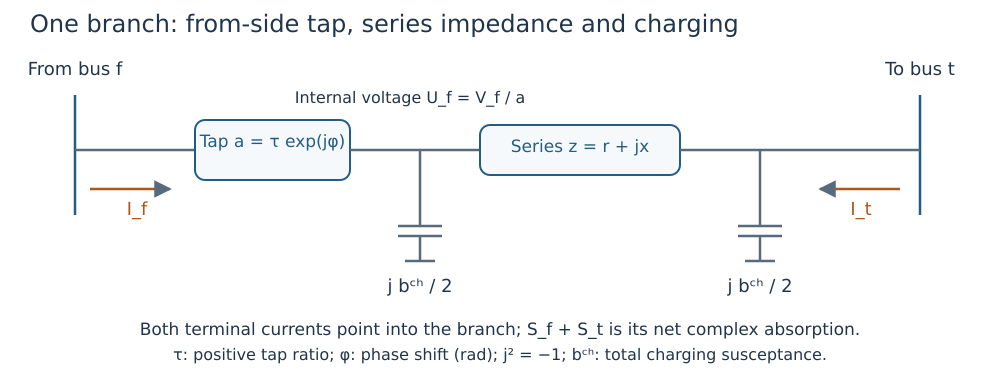

# Following power through the AC model

**Goal:** connect the electrical schematic, equations and data fields. The model
is a balanced, positive-sequence AC equivalent. It does not represent individual
phase conductors, electromagnetic transients or dynamic controllers.

## Voltage, current and complex power

At bus ``b``, let ``v_b>0`` be voltage magnitude in pu and ``\delta_b`` voltage
angle in radians. The complex voltage phasor is
``\widetilde V_b=v_b\exp(\mathrm j\delta_b)``, where ``\mathrm j^2=-1`` and
``\exp`` is the exponential function. For a terminal current ``I`` directed
**out of the bus into equipment**, complex power is
``S=\widetilde V\overline I=P+\mathrm jQ``. The bar denotes complex conjugation;
``P`` is active power and ``Q`` reactive power, both in pu on the system base.

A positive generator output injects into the bus. A positive load consumes from
the bus. Branch terminal powers below are positive into the branch. These
conventions make nodal balance an injection-minus-consumption equation.

## One branch, including a transformer



*Figure 1. The ideal complex tap acts on the from side. Charging uses the internal
from-side voltage after that tap. Both endpoint ratings must be checked.*

For branch ``\ell`` from bus ``f`` to bus ``t``, define:

| Symbol | Definition | Native field |
|---|---|---|
| ``r,x`` | Series resistance/reactance, pu | `resistance`, `reactance` |
| ``z=r+\mathrm jx``; ``y=1/z`` | Series impedance; admittance, pu | Calculated |
| ``b^{ch}`` | Total charging susceptance, pu | `charging` |
| ``\tau>0``; ``\phi`` | Tap magnitude; phase shift, radians | `tap_ratio`, `phase_shift` |
| ``a=\tau\exp(\mathrm j\phi)`` | Complex from-side tap | Calculated |
| ``U_f=\widetilde V_f/a`` | Voltage on the internal from terminal | Calculated |
| ``I_f,I_t`` | Currents into the branch from its endpoint buses | Calculated |
| ``J_s`` | Series current from the internal from node to the to node | Calculated |

The independent current calculation is

```math
\begin{aligned}
J_s &= y(U_f-\widetilde V_t),\\
I_f &= \frac{J_s+\mathrm j(b^{ch}/2)U_f}{\overline a},\\
I_t &= -J_s+\mathrm j(b^{ch}/2)\widetilde V_t,\\
S_f &= \widetilde V_f\overline{I_f},\qquad
S_t = \widetilde V_t\overline{I_t}.
\end{aligned}
```

Here ``S_f,S_t`` are complex powers into the branch. Their sum is net complex
branch absorption; it need not be zero. ``\Re(S_f+S_t)`` is active loss, where
``\Re`` takes the real part. Charging can make reactive absorption negative.
``|S_f|\le\overline S_\ell`` and ``|S_t|\le\overline S_\ell`` separately enforce
the branch's supplied terminal rating ``\overline S_\ell``. Magnitude is denoted
by ``|\cdot|``. The two terminal flows can differ, especially with charging.

The optimizer assembles a nodal admittance matrix ``Y`` from the same physical
data. It uses bus power ``\widetilde V_b\overline{(Y\widetilde V)_b}``, where
``(Y\widetilde V)_b`` is net current leaving bus ``b``. Validation separately
sums branch-terminal powers rather than reusing that optimizer expression.
See [the electrical data contract](data_model.md#Fixed-transformer-electrical-model).

## Shunts consume or supply power according to voltage

For shunt ID ``s`` at bus ``b``, conductance ``G_s\ge0`` and susceptance ``B_s``
are in pu. Its complex **consumption** is

```math
S_s^{sh}=(G_s-\mathrm jB_s)v_b^2.
```

Thus positive ``G_s`` consumes active power; positive ``B_s`` supplies reactive
power because reactive consumption is negative. For example, ``B_s=0.02`` pu and
``v_b=1`` inject 0.02 pu reactive power, or 2 MVAr on a 100 MVA base.
At ``v_b=0.95``, that injection is ``0.02(0.95)^2=0.01805`` pu.
A constant-Q load does not scale with ``v_b^2`` in this way.

A `FixedShunt` fixes admittance. A `ShuntBank` also records supplied section/legal
state metadata. Selected bank optimization may be a **continuous** relaxation;
its optimized fractional count is not automatically a legal switching action.
Do not represent the same physical capacitor in both a load adjustment and a shunt.

## Nodal power balance

Let ``\mathcal G_b`` be generators, ``\mathcal L_b`` loads, ``\mathcal E_b``
incident branch terminals and ``\mathcal S_b`` shunts/banks at bus ``b``.
Let ``S_g=P_g+\mathrm jQ_g`` be generator injection; ``S_l^L`` load consumption;
``S_{\ell,b}^{term}`` branch power into branch ``\ell`` at ``b``; and ``S_s^{sh}``
shunt consumption. Then the complex nodal residual ``r_b`` is

```math
r_b=\sum_{g\in\mathcal G_b}S_g
    -\sum_{l\in\mathcal L_b}S_l^L
    -\sum_{\ell\in\mathcal E_b}S_{\ell,b}^{term}
    -\sum_{s\in\mathcal S_b}S_s^{sh}=0.
```

Both the real and imaginary parts must vanish within their acceptance tolerance.
These are active and reactive balance, respectively. Summing real balances over
buses gives generation minus load equal to active branch and shunt losses.

## Units and reference choices are physical modeling choices

`Case.base_power` is the common power base in MVA. Native per-unit constructor
inputs must already be converted consistently; [notation and units](notation.md)
provides conversion formulas. A tap ratio is dimensionless, phase shift is radians,
and shunt susceptance is admittance in pu.

One angle reference removes an arbitrary common angle offset. It is not a source
of unbounded active output. Generator availability and P/Q capability remain
explicit. Missing import ratings cannot be replaced by a demonstration placeholder
and then described as verified equipment limits; see [PSS/E import](psse.md).

Next: [how the same model is coupled across outages and periods](study_workflows.md).
