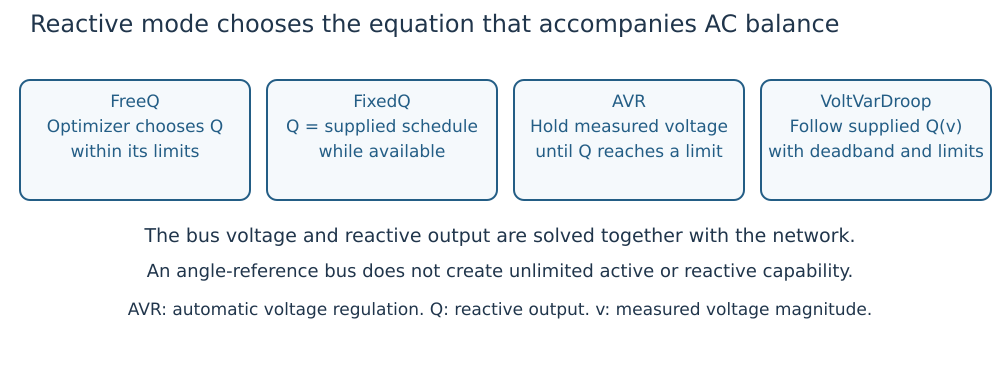

# What problem are we solving?

## Start with an operating point

An AC network has buses, connecting branches, generators and loads. An **operating
point** gives each bus's voltage magnitude and angle and each generator's active
and reactive output. Those numbers must satisfy AC power balance and equipment
limits at the same time.

| Quantity | Symbol | Stored in |
|---|---|---|
| Bus voltage magnitude, in per unit | ``v_b`` for bus ``b`` | `ACState.vm` |
| Bus voltage angle, in radians | ``\delta_b`` | `ACState.va` |
| Generator active output | ``P_g`` for generator ``g`` | `ACState.pg` |
| Generator reactive output | ``Q_g`` | `ACState.qg` |

The subscript identifies a device; it is not necessarily an array position.
Vectors follow the order in `case.network.buses` and `case.generators`.

**Power flow** finds a consistent state under prescribed operating rules.
**Optimal power flow (OPF)** also chooses permitted operating values to minimize
an explicit objective. DroopOPF's default base objective measures departure from
supplied generator reference outputs; it is not an invented fuel-cost curve.
See the [worked example](first_opf.md) for the exact objective and its units.

## A controller adds an equation

A free reactive output can move anywhere within its limits to help the optimization.
A droop-controlled output must also lie on its supplied voltage/output curve.
Consequently, the optimizer cannot independently choose both measured voltage and
reactive output for that generator. It solves their intersection with the network.

*Figure 1. Each mode determines a different relation between reactive output and
the network voltage. All modes still obey availability and capability constraints.*

## Four reactive modes

| Mode | What it means | What can respond |
|---|---|---|
| `FreeQ` | Reactive output is an optimization variable within limits. | The optimizer selects ``Q_g``. |
| `FixedQ` | Reactive output equals a supplied schedule. | Voltage follows the network equations. |
| `AVR` | Automatic voltage regulation holds a supplied measured-voltage target while reactive capability permits. | ``Q_g`` changes; at a reactive limit, voltage regulation releases. |
| `VoltVarDroop` | Reactive output follows a supplied deadband/saturated curve of measured voltage. | ``Q_g`` and voltage move together along the curve. |

An explicit `ReactiveControlAssignment` names the mode for a generator. Legacy
`GeneratorControlAttachment`s connect generators to entries in `case.controls`.
A generator without a legacy droop attachment defaults to `FreeQ`; the presence
of a generator alone does not create a droop or an AVR controller.

The regulated location can be a local bus, a remote bus or a supported branch
terminal. It says **where voltage is measured**. It does not relocate the generator's
power injection. Learn the data contract in [the data model](data_model.md).

## Dispatch, response and design are three decisions

| Decision | Example | How it is represented |
|---|---|---|
| Preventive dispatch | Choose generator outputs before an outage. | Base AC state. |
| Automatic response | Surviving generators adjust active output, or a fixed reactive curve produces a new equilibrium. | Declared inter-scenario policy and unchanged controller law. |
| Controller/equipment design | Select one slope, reference, tap or bank susceptance within specified bounds. | Selected design parameters and their sharing/timing rules. |

A fixed droop curve can give different reactive outputs at different operating
points. That is response, even though the curve itself has not been redesigned.
A designed curve is shared across the declared training conditions; testing a new
condition should freeze it according to the evaluation policy.

## Security and time add different kinds of coupling

A **contingency** is a declared loss of a line, transformer or generator.
Security-constrained OPF (**SCOPF**) finds a base operating point with acceptable
states for its declared outages and response/control policy. An ``N-1`` study
considers individual device losses; it must state which devices and islanding
conditions are actually covered.

Several **demand scenarios** are alternative operating conditions. Several
**periods** are ordered operating points with durations and, when supplied,
dispatch-ramp constraints. Outage alternatives at a period are not a chronological
simulation of the outage. See [the scenario/time diagram](study_workflows.md).

## What a successful result establishes

Native solver convergence and independent physical/policy replay are both needed.
They support the particular modeled equilibrium and declared conditions. Local
nonlinear optimization does not establish a global optimum. Steady-state
feasibility does not establish transient stability, frequency response, a device
switching trajectory or discrete tap/bank implementability.

Next: [build and check a two-bus OPF](first_opf.md).
