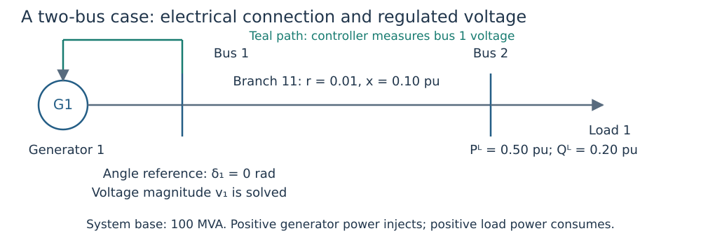

# Data model

```@meta
CurrentModule = DroopOPF
```

## Read the data as an electrical model

Start with [the complete two-bus construction](first_opf.md), then
[AC branch/shunt physics](ac_model.md). This page is the detailed constructor,
control and serialization reference. [Notation and units](notation.md) defines
system bases, current directions and mathematical aliases used below.



*Figure 1. A `Case` combines network, devices and control attachments. The measured
bus and the generator injection bus are separate pieces of data, even when equal.*

## Network and operating devices

`Bus`, `Branch`, `Load`, and `ACNetwork` describe the balanced AC network in
per-unit quantities. A `Generator` is attached to a network bus and carries
active/reactive limits, availability, and initial values.

```julia
network = ACNetwork(
    [Bus(1; reference = true), Bus(2)],
    [Branch(1, 1, 2; resistance = 0.01, reactance = 0.1,
            thermal_limit = 5.0)],
)
generator = Generator(
    1, 1;
    p_min = 0.0, p_max = 2.0,
    q_min = -1.0, q_max = 1.0,
    initial_p = 0.5,
)
```

## Volt-var droops

`VoltageSchedule` stores the reference voltage and deadband. `VoltVarDroop`
adds a positive voltage-per-reactive-power slope, a reactive reference inside
the deadband, and a `ReactiveCapability`.

```julia
control = VoltVarDroop(
    VoltageSchedule(1.0; v_db_low = 0.99, v_db_high = 1.01),
    0.05,
    0.0,
    ReactiveCapability(p_min = 0.0, p_max = 2.0,
                       q_min = -1.0, q_max = 1.0),
)
```

The exact curve is available through `droop_curve(control)` and evaluated with
`droop_response(control, voltage; p = active_power)`. The active-power range
on the control is enforced for its attached generator.

`q_ref(control)` is the preferred name for the constant reactive reference
inside the voltage deadband. The legacy `q_at_deadband` field remains available
for backward compatibility. New code may use the keyword constructor:

```julia
control = VoltVarDroop(schedule, slope, capability; q_ref = 0.0)
```

## Explicit reactive-control modes

`FreeQ`, `FixedQ`, `AVR`, and `VoltVarDroop` are explicit
`ReactiveControlMode`s. A `ReactiveControlAssignment` associates one mode with
one generator; AVR and Volt–VAr modes also require a regulated location.
`validate_reactive_assignments` rejects duplicate generator assignments,
out-of-range fixed-Q schedules and AVR setpoints, unknown locations, and droop
capabilities incompatible with generator limits.

```julia
assignments = [
    ReactiveControlAssignment(1, AVR(1.02), RegulatedLocation(:bus, 1)),
    ReactiveControlAssignment(2, FixedQ(0.1)),
]
validate_reactive_assignments(case, assignments)
```

`reactive_control_assignments(case)` gives every generator in a legacy case an
explicit mode without modifying the case: attached droops remain
`VoltVarDroop`, and unattached generators become `FreeQ`. The existing solver
and study-file representation remains backward compatible.

For base-case smooth or CCOpt OPF, pass `reactive_assignments=assignments` to
`solve_opf` or `solve_opf_complementarity`, respectively, and to
`validate_equilibrium`. This list replaces legacy attachments
for that call; omitted generators have bounded, free Q. `FixedQ` adds a Q
schedule equality and the independent validator reports `:fixed_q` when its
error exceeds `power_tolerance`. Unavailable generators retain zero output.
AVR is supported by both the smooth and CCOpt base-case entry points.
Study JSON v8 and SCOPF result JSON v4 store optional assignments explicitly,
along with equipment policy equipment controls, timing, movement budgets, and scenario settings.
Readers preserve `nothing` for older documents, which retains legacy attachment
semantics. Restored assignments are revalidated and SCOPF validation rejects a
study/result assignment mismatch. Joint design accepts the same optional
assignments for base-case tap/shunt design, validates the returned equilibrium
against them, and persists them in joint-design schema v2. Explicit assignments
cannot be combined with legacy droop-parameter design variables in one run.
When assignments contain only FreeQ/FixedQ, there are no complementarity
constraints and CCOpt delegates to MadNLP; these runs are not independent
third-solver evidence. Explicit VoltVarDroop assignments retain the exact
complementarity encoding.

## Attachments

`GeneratorControlAttachment` connects one generator to one control and gives
the regulated location. The base OPF permits one static attachment per generator.

```julia
attachment = GeneratorControlAttachment(
    1, 1, RegulatedLocation(:bus, 1),
)
```

The attachment separates the injection bus from the regulated measurement location.


## Transformer data contract

`Branch` accepts explicit `kind=:line` or `kind=:transformer`, plus
`tap_ratio=1` and `phase_shift=0`. The complex tap is on the
declared from side: `a = tap_ratio * cis(phase_shift)`. Ratio is dimensionless,
finite and strictly positive; phase is finite and in radians. Existing keyword
and typed positional constructors retain unity/zero defaults. Network/case
conversion, control attachment and contingency copies preserve both settings.

MATPOWER `TAP=0` becomes unity and marks a line; a supplied `TAP` (including
unity) or `SHIFT` marks a transformer. `SHIFT` is converted once from degrees
to radians.
No physical tap bounds or legal positions are inferred from those fields.
The MATPOWER importer converts nonzero bus `GS`/`BS` as aggregate fixed shunts (see below).

Study schema v2 requires both transformer settings; v3 adds an explicit fixed-shunt
list; v4 adds banks. The reader migrates
line-only v1 studies to unity/zero and rejects contradictory transformer metadata
labelled v1. Unchanged result/report document kinds retain schema v1. Older
readers reject v2, rather than silently losing transformer physics.

Study schema v9 introduced the explicit line/transformer kind; schema v10 also
identifies limit-aware automatic active response. Supported older uncoupled or
corrective studies reload with `kind=:line` when kind metadata is absent.
Historical coupled preventive studies require original-source replay rather than
silent migration to a different active-response policy.

The AC model supports fixed ratios and fixed phase shifts in AC evaluation,
OPF, SCOPF and existing bounded droop design. Unavailable branches contribute
no current while retaining supplied settings. Tap optimization, AVR and switched
shunts are documented below and in
[mixed controls](mixed_avr_droop.md).

## Fixed transformer electrical model

In this section `r` and `x` are series resistance/reactance; `j` is the imaginary
unit; `b` is total charging susceptance; `tau` is positive tap ratio; `phi` is phase
shift in radians; and `a` is the complex tap. `Vf`/`Vt` are endpoint voltage
phasors, `Uf` is internal from-side voltage, `J` is series current, and `If`/`It`
are currents into the branch. `Sf`/`St` are terminal complex powers.
`Yff`, `Yft`, `Ytf`, `Ytt` are the branch's two-port admittance entries (first
letter: current endpoint; second: voltage endpoint). `conj` denotes conjugation.
The [pi schematic and derivation](ac_model.md) show their physical locations.

For series admittance `y = 1/(r + j*x)`, total branch charging `b`, and
from-side complex tap `a = tau * exp(j*phi)`, the optimizer assembles:

```text
Yff = (y + j*b/2) / |a|²       Yft = -y / conj(a)
Ytf = -y / a                  Ytt = y + j*b/2
```

It applies `|Sf| <= rating` and `|St| <= rating` separately. Both the smooth
JuMP formulation (Ipopt/MadNLP) and complementarity formulation (CCOpt) use the
same terminal-limit builder, including transformer-outage exclusion. Phase
shifts make the off-diagonal entries different; they must not be symmetrized.

Physical validation follows a separate calculation. With `Uf = Vf/a` and
`J = y*(Uf - Vt)`, it computes `If = (J + j*b/2*Uf)/conj(a)` and
`It = -J + j*b/2*Vt`, then `Sf = Vf*conj(If)` and `St = Vt*conj(It)`.
Bus balances sum these terminal powers rather than reuse optimizer Ybus.
Both terminal powers are positive **into** the branch; their sum is net branch
absorption. Charging is included once at each internal terminal, with the
from-side contribution transformed by the tap.

Validate the reconstructed network with both-terminal currents and exact control
replay. Tap/shunt settings are steady-state inputs unless explicitly selected
for bounded optimization; no three-winding dynamics are inferred.

## Fixed bus shunts

`FixedShunt` is network equipment, separate from `Load` and branch charging:

```julia
shunt = FixedShunt(8, 10; conductance=0.02, susceptance=0.1, available=true)
network = ACNetwork([Bus(10; reference=true)], Branch[]; shunts=[shunt])
```

IDs and bus references must be positive; IDs are unique within the shunt list.
Admittance is finite and in per unit on the case base. Conductance G must be
nonnegative; susceptance B may have either sign. Positive B is capacitive.
Here `G`/`B` denote shunt conductance/susceptance, `V` is its bus-voltage phasor,
`S` is complex consumption, and `j` is the imaginary unit. Complex terminal
consumption is `S = (G - j*B)*|V|²`: positive P consumes active
power, negative Q injects reactive power. Several distinct devices may share a
bus and their contributions sum once. `available=false` contributes zero while
preserving supplied data. An empty list preserves the previous network model.

The optimizer adds `G+j*B` to the bus diagonal in Ybus. The independent evaluator
`shunt_powers(network, state)` computes `V*conj((G+j*B)*V)` per device in
`network.shunts` order. `power_balance` sums these powers alongside branch terminal
powers. Bus shunts do not enter `branch_flows` or duplicate line charging.

MATPOWER GS is MW consumed at unit voltage; BS is MVAr injected at unit voltage.
Import divides both by baseMVA, with no sign reversal: `G=GS/baseMVA`,
`B=BS/baseMVA`. Nonzero aggregate rows become one fixed record using the bus ID
as shunt ID; zero rows add none. No bank identity, legal step, nominal schedule
or automatic controller is inferred. Negative GS is rejected because this passive
equipment model does not represent active-power injection.

Study JSON v3 requires `network.shunts`; each record includes ID, bus ID, G, B
and availability. Readers retain v1/v2 support with empty shunts and reject
nonempty shunts misleadingly labelled with an older schema. New writers use v4
even when the list is empty, so old readers fail explicitly. Other document kinds
keep their existing versions. Numeric promotion, case/control copies and existing
branch/generator contingency overlays preserve fixed shunts. Dedicated shunt
contingencies are not part of this fixed-shunt representation.

## Supplied switched-bank states

```julia
bank = ShuntBank(201, 30;
    step_susceptances=(0.02, -0.01),
    step_conductances=(0.001, 0.0005),
    legal_states=((0,0), (1,0), (2,0), (0,1), (1,1)),
    state=(1,0), nominal_state=(1,0))
changed = with_bank_state(bank, (2,0))
network = ACNetwork(buses, branches; shunts=fixed_shunts, banks=[changed])
```
Each state is a tuple of nonnegative integer counts for the corresponding step
admittances. Legal combinations must be explicitly supplied, nonempty and unique;
both current and nominal states must be legal even when the bank is unavailable.
Metadata are copied into immutable tuples. Unavailability produces zero admittance
without erasing the installed state. `bank_admittance` returns aggregate G+jB;
`bank_powers` independently computes consumption P+jQ by summing step currents.
Positive B is capacitive, so Q is negative consumption. Fixed shunts and banks
share a unique ID namespace. Do not represent the same physical aggregate in both.
MATPOWER GS/BS remains fixed admittance and does not infer bank identities or states.

Study schema v4 requires `network.banks` and preserves all metadata. Schema v5
adds optional reactive-control assignments; schema v6 adds `branch_id` to a
branch-terminal location; schema v7 adds selected continuous equipment and its
SCOPF timing policy; schema v8 adds optional corrective movement-limit maps.
Readers
migrate v1-v3 to empty banks and reject nonempty banks mislabeled as old schemas.
Existing branch/generator contingencies preserve supplied bank states. The model uses
fixed states in OPF, preventive/corrective SCOPF and droop design. Selected equipment may be optimized separately; a bank state is not an automatic switching policy or trajectory.

## Continuous transformer tap design

```julia
policy = [TapControl(11; lower=0.95, upper=1.05, nominal=1.0)]
result = optimize_taps(case, policy; initial_state=state, smooth_epsilon=1e-5)
report = validate_tap_design(case, result)
physical_case = with_tap_settings(case, result.taps)
metrics = tap_design_metrics(case, result)
write_tap_design("tap-design.json", result)
reloaded = read_tap_design("tap-design.json")
```

Bounds are required; no range is inferred from imported taps. Branch IDs must be
unique, known and available. Omitted branches remain at their supplied ratios.
Set `lower == upper` to fix a selected device, and supply `initial` if the supplied
ratio is outside the bounds. Initial values are numerical starts; `nominal` is a
positive reference for reporting, defaulting to the supplied ratio, and need not
lie in the optimization envelope. Neither introduces a penalty in the objective.

The baseline objective remains generator dispatch deviation. Phase shifts, shunts
and droop curves stay fixed. Ratios enter nonlinear balances and both-terminal
thermal constraints; input case data remain unchanged. Results are continuous
relaxations, without discrete-position recovery or switching-count interpretation.
`report.physical` evaluates the reconstructed physical network; `policy_valid`
separately checks bounds and fixed settings. A failed solve can have no state or
ratios; physical validation is then unavailable and overall validity is false.

The dedicated base-case entry point accepts a `Case`. The equipment-aware SCOPF interface also accepts the same
controls on `Study`, with explicit scenario policy coupling through
`SCOPFControlPolicy`; see [SCOPF](scopf.md#Equipment-timing-and-movement-bounds).
The current implementation uses the smooth encoding
with Ipopt by default and supports the existing optimizer-factory interface.
See [tap design evidence](equipment_optimization.md) for sweeps and comparisons.

## Simple continuous shunt design

```julia
bank = ShuntBank(201, 30; step_susceptances=(0.02,),
    step_conductances=(0.001,), legal_states=((0,), (1,), (2,), (3,)), state=(1,))
# After adding bank to case.network.banks:
policy = [ShuntControl(201)] # B bounds default to [0, 0.06] pu
result = optimize_shunts(case, policy; initial_state=state)
report = validate_shunt_design(case, result)
metrics = shunt_design_metrics(case, result)
physical_case = with_shunt_settings(case, result.susceptances)
write_shunt_design("shunt-design.json", result)
reloaded = read_shunt_design("shunt-design.json")
```

A reactor uses negative step B, e.g. −0.02 gives an interval [−0.06, 0]. Here `B` is the aggregate susceptance and `Bstep` the susceptance per
section, both in pu. Conductance `G` is tied
to B through their common fractional count; here G=0.001(B/Bstep). Banks with
multiple step types or zero step B are rejected when selected, as are unavailable
or unknown banks and fixed-shunt IDs. Unselected heterogeneous banks remain fixed.

Optional `lower`, `upper`, `initial` and `nominal` are all B in pu. Bounds must
lie in the legal-count envelope; equal bounds fix B. The default initial B is the
supplied bank setting, so narrowing bounds past it requires an explicit start.
The default nominal B comes from the bank's nominal state. Nominal B must lie in
the physical envelope but may lie outside a narrower optimization interval.

Taps, phase shifts and droop settings stay fixed; multiple simple banks can be
selected independently. The baseline dispatch objective remains unchanged.
Metrics include fractional count, B deviations, G, active consumption, reactive
injection and branch losses. The result is explicitly continuous, not a recovered
switching position. `with_shunt_settings` creates an evaluation case by replacing
selected banks with equivalent fixed shunts; the original case retains bank metadata.
Policy bounds are checked separately by `validate_shunt_design`. JSON stores
settings and policy; retain the input study alongside it for reproducible replay.

[Validation evidence](equipment_optimization.md) includes capacitor/reactor
sweeps and plots. Heterogeneous optimization is post-scaling backlog; the gate
requires evidence that simple banks, transformers and droops scale adequately first.

## Joint equipment and droop design

```julia
result = optimize_joint_design(case;
    tap_controls=[TapControl(11; lower=0.95, upper=1.05)],
    shunt_controls=[ShuntControl(201)],
    droop_controls=[DroopControl(2; slope_bounds=(0.04, 0.10))],
    initial_state=state)
report = validate_joint_design(case, result)
physical_case = with_joint_settings(case, result)
metrics = joint_design_metrics(case, result)
write_joint_design("joint-design.json", result)
reloaded = read_joint_design("joint-design.json")
```

Omit a control list to keep that family fixed; select devices independently within
each list. `DroopControl` additionally accepts `v_ref_bounds`,
`deadband_low_bounds`, `deadband_high_bounds` and `initial::DroopSettings`. Missing
bounds fix a parameter to its supplied value. Bounds preserve the positive-slope,
positive-reference and positive-total-deadband contract. No free-knot curve family
is introduced. Multiple attached available droop controls may be selected.

The objective is identical across fixed/free configurations. Reports distinguish
solver success, parameter/equipment policy compliance and reconstructed physical
validity. Ratios and bank settings remain continuous relaxations. See
[equipment design results and visualizations](equipment_optimization.md) for the complete grid,
multi-start variability, objective components and matched conditional benefits.
