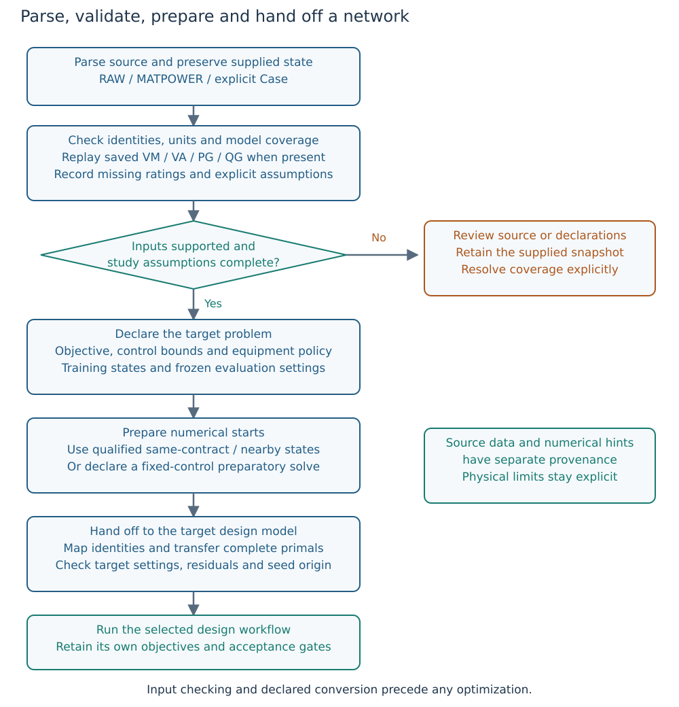
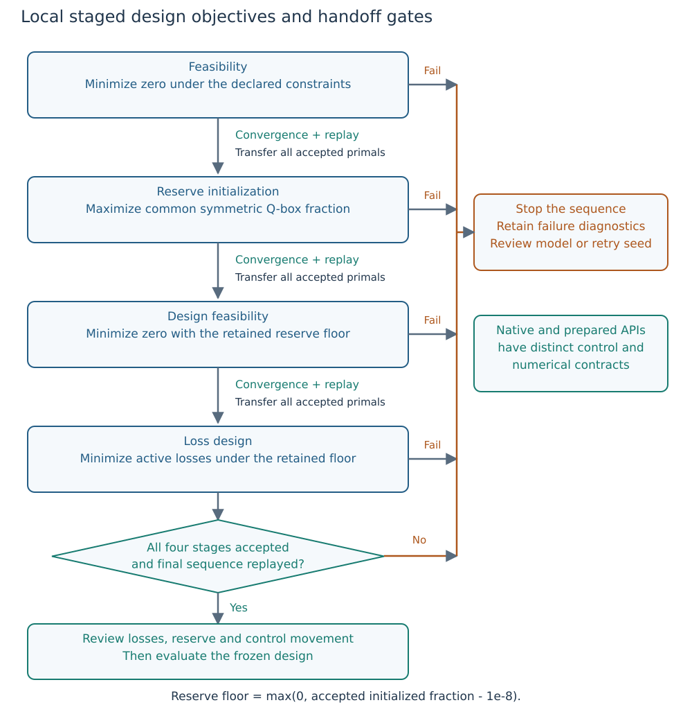
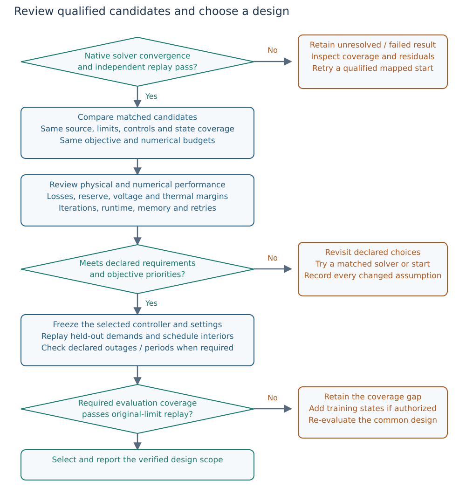

# From source data to a reviewed design

DroopOPF reads a declared network, prepares a numerical start, solves the selected
control problem and replays the resulting equilibrium. The flowcharts below
identify the objectives, decisions and acceptance gates at each handoff. The
staged interfaces described here are opt-in APIs with explicit acceptance gates.

## Parse and establish the study contract



`import_case` provides native and optional PowerIO import paths. RAW import keeps
source identities and supplied VM, VA, PG and QG separately from optimizer hints.
`check_psse_file` can replay that supplied state before a design is attempted.
For a prepared per-unit PowerModels dictionary, `NetworkDesignContract` accepts
the caller's explicit control, regulation and equipment declarations.

The importer performs supported format conversion, unit/base conversion and
structural checks. Source corrections require explicit, recorded input changes.
Some generator initialization hints are clamped to their declared bounds while
the supplied operating point remains available for replay. Treat that operation
as numerical preparation. The workflow has no automatic network-data cleaning
stage that repairs source limits or selects missing equipment capabilities.

Record the following before optimization.

| Declaration | What the workflow needs |
|---|---|
| Source and coverage | Source identity, import path, component identities, units, supplied-state presence and supported electrical models |
| Physical envelope | Voltage, angle, thermal, active/reactive and apparent/current bounds, with missing ratings and assumptions explicit |
| Control laws | Supplied AVR, fixed-Q or droop assignments, measured bus, capability, active response and declared IBR roles |
| Design freedom | Selected slopes, references, deadbands, taps and banks with explicit bounds and sharing |
| Information policy | Training demands, periods/outages, frozen evaluation controls and permitted preventive dispatch |
| Objective | Dispatch distance, reserve, losses, cost or another explicitly supported criterion, together with its priority and state scope |
| Numerical policy | Encoding, smoothing, solver/Hessian choice, tolerances, per-stage budgets and seed provenance |

For the fixed-frequency inverter API, `qv_inverter` applies the configured Q cap
(default 0.395 times effective apparent rating) together with tighter source and
capability limits. The caller supplies ratings and measurement locations. RAW
MBASE and source impedance do not establish converter ratings or virtual
impedance. See [static inverter capability](static_inverters.md).

## Initialization and handoff

A qualified same-contract state is the preferred starting point. Nearby states
can be mapped by equipment identity and angle reference after their availability,
settings and limits have been checked. Saved-profile and flat starts remain
available. A separately declared fixed-control feasibility or loss-preparation
solve may provide another seed. Record any difference between that preparatory
problem and the target design.

| Entry point | Objective and assumptions |
|---|---|
| `solve_opf` / ordinary `optimize_joint_design` | Minimize squared active dispatch deviation plus 0.001 times squared reactive deviation from stored generator initial outputs. Selected joint controls follow their supplied bounds. |
| `prepare_initialization` | Map/project a numerical state and optionally estimate common-frequency balance. An AC solve and replay still follow the projection. |
| `optimize_staged_joint_design` | Run the four-stage native sequence below with explicitly selected Q-reserve participants and design controls. |
| `solve_network_design` | Run the four-stage prepared-network sequence with its declared regulation, sharing, equipment and response contract. PowerModels must be loaded. |

An ordinary `solve_opf` call therefore needs its dispatch-distance objective
recorded when it is used as a prepass. A loss prepass requires an API or explicit
model objective that actually minimizes losses.

The native staged API retains one model and transfers every accepted primal
variable by identity. The prepared-network workflow rebuilds each stage and
transfers voltage, generator outputs, control/equipment settings, active-response
signals, AVR settings and sharing variables. It checks the handoff contract and
replays each accepted state. Initial residual diagnostics distinguish the
requested start from the first iterate used by the solver.

## Staged design objectives



The order is feasibility, reserve initialization, design feasibility, then loss
design. Selected control and equipment variables remain bounded by the declared
contract throughout the sequence. Initialization can already move selected
design variables. A handoff does not imply that they were fixed in earlier stages.

For an explicitly selected available generator with nonzero source Q width,

```math
r_i=\min\left(\frac{Q_i-Q_i^{\min}}{Q_i^{\max}-Q_i^{\min}},
              \frac{Q_i^{\max}-Q_i}{Q_i^{\max}-Q_i^{\min}}\right),
\qquad \rho=\min_i r_i.
```

Reserve initialization maximizes the common fraction, bounded by 0 and 0.5.
The subsequent floor is `max(0, initialized_reserve - 1e-8)`. The native
reserve-maximization auxiliary is then fixed to zero while fixed-floor
constraints retain the achieved requirement. The physical/control/equipment
starts continue from the accepted point. This metric uses
source Q boxes. Apparent/current capability and control restrictions still apply
and can limit usable reserve further. Report the achieved floor, including zero.

Native loss design minimizes total system-base active generation. With fixed
loads this also minimizes total network active consumption, including fixed
shunts. The prepared single-snapshot objective subtracts fixed active load and
uses the system MVA base. Its multi-snapshot extension applies explicit positive,
normalized weights. Compare stage-specific loss metrics because the numerical
objective has a different meaning at each stage.

| Contract detail | Native staged Case | Prepared-network extension |
|---|---|---|
| Entry | `optimize_staged_joint_design` | `solve_network_design` / `solve_network_series` |
| Model handoff | Same model and all primal variables | Rebuilt stage with explicit saved starts and sharing |
| Controller semantics | Native reactive assignments and supplied bounds | Explicit regulation, response, sharing and equipment plans |
| Smoothing | Existing stable log1pexp formulation | Factored square-root clipping, epsilon 1e-8 |
| Hessian default | Exact throughout, with explicit limited-memory option | Exact for feasibility, limited-memory for subsequent stages unless explicitly changed |
| Stage budgets | 3000 iterations / 1200 seconds per stage by default | 3000 iterations / 1200 seconds per stage by default |
| Replay | `validate_staged_joint_design` | `replay_network_design` / `replay_network_series` |

The native sequence requires native converged/feasible status, maximum model
violation at most 1e-10, independent original-limit replay and the retained reserve
floor. It uses Ipopt tolerance 1e-8, constraint tolerance 1e-10, zero numerical
bound relaxation, 1e-9 bound/slack push and fraction settings, and disabled
acceptable-level early stopping. Prepared-network strict stages use the declared
strict transition settings and their independent replay gate. Cold feasibility
has its own reported numerical settings. See [initialization](initialization.md)
and [prepared-network design](network_design.md) for the individual interfaces.

Any failed stage stops the sequence. Retain its termination, residuals, requested
and actual starting points, timing and last attempted values for diagnosis.
A replay-passing point with unsuccessful native termination remains unresolved
under the staged acceptance contract.

## Review performance and choose a candidate



Compare feasible candidates under matched inputs, control bounds, objectives,
coverage and numerical budgets. Apply the declared objective priorities before
selecting a candidate. A later loss improvement must retain every required
feasibility and reserve gate.

| Review question | Evidence used to choose |
|---|---|
| Is the candidate accepted? | Native termination, finite primals, model residuals and independent AC/control replay |
| Does it retain physical limits? | Voltage profiles, both-terminal thermal loading, effective generator capability and angle bounds |
| Does it meet the headroom requirement? | Named reserve metric, achieved floor, participant IDs and state coverage |
| Does the objective improve? | Matched baseline and candidate losses or the explicitly selected economic metric |
| How much control movement is required? | Slopes, Vrefs, deadbands, dispatch, taps and banks relative to supplied settings and budgets |
| Which numerical configuration is preferable? | Success across repeated qualified starts, first-iterate residuals, iterations, runtime, memory, retries and the best accepted objective |
| Does the design generalize? | Frozen-controller checks on held-out demands, schedule interiors and all required outage/period states |
| Are Q–V margins required? | Consumer Q–V tracing with matching equilibria, capability and frozen settings, through DroopDesign |

Use Ipopt or MadNLP for the selected smooth formulation and CCOpt for an explicitly
selected complementarity comparison. The opt-in staged native wrapper fixes its
own Ipopt/smooth contract. Record a changed Hessian or solver as a separate
numerical attempt with matched physical inputs. A numerical failure alone does
not establish physical infeasibility.

If a candidate is worse than an existing feasible baseline, retry from that
baseline or a qualified nearby state before choosing. For frozen evaluation,
apply the accepted common controls to the evaluation demand first. Record any
allowed demand-specific preventive dispatch separately. Additional training
states require another common-design solve and fresh evaluation coverage.
