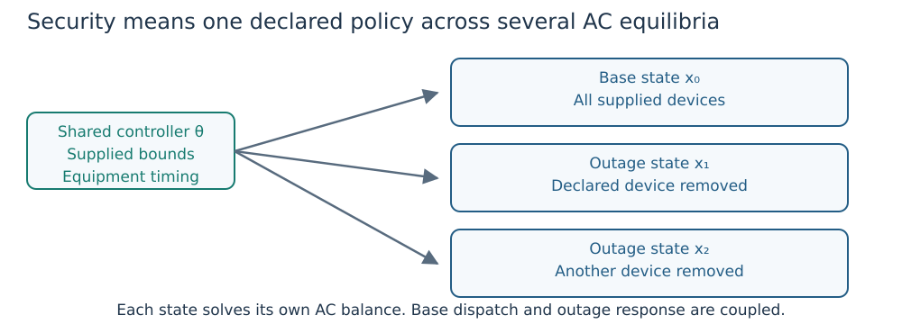

# Droop design with contingency addition

## Physical and acceptance contract

The design variables are selected controllers' positive slopes (pu voltage per
pu reactive power), voltage references (pu), and nonnegative lower/upper
deadband widths (pu). One setting vector is shared by the base and every
training outage. Reactive capability and deadband output remain supplied data.
The existing saturated Volt–VAr law, AC balance equations, operating limits and
base schedule-deviation objective are unchanged. Each scenario has independent
AC states; an outaged generator has zero P/Q and no active controller equation.
Active response follows the Study participation/redispatch policy. Selected
taps and shunts retain their preventive/corrective bounds and movement budgets.

The default smooth design NLP uses the existing SCOPF builder. Pass
`encoding=:complementarity` to `optimize_droop_parameters(study, controls; ...)`
for a CCOpt design with the exact deadband and saturation graph. Omit
`optimizer_factory` in exact mode and supply CCOpt options through
`optimizer_attributes`. Slopes, references and declared deadband bounds remain
shared across scenarios in either encoding. Exact shared-parameter design
currently uses the case's attached droop controls; explicit
`reactive_assignments` remain supported by the smooth design path and are
rejected by this exact builder. Independent validation
reconstructs exact physical curves and checks the design bounds, AC physics,
outage availability and inter-scenario coupling. Fixed design bounds must
reproduce fixed-curve SCOPF; no contingencies must reproduce base-case design.
Multiple local optima may exist: objective agreement is an experimental check,
not a global-optimality assertion.

The small exact shared-design regression in `test/test_droop_security.jl`
uses an initial barrier of 1e-6, a 1e-14 proportional relaxation floor,
native tolerance 1e-11 and zero bound relaxation. Its two-controller,
one-generator-outage fixture has nonzero fixed deadbands and passes the
unchanged independent physical gate. These are recorded numerical settings;
the test does not establish convergence from arbitrary starts or at 500 buses.

Contingency addition starts from a declared subset, solves a shared design,
recomputes screening at the new base/settings, assesses required outages, and
adds unresolved omitted outages. Solver rejection is unresolved evidence, not
proven infeasibility. Screening alone never permits successful termination:
every eligible outage receives a full AC audit at the final design. Islanding
entries remain explicit exclusions from the joint design and prevent a full
network N-1 claim. Iteration limits, failed masters and unresolved training
outages remain unsuccessful outcomes.

## Read the shared design



*Figure 1. Training scenarios share a curve parameter vector. Final omitted
outages must be checked again at the retained design and frozen base policy.*

The [Volt/VAR tutorial](volt_var.md) derives the exact law. In this page's notation,
``j`` indexes controllers, ``c`` scenarios (``0`` is base), and ``g`` generators.
``Q_{j,c}`` is the attached generator's output; ``V_{j,c}`` its measured voltage;
``Q_j^0`` the supplied deadband output; ``Q_j^{min},Q_j^{max}`` the Q interval
shown in the fixed-box formula. ``[z]_+=\max(z,0)`` and
``\operatorname{clip}(z,L,U)=\min(U,\max(L,z))``. Here ``z`` is a real input and ``L,U`` lower/upper bounds in the same units.
Rated generators instead
use their effective P-dependent limits. For controller ``j``, with slope ``m_j``,
reference ``v_j`` and nonnegative half-widths ``d_j^-`` and ``d_j^+``,
the independently replayed response is

```math
Q_{j,c}=\operatorname{clip}\!\left(Q_j^0+
\frac{[v_j-d_j^- - V_{j,c}]_+}{m_j}-
\frac{[V_{j,c}-v_j-d_j^+]_+}{m_j},\ Q_j^{\min},Q_j^{\max}\right).
```

All design parameters are shared over ``c``. In the objective below,
``P_{g,0},Q_{g,0}`` are base outputs and superscript ``initial`` denotes supplied
reference outputs; the objective has weighted squared pu units. It remains

```math
\min \sum_g \left[(P_{g,0}-P_g^{\mathrm{initial}})^2
+10^{-3}(Q_{g,0}-Q_g^{\mathrm{initial}})^2\right].
```

For preventive active response, surviving generators obey
`P[g,c] = clip(P[g,0] + alpha[g,c]*signal[c], L[g,c], U[g,c])`,
with capability-aware weights renormalised over survivors and saturation allowing
remaining participants to take over. Zero-weight units hold base output. Corrective mode instead enforces the declared redispatch bounds.
The final audit holds the complete base AC state and base equipment settings
fixed; it never reoptimises a different base separately for each outage.

## API and reproducible runs

```julia
catalog = contingency_catalog(case)
base_study = Study(case; participation=participation)
controls = [DroopControl(1; slope_bounds=(0.04,0.08)),
            DroopControl(2; slope_bounds=(0.04,0.10))]
result = optimize_droop_security(base_study, controls;
    catalog, max_rounds=5, batch_size=1,
    initial_states=Dict(:base=>validated_base),
    solver_kwargs=(;smooth_epsilon=1e-5,
        optimizer_attributes=Dict("max_iter"=>1000,"max_cpu_time"=>30.0)))
write_droop_security("security.json", result)
```

Use `optimize_droop_parameters(study, controls)` for the corresponding full
training-set design. `validate_droop_design(study, design)` returns `valid`,
`policy_valid`, and the ordinary independent `report`. The scalar droop design interface
remains available and now preserves equipment policy during reconstruction and
held-out evaluation. Attached legacy droops and explicit reactive assignments
cannot be combined in this design interface; unsupported combinations reject
rather than silently dropping a controller policy.

`DroopSecurityResult.eligible_accepted` covers the supplied eligible catalog.
`full_n1_accepted` additionally requires the complete network catalog and no
excluded islands. A successful result contains a final exhaustive audit; a
failed master contains its validation outcome and never receives an inferred
security pass. `on_iteration` can checkpoint the entire round after assessment.
Independent assessment errors are retained, and added IDs use deterministic
error/violation ordering. The algorithm adds scenario constraints, not linear
cuts or a decomposition with convergence/global-optimality guarantees.

`sparse_balance=true` opts smooth OPF/SCOPF into omitting exact-zero admittance
terms even with droop controls. It changes expression sparsity, not equations.
Legacy controlled-case defaults remain unchanged because solver trajectories
can be sensitive to numerical representation. The public runner declares this
option and bounded solver settings in its protocol. Time limits apply during
optimization, not package loading or model construction.

Optional plotting needs Matplotlib. Exhaustive assessments use
input-fingerprinted checkpoints; a changed case, source, policy or
solver budget requires a new directory. The subsequent design trace is retained
round-by-round but is not automatically resumable. Fresh design runs must use
fresh evidence directories if prior results are to be preserved.

To assess only branch contingencies (lines and transformers), retain the
original runs and use separate directories:

The branch-only catalog retains islanding branch outages in the exhaustive
assessment and excludes generator outages entirely. The joint design still
handles only connected outages. A successful eligible branch audit therefore
does not imply full-network N-1 acceptance. `retained/` saves the valid master
with the largest training set, then most independently accepted outages, then
lowest objective. Its acceptance manifest lists the exact coverage; a later
rejected master never replaces this candidate with an invalid design.
`optimized-study.json` and `master-result.json` use the public `read_study` and
`read_scopf_result` interfaces. The replay example verifies their round trip,
independently revalidates every saved accepted outage, and checks that all
witnesses use the identical retained base state. The comparison report also
checks that the original evidence files have not changed against the saved
`verification/pre-branch-preservation.json` manifest (run it from the repository
root).
The optional `--prior` replay exports accepted branch witnesses from an earlier
fixed-base assessment separately. It verifies matching study/base inputs and
revalidates the saved states; it does not re-solve them or count them as new
successful attempts.

## Interpret the coverage

A retained candidate must pass native solver acceptance and independent AC,
control and policy checks over the declared final catalogue. Report exclusions,
failed solves and omitted outages explicitly. An unresolved numerical solve is
not proof that the network is infeasible. A ranked or screened subset does not
establish complete outage security.
