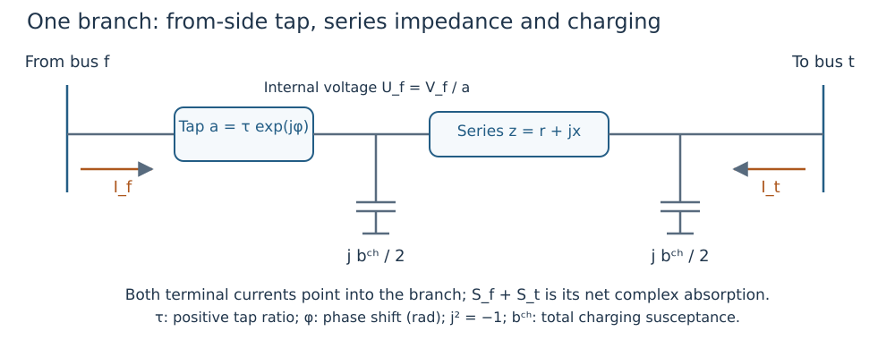

# Equipment and joint droop optimization

Selected continuous taps, simple banks and curve parameters can be optimized
while unselected equipment stays at supplied settings. Start with
[branch/shunt physics](ac_model.md) and [the data contract](data_model.md).
Bounds must describe the equipment you intend to permit; imported settings do
not establish manufacturer capability or legal positions.



*Figure 1. Tap design changes the positive from-side ratio. Bank design changes
bus admittance, which is separate from branch charging.*

## Transformer ratios

For a `case` with transformer ID 11 and a validated `state`:

```julia
controls = [TapControl(11; lower=0.95, upper=1.05, nominal=1.0)]
result = optimize_taps(case, controls; initial_state=state)
audit = validate_tap_design(case, result)
physical_case = with_tap_settings(case, result.taps)
```

The bounds and `nominal` are dimensionless ratios. `initial` is a numerical
starting value; `nominal` is a reporting reference, not an objective penalty.
Set equal lower/upper bounds to fix a selected setting. Phase shifts remain
supplied. Both branch-terminal ratings and AC balance remain active.

## Simple bank susceptance

A selected bank must have supported single-step metadata with nonzero step
susceptance. For example, step susceptance ``B_{step}=0.02`` pu and legal counts
0–3 give a continuous design interval 0–0.06 pu. Here ``B_{step}`` is admittance
per section, while ``B`` is aggregate susceptance. With conductance per section
``G_{step}``, aggregate conductance remains ``G=G_{step}B/B_{step}``.
Positive ``B`` is capacitive; negative ``B`` is inductive.

```julia
# Requires supported simple bank ID 201 in case.network.banks.
result = optimize_shunts(case, [ShuntControl(201)]; initial_state=state)
audit = validate_shunt_design(case, result)
physical_case = with_shunt_settings(case, result.susceptances)
```

A fractional section count is a continuous relaxation. It needs a separate legal
state recovery and validation before being described as discrete switching.
Fixed shunts without bank metadata cannot be selected through this interface.

## Joint settings and curves

```julia
result = optimize_joint_design(case;
    tap_controls=[TapControl(11; lower=0.95, upper=1.05)],
    shunt_controls=[ShuntControl(201)],
    droop_controls=[DroopControl(2; slope_bounds=(0.04,0.10))],
    initial_state=state)
audit = validate_joint_design(case, result)
physical_case = with_joint_settings(case, result)
```

This fragment assumes those device IDs and control index 2 exist. Slope is in
pu voltage/pu reactive power. Missing design bounds fix the corresponding curve
parameter. Reactive output inside the deadband and supplied capability remain
fixed. Explicit reactive assignments must match the selected design family.

Compare fixed and free configurations under the same objective, operating
limits and initial/evaluation policy. Similar objectives with different settings
can indicate weak parameter identification; repeated starts do not prove a
unique or global optimum.

## Outage permission is a separate decision

A base `Case` design does not itself authorize corrective equipment movement.
A `Study` declares selections, absolute bounds, preventive/corrective timing and
movement maps through `SCOPFControlPolicy`. Read [SCOPF equipment timing](scopf.md#Equipment-timing-and-movement-bounds)
before using outage recourse. Continuous endpoints do not establish device timing
or the feasibility of the path between endpoints.
