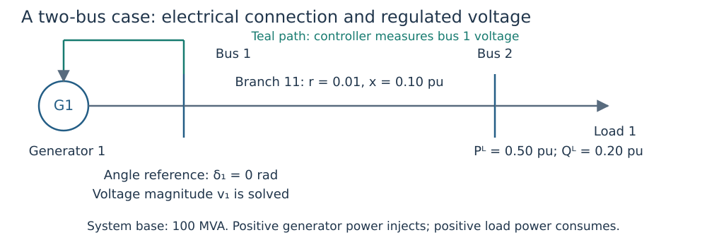

# Your first OPF: build, solve, explain and check

**Goal:** construct a two-bus network, connect one generator to a Volt/VAR curve,
and explain the resulting operating point. Every `@example` block below runs
when the documentation builds. The blocks share one Julia session.

Prerequisites: [installation](getting_started.md) and the meaning of active power
``P``, reactive power ``Q``, voltage magnitude ``v`` and voltage angle ``\delta``
in [concepts](concepts.md). All powers below are per unit on a 100 MVA system base.

## 1. Draw the physical problem



*Figure 1. Bus 1 fixes the angular reference and hosts generator 1. The controller
measures bus 1 voltage. Bus 2 consumes 50 MW and 20 MVAr. There is no tap or shunt.*

The branch resistance is ``r=0.01`` pu, reactance is ``x=0.10`` pu, and terminal
apparent-power limit is 2 pu (200 MVA). Bus voltage bounds default to 0.9–1.1 pu.
The reference flag fixes ``\delta_1=0``; it does not fix ``v_1=1`` or grant
unlimited generator output.

```@example first_opf
using DroopOPF

network = ACNetwork(
    [Bus(1; reference=true), Bus(2)],
    [Branch(11, 1, 2;
        resistance=0.01, reactance=0.10, thermal_limit=2.0)],
)
load = Load(1, 2; p=0.50, q=0.20)
generator = Generator(1, 1;
    p_min=0.0, p_max=2.0, q_min=-1.0, q_max=1.0,
    initial_p=0.50, initial_q=0.20)
nothing # hide
```

Constructor IDs identify devices: `Load(1, 2; ...)` means load ID 1 at bus ID 2.
`initial_p` and `initial_q` are supplied generator reference values and numerical
initialization information; they are not equality constraints on final output.

## 2. Give the generator a reactive-control law

The controller has reference ``v^{ref}=1.0`` pu, lower/upper deadband edges
``v^-=0.99`` and ``v^+=1.01`` pu, deadband output ``q^0=0`` pu and slope
``m=0.05`` pu voltage per pu reactive power. The proportional gain is ``1/m=20``
pu reactive power per pu voltage. The output is clipped to the supplied Q limits.

```@example first_opf
capability = ReactiveCapability(
    p_min=0.0, p_max=2.0, q_min=-1.0, q_max=1.0)
schedule = VoltageSchedule(1.0; v_db_low=0.99, v_db_high=1.01)
control = VoltVarDroop(schedule, 0.05, capability; q_ref=0.0)
attachment = GeneratorControlAttachment(1, 1, RegulatedLocation(:bus, 1))

case = Case("teaching-two-bus";
    base_power=100.0, base_frequency=50.0, network=network,
    loads=[load], generators=[generator], controls=[control],
    attachments=[attachment])
nothing # hide
```

The attachment joins generator ID 1 to **control index 1**, measuring bus 1.
The `Case` keyword arguments name the power base (MVA), nominal frequency (Hz),
network, loads, generators, controls and attachments. Nominal frequency does not
introduce generator dynamics.

## 3. Solve the coupled equilibrium

The default base OPF minimizes

```math
J=\sum_{g\in\mathcal G}\left[(P_g-P_g^{initial})^2
      +10^{-3}(Q_g-Q_g^{initial})^2\right].
```

Here ``\mathcal G`` is the generator set; ``P_g,Q_g`` are active/reactive output,
and the superscript ``initial`` denotes the supplied generator reference values.
``J`` is a weighted squared per-unit deviation, with **no monetary units**.
The factor ``10^{-3}`` is the implemented relative Q weight. AC balance, voltage,
capability, branch limits and the reactive-control law constrain the solution.
This is not a fuel-cost or loss-minimization objective. With one generator and
a fixed curve, this case has very little dispatch freedom; it teaches coupled
equilibrium and replay. The [security example](first_security.md) adds a second
generator and shared dispatch decisions.

```@example first_opf
result = solve_opf(case;
    smooth_epsilon=1e-5,
    optimizer_attributes=Dict("print_level" => 0))
audit = validate_equilibrium(case, result)
@assert result.termination_status in (:LOCALLY_SOLVED, :ALMOST_LOCALLY_SOLVED, :OPTIMAL)
@assert audit.valid

(state_voltages_pu=round.(result.state.vm; digits=5),
 generator_P_MW=round.(100 .* result.state.pg; digits=3),
 generator_Q_MVAr=round.(100 .* result.state.qg; digits=3))
```

The numerical smoothing width `smooth_epsilon` is in pu voltage. It approximates
corners of the optimization encoding; the independent audit checks the **exact**
physical curve. Smaller widths are not automatically easier to solve.

## 4. Explain the numbers before accepting them

There is only one generator. Its active injection must exceed the load's
``0.50`` pu by the branch's active loss. The reference-bus voltage is solved
below the lower deadband edge so that the droop supplies positive reactive output.
The downstream voltage also reflects the branch voltage drop.

```@example first_opf
state = result.state
active_loss_pu = sum(state.pg) - load.p
exact_Q_pu = droop_response(control, state.vm[1]; p=state.pg[1])
@assert active_loss_pu > 0
@assert state.vm[1] < schedule.v_db_low
@assert abs(state.qg[1] - exact_Q_pu) <= 1e-5

(active_loss_MW=round(100 * active_loss_pu; digits=3),
 power_balance_residual=audit.power_balance_max,
 exact_droop_residual=audit.droop_residual_max)
```

`sum` adds entries; `abs` takes absolute value; `exact_Q_pu` is the curve response
at the solved measured voltage and active output. A small residual measures
agreement with an equation, not closeness to zero generation or zero losses.

## 5. Check that the validator can reject a wrong point

Deliberately change reactive generation by 0.05 pu (5 MVAr) without changing
voltages. This violates the frozen equilibrium; the solver is not called again.

```@example first_opf
bad_qg = copy(state.qg)
bad_qg[1] += 0.05
bad_state = ACState(copy(state.vm), copy(state.va), copy(state.pg), bad_qg)
bad_audit = validate_equilibrium(case, bad_state)
@assert !bad_audit.valid

(original_valid=audit.valid, corrupted_valid=bad_audit.valid)
```

## 6. What to change next

- Evaluate `droop_response(control, 0.97; p=0.5)` by hand using the
  [Volt/VAR tutorial](volt_var.md). It should return 0.4 pu reactive power.
- Increase load reactive demand and observe the upstream/downstream voltages;
  solve and validate each changed case afresh.
- Compare this generator with `FreeQ`, `FixedQ` or `AVR` through explicit
  [reactive assignments](data_model.md#Explicit-reactive-control-modes).
- Before adding an outage, decide [what is shared and allowed to respond](study_workflows.md).

This one-point result establishes neither outage security nor transient stability.
The explicit construction and corruption check make it a reproducible starting
point for your own model.
