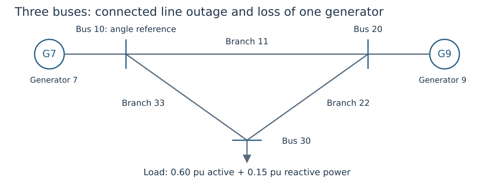
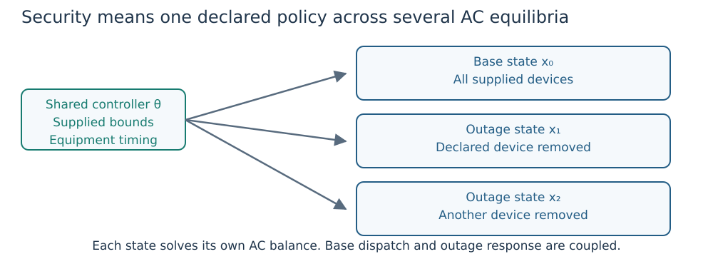

# Your first security study

**Goal:** use one preventive dispatch and fixed curves for a base state, a line
outage and a generator outage. This complete example runs during the documentation
build. Read [the single-state example](first_opf.md) and
[the policy tutorial](study_workflows.md) first.

## 1. Use a network that has alternative supply paths



*Figure 1. Removing branch 22 still leaves a supply path to bus 30. Removing
generator 9 leaves generator 7 as the only active source.*

The synthetic network is a triangle: branches 11 (bus 10–20), 22 (20–30) and
33 (10–30). Generator 7 injects at bus 10, generator 9 at bus 20, and the load
consumes at bus 30. Bus 10 is the angle reference. IDs are intentionally nonconsecutive.

```@example first_security
using DroopOPF
network = ACNetwork(
    [Bus(10; reference=true), Bus(20), Bus(30)],
    [Branch(id, f, t; resistance=0.01, reactance=0.10, thermal_limit=2.0)
     for (id, f, t) in [(11,10,20), (22,20,30), (33,10,30)]])
generators = [Generator(id, bus;
    p_min=0.0, p_max=1.2, q_min=-1.0, q_max=1.0,
    initial_p=0.3, initial_q=0.0)
    for (id, bus) in [(7,10), (9,20)]]
cap = ReactiveCapability(p_min=0.0, p_max=1.2, q_min=-1.0, q_max=1.0)
controls = [VoltVarDroop(
    VoltageSchedule(1.0; v_db_low=0.99, v_db_high=1.01), m, cap; q_ref=0.0)
    for m in [0.05, 0.075]]
attachments = [GeneratorControlAttachment(g.id, i, RegulatedLocation(:bus, g.bus_id))
    for (i, g) in enumerate(generators)]
case = Case("teaching-security";
    base_power=100.0, base_frequency=50.0, network=network,
    loads=[Load(1, 30; p=0.6, q=0.15)], generators=generators,
    controls=controls, attachments=attachments)
nothing # hide
```

Each generator's limits are 0–1.2 pu active power and −1–1 pu reactive power.
The load consumes 60 MW and 15 MVAr on the 100 MVA base. The comprehension
variable `m` is a positive droop slope in pu voltage/pu reactive power.
`enumerate` supplies the array control index `i` separately from generator ID `g.id`.
No equipment design variables or corrective tap/shunt actions are selected.

## 2. State the outages and response policy

```@example first_security
study = Study(case;
    contingencies=[Contingency(:line_22; branch_ids=[22]),
                   Contingency(:generator_9; generator_ids=[9])],
    participation=default_participation(case))
result = solve_scopf(study;
    smooth_epsilon=1e-5,
    optimizer_attributes=Dict("print_level" => 0))
report = equilibrium_report(study, result)
@assert report.valid
sort!(collect(keys(result.states)); by=string)
```

`Study` defaults to preventive active dispatch with limit-aware automatic
response. `default_participation` uses effective active-capability ranges; survivor
weights are normalized for each outage. Curves stay fixed. Each surviving
reactive controller responds to its scenario's measured voltage.



*Figure 2. In this example the two outage boxes are `:line_22` and `:generator_9`.
Each has its own voltages and outputs; the base dispatch is not independently
redesigned for each box.*

The solver objective penalizes deviation of **base** generator outputs from their
supplied references, as defined in [the first OPF](first_opf.md). Outage states add
feasibility requirements. This is not a sum of independently optimized base cases.

## 3. Inspect what the generator outage actually changes

```@example first_security
base = result.states[:base]
outage = result.states[:generator_9]
@assert abs(outage.pg[2]) <= 1e-8
@assert abs(outage.qg[2]) <= 1e-8
@assert outage.pg[1] > base.pg[1]

(base_P_MW=round.(100 .* base.pg; digits=3),
 outage_P_MW=round.(100 .* outage.pg; digits=3),
 surviving_unit_increase_MW=round(100 * (outage.pg[1]-base.pg[1]); digits=3))
```

State vectors use generator order `[7,9]`, so position 2 belongs to generator 9.
The outaged unit has zero P/Q; its droop equation is inactive. Generator 7 must
supply the load plus the changed network loss within its unchanged capability.
The angle-reference bus does not provide additional hidden generation.

## 4. Test outage availability independently

```@example first_security
corrupted = deepcopy(result)
corrupted.states[:generator_9].qg[2] = 0.1
corrupted_report = equilibrium_report(study, corrupted)
@assert !corrupted_report.valid
@assert :unavailable_generator in corrupted_report.violations[:generator_9]

(original_valid=report.valid, corrupted_valid=corrupted_report.valid)
```

The intentionally restored 0.1 pu reactive output is 10 MVAr from a failed unit.
Rejection is necessary even if some other bounds appear satisfactory.

## 5. Describe coverage honestly

This example checks **two selected outages**, not the full ``N-1`` catalogue.
Use `contingency_catalog(case)` to enumerate available device losses and inspect
eligibility/islanding before deciding the required coverage. A successful small
study is not evidence about unlisted outages, larger systems, discrete movement
or transient stability.

To design a shared curve next, use [bounded parameter design](droop_optimization.md).
To add omitted outages iteratively, use [contingency addition](droop_security.md),
which still requires complete final assessment of the declared eligible catalogue.
