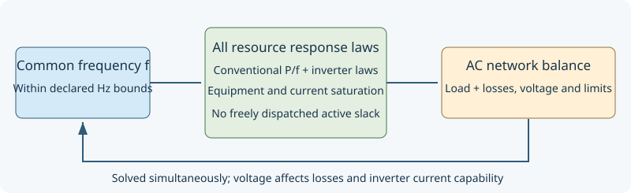

# Frequency-aware Q–V design

This optional side study investigates P–f response and its effect on Q–V
operation. The main study uses fixed-frequency terminal Q–V control with
configurable reactive caps; see [static inverter capability](static_inverters.md).
No existing frequency-aware evidence is reclassified as main-study evidence.

## Solving common frequency

A fixed-frequency OPF can rebalance demand through freely dispatched conventional
generators. It therefore cannot predict frequency deviation. To calculate a
settled frequency, supply an active response for **every** generator, leaving no
free active-power slack. The reference-bus angle remains a coordinate choice;
fixing that angle does not fix frequency.



For a conventional generator ``i``, `GeneratorFrequencyResponse` declares

```math
P_i(f)=\operatorname{clip}\!\left(P_i^0+K_i(f_i^0-f);\underline P_i,\overline P_i\right).
```

Here ``P_i^0`` is its reference injection on the case system MVA base,
``K_i\geq0`` is the response gain in system pu/Hz, ``f_i^0`` is its reference in
Hz, and ``\underline P_i,\overline P_i`` are its effective active bounds: the
intersection of source P limits, apparent-rating active bounds and attached-control
active limits. The coupled P/Q apparent circle is enforced separately.
Zero gain holds the clipped reference. An unavailable unit injects zero.
Inverter units use the P/f and priority projection equations above instead;
GFL active requests have no direct frequency sensitivity.

The solver finds voltage magnitudes ``V``, voltage angles ``\theta``, reactive
injections ``Q`` and common frequency ``f`` satisfying every bus's AC balance.
Summing the active equations gives

```math
\sum_i P_i(f,V)=P_D+P_{\mathrm{loss}}(V,\theta),
\qquad f_{\min}\leq f\leq f_{\max}.
```

``P_D`` is total constant active load in system pu; ``P_{\mathrm{loss}}`` is total
active network consumption, including resistive branches and shunt conductance.
The frequency bounds are caller-supplied study limits in Hz. Equipment, current,
apparent-power, voltage and thermal limits remain enforced. Optional branch
angle-difference limits are specified in radians. Conventional reactive injections
retain their native OPF controls; this is a conditional equilibrium, not a complete
set of physical voltage-controller models.

For an unsaturated set of resources sharing nominal frequency ``f_0``, with a
balanced reference operating point, the aggregate relation is

```math
\Delta f=f-f_0=-\frac{\Delta P_D+\Delta P_{\mathrm{loss}}}{K_{\mathrm{tot}}},
\qquad
K_{\mathrm{tot}}=\sum_{i\in\mathcal G}K_i+
\sum_{j\in\mathcal F}\frac{\alpha_j}{m_{p,j}}.
```

``\mathcal G`` denotes conventional responding generators and ``\mathcal F``
GFM inverters; ``\alpha_j`` and ``m_{p,j}`` are the inverter base ratio and P/f
slope defined above. The deltas compare the new and reference equilibria.
``K_{\mathrm{tot}}`` is in system pu/Hz. This relation is explanatory: losses
must be solved with the network, and saturation changes the responding set.
It is not a substitute for the constrained AC solve.

For example, on a 100 MVA system base, two unsaturated generators with gains
0.4 and 0.6 pu/Hz responding to an extra 20 MW in a lossless network give
``\Delta f=-0.2`` Hz. If the first can supply only 5 MW more, the second must
supply the remaining 15 MW, giving ``\Delta f=-0.25`` Hz.

```julia
# Illustrative continuation of a two-generator case with inverter generator 2.
responses = [GeneratorFrequencyResponse(
    generator_id=1, p_ref=0.6, gain_pu_per_hz=0.4, f_ref_hz=50.0)]
result = solve_common_frequency(case, [plant], responses;
    frequency_bounds=(48.0, 52.0))
report = validate_common_frequency(case, result)
report.valid || error("common-frequency equilibrium did not qualify")
delta_f_hz = result.frequency_hz - case.base_frequency
```

Both resource declarations and results retain units and frequency bounds.
Validation replays the response laws and physical AC constraints independently
of the optimization constraints. If all active responses are locally saturated,
`frequency_sensitive=false` warns that the returned frequency can lie on a flat
response interval. A true flag does not prove uniqueness of the nonlinear AC
solution. Disconnected networks and incomplete/duplicate active-control ownership
are rejected. No frequency-dependent load, secondary restoration, inertia,
RoCoF or nadir is modeled.


Voltage-source/internal-impedance refinements are documented in
[voltage-source GFM equilibrium](voltage_source_gfm.md).
