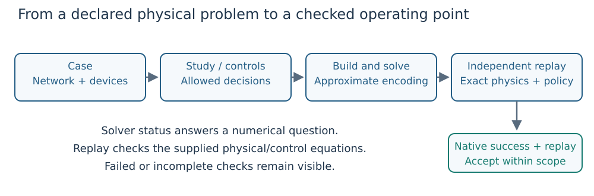

# DroopOPF.jl

**Find a steady-state AC operating point that respects the network and its reactive
controls; then check that point independently.** DroopOPF supports optimal power
flow (OPF), shared Volt/VAR design and security-constrained OPF (SCOPF).

*Figure 1. A numerical solve produces a candidate. Acceptance also needs independent
replay of the exact network, control laws, device limits and declared policy.*

## Learn with one small network

1. [Install and run](getting_started.md): set up Julia and choose a learning path.
2. [Understand the problem](concepts.md): distinguish dispatch, automatic response
   and controller design before choosing an API.
3. [Build your first OPF](first_opf.md): a complete two-bus example, executed when
   these docs build, from device data to a deliberately corrupted result.
4. [Read a Volt/VAR curve](volt_var.md): work through deadband, slope and saturation.
5. [Follow AC power through a branch](ac_model.md): current directions, taps,
   shunts, per-unit bases and nodal balance.
6. [Solve a security study](first_security.md): execute a complete two-outage
   example and reject injection from a failed generator.
7. [Add security or time](study_workflows.md): understand what is shared and what
   changes across outages, demand samples and chronological periods.

[Notation and units](notation.md) defines the mathematical symbols and their code
counterparts. Individual teaching pages also define symbols where they first appear.
All examples use a balanced, positive-sequence AC model. An equilibrium or an hourly
schedule is not a transient-stability or device-switching trajectory assessment.

## Find the guide for your task

| Your question | Start here | Detailed reference |
|---|---|---|
| How do I assemble network and control data? | [First OPF](first_opf.md) | [Data model](data_model.md), [PSS/E import](psse.md) |
| Why does reactive output change with voltage? | [Volt/VAR tutorial](volt_var.md) | [Mixed AVR/droop](mixed_avr_droop.md) |
| Which controls may change after an outage? | [Study workflows](study_workflows.md) | [SCOPF policy](scopf.md) |
| How do I choose one curve for many conditions? | [Design versus response](concepts.md) | [Droop optimization](droop_optimization.md), [contingency addition](droop_security.md) |
| How are demand samples different from time periods? | [Scenario/time diagram](study_workflows.md) | [Multi-period model](multi_period.md) |
| Can I trust this result? | [Validation](validation.md) | [Feasibility](feasibility_gate.md), [robustness](robustness.md) |
| Which model features are supported? | [Supported scope](release_scope.md) | [API reference](api.md) |

## Implementation reference

Use the [API](api.md) for signatures, [supported scope](release_scope.md) for
model limitations and [development guide](development.md) to build or test the
package. The teaching structure takes inspiration from the concept primers,
executed examples and validation guidance in
[BMOPFTools.jl](https://frederikgeth.github.io/BMOPFTools.jl/dev/).
