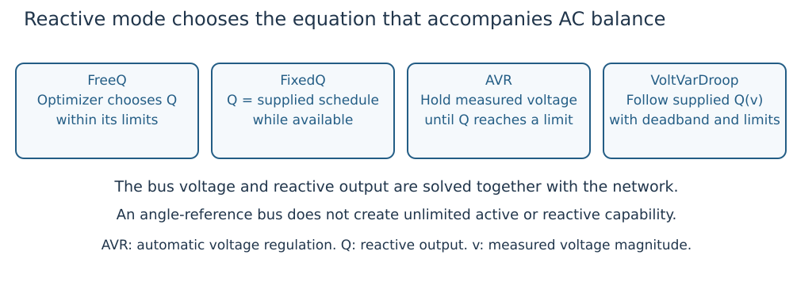

# Mixed AVR and Volt/VAR controls

A single network may combine free reactive output, fixed schedules, automatic
voltage regulation (AVR) and Volt/VAR droop. The [reactive-mode primer](concepts.md#Four-reactive-modes)
explains the distinctions. Every available generator still obeys AC balance and
its supplied capability.

*Figure 1. AVR adjusts reactive output to a voltage target until capability binds;
a droop follows its supplied curve. These are steady-state relations.*

## Apparent rating and effective reactive limits

`Generator(...; s_rated=S)` declares apparent rating ``S`` in pu on the case
system base. Let ``P,Q`` be active/reactive output in pu and
``Q^{min},Q^{max}`` supplied box limits. An explicit rating adds
``P^2+Q^2\le S^2`` without replacing those bounds. For ``|P|\le S``, the effective
reactive interval intersects the box with
``[-\sqrt{S^2-P^2},\sqrt{S^2-P^2}]``. ``|\cdot|`` is absolute value and the square
root is nonnegative. `reactive_limits(generator, p)` evaluates this intersection
at active output `p`.

Omitting `s_rated` preserves the rectangular capability model. PSS/E MBASE is
not automatically a verified nameplate rating. An apparent-power circle is not
a complete voltage-dependent converter current envelope.

## Voltage regulation and sharing

An AVR holds its measured-voltage target while its effective Q interval permits.
At a reactive limit it releases voltage regulation. A clipped droop retains its
parameters and delivers the effective Q bound. Multiple AVR units at one
regulated location require a consistent target and share the same normalized
position within their current reactive intervals.

`ReactiveControlAssignment` makes the mode and regulated location explicit.
Pass the same assignments to the solve and independent validation. Legacy
attachments and explicit assignments follow their documented compatibility
rules; unsupported combinations are rejected rather than silently ignored.

`mixed_reactive_controls(case; avr_fraction, ratings, voltage_targets)` can select
online positive-Pmax units deterministically by descending Pmax and ascending ID,
rounding the requested count to nearest integer with half upward. Offline records
stay offline. Supply ratings and targets explicitly; the helper does not infer
manufacturer capability or controller dynamics.

## Shared design and chronological security

The smooth `optimize_joint_design`, `optimize_droop_parameters` and
`optimize_multi_period` paths support compatible explicit mixed assignments and
selected free legacy curve parameters. A selected curve must match its assignment.
Consult [solver compatibility](solvers.md) for exact parameter-design restrictions.

`optimize_multi_period_security` couples chronological base dispatch with ramp
rates, shared curves and declared outage recourse. Each period's preventive AVR
target remains shared across its outages. Optional target bounds and hourly
movement limits must be supplied explicitly. Fixed equipment stays fixed unless
selected through the study's equipment policy.

The production response is limit-aware, with normal operating bounds and full
load unless the caller explicitly chooses another supported contract. Relief,
emergency limits and alternate response policies must not be inferred from a
solver setting or from this tutorial. Preserve the complete study contract.

## Optional headroom objective

The usual base loss objective is not a fuel-cost curve. An optional reserve-aware
policy first maximizes a common normalized upward-headroom variable ``h`` before
optional loss polishing. For generator ``g``, let ``P_g`` be base active output
and ``[L_g,U_g]`` its participating effective active interval, all in pu. The
constraint is ``P_g+(U_g-L_g)h\le U_g``. Variable ``h`` is dimensionless.

`objective_policy=:reserve` stops after the reserve stage;
`:reserve_loss` adds loss polishing; the usual default remains `:loss`.
Headroom is a dispatch preference, not a guarantee of delivering reserve through
every outage or a substitute for security constraints.

## Independent checks and model limits

Require native success and `validate_multi_period_security(studies, result).valid`.
Replay checks every period/state, exact controls, capability, equipment, response,
ramps, target sharing and the declared objective. Store the input studies as
well as the result; a result's policy fields are not an independent specification.

AVR/droop labels do not instantiate synchronous-machine, governor, PLL, grid-forming
or grid-following dynamics. Steady-state security does not establish frequency
response, transient stability, discrete movement or a dynamic transition.
