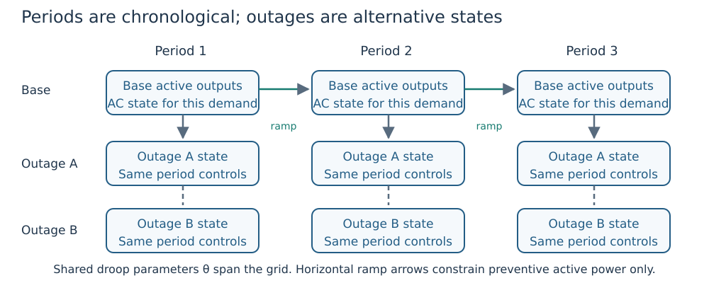

# Chronological multi-period design

The initial multi-period capability solves one deterministic sequence of AC
operating periods in a single sparse nonlinear model. A single set of reactive
voltage-droop parameters is shared across all periods. Each period has its own
active/reactive dispatch and voltage state. Equipment stays at the supplied
fixed settings throughout the horizon.

This API covers deterministic base-operation periods with fixed equipment.
Storage, commitment and dynamic trajectories are outside this formulation.



*Figure 1. The base-operation API models the upper row. Outage rows belong to the
separate multi-period security extension. Horizontal arrows are preventive ramps,
not dynamic response trajectories. See [the workflow tutorial](study_workflows.md).*

## Time and objective contract

Cases must share the same ordered network, equipment settings, generators,
controls, attachments, power base, frequency and load identities. Only load
powers may vary. All original voltage, thermal and generator limits remain
active, with optional explicit branch-angle bounds.

For period `t`, `duration_hours[t]` is both its energy weight and the elapsed
start-to-start time to period `t+1`. The last duration weights energy only.
There is no initial or terminal ramp boundary, cyclic closure or interpolated
trajectory. Inputs represent period operating points with a piecewise-constant
energy accounting convention.

The objective is the sum of `duration_hours[t] * base_power * (sum(pg[t]) -
sum(load_p[t]))`, in MWh. This is active network energy loss, including shunt
conductance losses. It is not generation cost or a storage energy balance.

For generator `g`, `ramp_limits[g] = (up, down)` specifies nonnegative rates in
pu/hour on the case power base. Between consecutive period starts:

```math
-r_g^{down}\Delta t \le P_{g,t+1}-P_{g,t} \le r_g^{up}\Delta t.
```

In this equation ``g`` is generator ID, ``t`` is chronological period index,
``P_{g,t}`` is preventive active output in pu, ``r_g^{up},r_g^{down}`` are
nonnegative ramp rates in pu/hour and ``\Delta t`` is the elapsed start-to-start
interval in hours. The lower bound limits a decrease; the upper limits an increase.
The global notation reference uses ``k`` for time to avoid confusing it with a
branch's to-side endpoint ``t``.

Omitted generators have no inter-period ramp restriction. Zero rates freeze
active output across periods. These planned dispatch ramps do not replace the
library's automatic contingency-response policy and do not establish dynamic
frequency performance.

## API

```julia
study = MultiPeriodStudy(period_cases;
    duration_hours=[1., 1., 2.],
    ramp_limits=Dict(generator_id => (0.2, 0.1)),
    angle_limits=Dict(branch_id => (-0.5, 0.5)))
result = optimize_multi_period(study;
    droop_controls=[DroopControl(1;
        slope_bounds=(0.02, 0.08), v_ref_bounds=(0.98, 1.02))],
    initial_states=period_initial_states)
audit = validate_multi_period(study, result)
```

Slope bounds are in physical pu-voltage / pu-reactive-power units, not percent.
Omitted droop fields remain fixed. Empty `droop_controls` fixes all curves.
The first implementation uses the existing smooth volt-var family; the normal
independent validator also checks exact PWL droop residuals. Native convergence,
all AC states, design bounds, ramp constraints, branch-angle constraints, period
losses and the total energy objective must pass independently. Solver-reported
local optima do not establish global optimality or design uniqueness.

## Mixed AVR and contingency recourse extension

The base-operation API above retains its fixed-equipment scope. The separate
`optimize_multi_period_security` API supports mixed AVR/droop controls, apparent
capability circles, outage recourse, explicit Study equipment policies and optional
preventive AVR scheduling. See [Mixed AVR and droop studies](mixed_avr_droop.md)
for the model contract, declared legacy comparison comparison settings and qualification limits.
