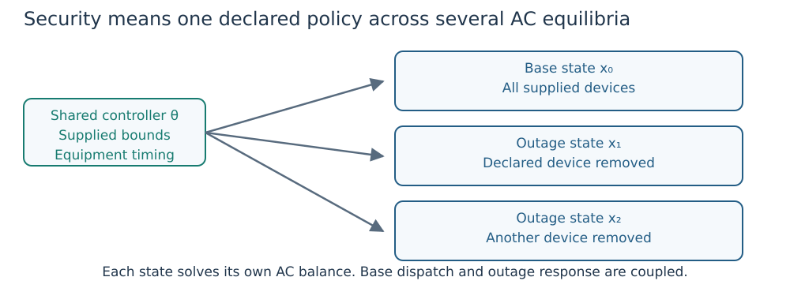

# Security-constrained AC OPF

Security-constrained optimal power flow (SCOPF) couples one preventive operating
point with a declared set of outage equilibria. Each state has its own AC
voltages, angles and generator outputs. The study states which controls are
shared and what may respond after an outage.

Start with [the complete security tutorial](first_security.md) and
[the policy diagrams](study_workflows.md). The snippets here are API fragments;
`case`, initial states, selected controls and their limits must be supplied by
the caller. [Notation and units](notation.md) defines the common symbols.



*Figure 1. The arrows impose shared-parameter and response policies. They do not
represent a chronological simulation of a disturbance.*

## Active response

All powers use the case system base. Let ``g`` index generators and ``c`` outage
scenarios, with ``0`` denoting the base. In preventive mode,

```math
P_{g,c}=\operatorname{clip}(P_{g,0}+\alpha_{g,c}\lambda_c,L_{g,c},U_{g,c}).
```

``P_{g,0}`` and ``P_{g,c}`` are base/outage active output in pu;
``\alpha_{g,c}\ge0`` is a dimensionless normalized survivor weight;
``\lambda_c`` is the common active-response request in pu; and
``L_{g,c},U_{g,c}`` are effective active bounds in pu.
``\operatorname{clip}(z,L,U)=\min(U,\max(L,z))`` for a real input ``z`` and
lower/upper bounds ``L,U``.

Effective bounds intersect generator and attached control capability with any
declared movement limits. A saturated unit holds its bound while the common
signal can increase to let remaining participants supply the required balance.
Zero-weight survivors hold their base output. Unavailable generators inject zero.
The angle-reference bus does not supply unbounded power.

`Study` defaults to `default_participation(case)`: nonzero effective
active-capability-range weights normalized among eligible survivors. Supply
actual weights when known. An explicitly empty weight map selects no participants.
Weights describe steady-state sharing, not governor speed or frequency dynamics.
The result's `balancing_power` field stores the common request signal; after
clipping it need not equal the total delivered output change.

Corrective active redispatch replaces the response equation with

```math
-r_g\le P_{g,c}-P_{g,0}\le r_g.
```

Here ``r_g`` is the finite nonnegative symmetric movement allowance in pu from
`redispatch_limits[g]`. Omitted units have zero permitted movement. This allowance
is not a ramp rate; participation weights are rejected in corrective mode.

## Reactive controls and capability

Surviving devices retain their supplied reactive modes, references and measured
locations. Their reactive outputs respond to each scenario's AC solution.
Unavailable generators have zero P/Q and no active controller equation.
An unavailable monitored branch disables its branch-terminal regulator.

Generator/control P/Q bounds remain active. An explicitly supplied apparent
rating additionally restricts capability as described in
[mixed controls](mixed_avr_droop.md). A fixed curve is not retuned per outage.

## Equipment timing and movement bounds

Only selected equipment may be optimized. Declare its timing explicitly:

```julia
policy = SCOPFControlPolicy(
    taps=:preventive,
    shunts=:corrective,
    reactive=:automatic,
    shunt_movement_limits=Dict(201 => 0.02))

study = Study(case;
    contingencies=contingencies,
    participation=default_participation(case),
    tap_controls=[TapControl(11; lower=0.95, upper=1.05)],
    shunt_controls=[ShuntControl(201)],
    control_policy=policy)
```

This fragment assumes a transformer ID 11 and a supported simple bank ID 201.
The tap ratio bounds are dimensionless; the bank movement limit is 0.02 pu
susceptance. A preventive setting is shared by all states where the device is
available. A corrective setting may differ by scenario inside absolute bounds
and any declared base-to-outage movement limit. Unselected devices stay fixed.

Selected taps/shunts default to corrective timing if it is omitted. A movement
map of `nothing` adds no extra movement cap beyond absolute control bounds.
A supplied map defines the allowed-action set: selected devices omitted from
that map are frozen. An empty map therefore permits no selected corrective
movement. Outaging the selected device removes its state/coupling equation;
it is not a movement action.

These controls are continuous steady-state relaxations. Timing permission does
not supply a response delay, legal discrete position, switching count or a
verified transition trajectory. Immediate/settled assessment functions compare
separately declared stages under the same base lineage; they do not simulate
the movement between those stages.

## Objective

The default objective penalizes the base schedule's deviation from supplied
reference outputs:

```math
J=\sum_{g\in\mathcal G}\left[(P_{g,0}-P_g^{initial})^2
    +10^{-3}(Q_{g,0}-Q_g^{initial})^2\right].
```

``\mathcal G`` is the generator set, ``Q_{g,0}`` base reactive output and the
superscript ``initial`` denotes supplied reference outputs. ``J`` has weighted
squared pu units, with no monetary units. Outage states impose feasibility
constraints, so their recourse can be nonunique. With no outages, this reduces
to the corresponding base OPF.

## Solve and independently check

```julia
study = Study(case;
    contingencies=[Contingency(:line_22; branch_ids=[22]),
                   Contingency(:generator_9; generator_ids=[9])],
    participation=default_participation(case))
result = solve_scopf(study; smooth_epsilon=1e-5)
report = equilibrium_report(study, result)
```

This fragment requires those device IDs in `case`. Check the report and native
solver status; inspect each scenario rather than only the base. To assess an
already chosen base state, use `evaluate_contingencies(study, base_state)`.
That path freezes its base; it does not independently choose a new preventive
schedule for each outage. See [validation](validation.md) for exact replay.

For storage/reuse, `write_study` and `write_scopf_result` preserve the declared
input and result contracts. Reload and revalidate against the expected study;
a saved success flag alone is insufficient. Historical response contracts are
not silently migrated to a different policy.

## Catalogue, ranking and complete coverage

`contingency_catalog(case)` enumerates available line, transformer and generator
outages with stable IDs. Inspect `eligible_contingencies` and
`excluded_contingencies` before interpreting coverage. The joint formulation
requires a connected base and does not balance arbitrary islands. A separate
`evaluate_islanding_contingency` assesses a retained component and reports
removed demand and capacity; discarded demand is not classified as served.

`evaluate_contingency_catalog` evaluates the eligible catalogue from one validated
base. `contingency_screening_scores` prioritizes work without certifying safety.
The optional filtering pipeline reports `routing_complete`, `full_ac_coverage`
and `all_outcomes_accepted` separately. A screened-but-unsolved outage is not an
accepted AC result. Unsupported or uncertain predictions must fall back to exact
assessment; final required coverage needs actual AC replay.

`run_contingency_campaign` supports input-fingerprinted checkpoints. Changed
network data, base states, policies, numerical settings or solver versions need
a new output directory. Checkpoint reuse revalidates saved states; errors and
incomplete records remain visible. Ranking, a bounded subset or a numerical
failure does not prove full security or physical infeasibility.

For a shared curve design with iterative scenario addition, read
[droop security design](droop_security.md). For chronological coupling, read
[multi-period design](multi_period.md).
