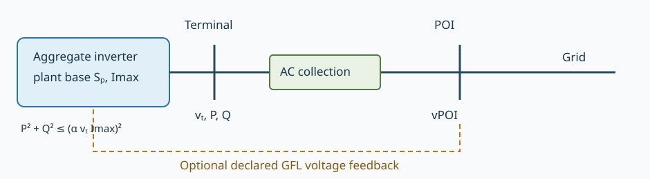

# Static inverter capability and control

## Main study: fixed-frequency Q–V design

Use `qv_inverter` for new aggregate GFL/GFM Q–V studies. It constructs a
`StaticInverter` with `frequency_response=false`, Volt/VAR control and a
configurable `q_cap_fraction=0.395`. BESS uses either mode and a source P box
that permits charging; this controller does not add SOC/energy constraints.

```julia
plant = qv_inverter(generator_id=2, terminal_bus=2, mode=:gfm,
    priority=:active, base_mva=50.0, terminal_base_kv=20.0,
    s_max=1.0, i_max=1.1, p_available=0.9, p_ref=0.8,
    q_ref=0.0, v_ref=1.0, q_droop=0.05,
    reactive_available=true, frequency_hz=50.0, q_cap_fraction=0.395)
result = solve_inverter_opf(case, [plant])
report = validate_inverter_opf(case, result)
```

The symmetric cap is ±`q_cap_fraction` times the effective apparent rating
(the tighter of declared plant and generator ratings). It intersects supplied
asymmetric Q bounds and current/apparent capability; it never widens them.
It is a ceiling, not reserved Q headroom. Active priority can reduce Q below
this cap; reactive priority can curtail P. A GFM label alone adds no dynamic
forming guarantee. Identical terminal laws have identical static behavior.

Frequency is prescribed in this main study. Existing network active balancing
policies are not reinterpreted as frequency in Hz. Independent replay still
checks controller equilibrium, AC balance and physical limits. Q–V tracing in
DroopDesign should consume the same declared limits and frozen controllers.

Keep physical collector/transformer impedances in the network. Separate LCL,
PLL and inner-loop models are not required by this terminal representation.
Internal-voltage droop or virtual impedance requires a justified equivalent
or the optional voltage-source model; deleting impedance is not an equivalence
proof. RAW Q bounds are retained; MBASE is not automatically a capability rating,
and source impedance is not automatically virtual impedance. Ratings and
controller measurement locations require explicit declarations.

## Side study: frequency-aware Q–V design

Common-frequency, P–f response and voltage-source GFM models remain available
for the separate **frequency-aware Q–V design** study. Existing direct
`StaticInverter` construction retains its original behavior: GFM frequency
response enabled and `q_cap_fraction=1.0` (no extra restriction beyond its
apparent circle). The response flag and cap are serialized in new results.
Existing sealed evidence is unchanged; no historical campaign is reclassified.
Run `julia --project=. examples/fixed_frequency_qv.jl` for a synthetic example.


An inverter's current rating limits its deliverable power more tightly when
terminal voltage falls. The static plant model connects this limit to explicit
active/reactive priority and a declared command law. It uses the existing AC
network equations and preserves the original equipment and operating limits.



## Scope and required data

`StaticInverter` associates one aggregate plant with one existing `Generator`.
Declare the generator ID, terminal bus, point of interconnection (POI), control
mode, priority, plant MVA base, terminal line-to-line kV base, current limit,
apparent-power limit, available active power, P/Q references, voltage reference,
droop slopes, reference frequency and reactive availability. These inputs are
study declarations, not inferred manufacturer capabilities. No RAW technology
label or GFM label supplies missing ratings or changes a controller automatically.

The terminal is the generator's injection bus. The POI is a distinct identity;
collector lines, transformers, losses and shunts must be present in the network
when needed. Naming a POI neither creates that network nor measures POI power.
GFL voltage control may sense another declared bus, including the POI. This GFM
surrogate requires terminal-local Q/V droop. All named buses must be connected
through available branches. The network does not store nominal kV: the caller
must establish that `terminal_base_kv` matches the terminal voltage base.

## Bases, signs and capability

Let ``S_b`` be the case system MVA base and ``S_p`` the plant MVA base. Lowercase
``p,q`` below are plant-base active/reactive injections; ``P,Q`` are system-base
injections into the network. Positive ``q`` supplies reactive power. Define

```math
\alpha=\frac{S_p}{S_b},\qquad P=\alpha p,\quad Q=\alpha q,
\qquad I_b=\frac{S_p}{\sqrt{3}V_b}\;\mathrm{kA}.
```

``V_b`` is the declared terminal line-to-line base in kV. ``v_t>0`` is terminal
voltage magnitude in pu on that base. With the voltage phasor as reference,
``i_p=p/v_t`` and ``i_q=q/v_t``; the complex injected current is
``i_p-\mathrm{j}i_q``. Its magnitude is ``\sqrt{p^2+q^2}/v_t``.

The supplied generator box, converted to plant base, is intersected with
available production ``p_{\rm av}\geq0``. Reactive availability is a separate
Boolean declaration:

```math
\ell_p=\frac{P_{\min}}{\alpha},\quad
u_p=\min\left(\frac{P_{\max}}{\alpha},p_{\rm av}\right),\qquad
[\ell_q,u_q]=
\begin{cases}
[Q_{\min}/\alpha,Q_{\max}/\alpha],&\text{reactive available},\\
[0,0],&\text{otherwise}.
\end{cases}
```

The Q interval above is additionally intersected with
``[-\kappa_Q s,\kappa_Q s]``, where `q_cap_fraction` supplies ``\kappa_Q``
and ``s`` is the effective apparent rating defined below.

Both source P and Q intervals must contain zero. Positive minimum generation or
mandatory nonzero Q is rejected, not relaxed: those cases require a commitment
model. Negative P is supported when the source box permits charging, but no
energy-storage state or energy budget is modeled. ``p_{\rm av}`` bounds positive
production; it is not a charging-energy constraint.

Let ``s_p>0`` and ``i_{\max}>0`` be declared plant apparent/current limits.
If the generator also has a supplied system-base apparent rating ``S_g``, define
``s=\min(s_p,S_g/\alpha)``; otherwise ``s=s_p``. Then

```math
c(v_t)=\min(s,v_t i_{\max}),\qquad
p^2+q^2\le s^2,\qquad p^2+q^2\le v_t^2i_{\max}^2.
```

The sequential command projection below enforces these two circles together
with the box. At zero active availability, reactive output remains possible
only when explicitly declared available. If either the source generator or
plant is unavailable, ``P=Q=0``. Availability never changes automatically at a
voltage or frequency threshold.

## Command equations

Let ``p_0,q_0`` be supplied plant-base power references and ``f`` a supplied
steady-state system frequency in Hz. The active request is

```math
p^*=\begin{cases}
p_0,&\text{frequency response disabled},\\
p_0+(f_0-f)/m_p,&\text{frequency response enabled},
\end{cases}
```

where ``f_0>0`` is reference frequency and ``m_p>0`` is P/f droop in
Hz per plant-pu active power. `solve_inverter_opf` takes frequency as a fixed
study input. `solve_common_frequency` instead solves it jointly with AC balance
under the complete response contract in the frequency-aware side study. Neither changes SCOPF participation.

For fixed Q, ``q^*=q_0``. For Volt/VAR, let ``v_r`` be the sensed voltage,
``v_0>0`` its reference, ``d\geq0`` the symmetric deadband half-width and
``n_q>0`` the slope in voltage pu per plant-pu Q. Then

```math
q^*=q_0+\frac{[v_0-d-v_r]_+-[v_r-v_0-d]_+}{n_q},
\qquad [x]_+=\max(x,0).
```

Without deadband or limiting, local Q–V control gives
``v_t=v_0-n_q(q-q_0)``. Only when frequency response is enabled does
``f=f_0-m_p(p-p_0)`` also apply.
When limiting acts, the command is curtailed rather than imposing an impossible
voltage/frequency equality. GFL may also use Volt/VAR: identical equilibrium
curves do not imply identical dynamic behavior.

## Priority and saturation

Define ``\operatorname{clip}(x;a,b)=\min(b,\max(a,x))`` and ``c=c(v_t)``.
For **active priority**:

```math
p=\operatorname{clip}(p^*;\max(\ell_p,-c),\min(u_p,c)),\qquad
h_q=\sqrt{\max(c^2-p^2,0)},
```
```math
q=\operatorname{clip}(q^*;\max(\ell_q,-h_q),\min(u_q,h_q)).
```

For **reactive priority**:

```math
q=\operatorname{clip}(q^*;\max(\ell_q,-c),\min(u_q,c)),\qquad
h_p=\sqrt{\max(c^2-q^2,0)},
```
```math
p=\operatorname{clip}(p^*;\max(\ell_p,-h_p),\min(u_p,h_p)).
```

Priority applies only after the prioritized request's own equipment bounds.
For example, at ``v_t=i_{\max}=1``, requests ``p^*=q^*=0.8`` give
``(p,q)=(0.8,0.6)`` for active priority and ``(0.6,0.8)`` for reactive priority.

The JuMP model adds the projected P/Q equalities to the native AC formulation;
it does not smooth the priority corners. Square-root radicands use a ``10^{-24}``
floor to keep intermediate-iterate derivatives finite. Independent replay uses
zero and checks the original circles and commands. This numerical guard is not
an extra current allowance. Piecewise corners can impair local NLP convergence;
a failed solve is not proof of infeasibility.

## Solve and verify

```julia
plant = StaticInverter(
    generator_id=2, terminal_bus=2, poi_bus=1,
    mode=:gfl, priority=:active, q_control=:fixed_q,
    base_mva=50.0, terminal_base_kv=20.0,
    i_max=1.0, s_max=1.2, p_available=1.0,
    p_ref=0.8, q_ref=0.2,
    v_ref=1.0, q_droop=0.05, f_ref_hz=50.0, p_droop_hz=2.5,
    reactive_available=true,
)
# case must contain generator 2 at bus 2, with explicit source bounds.
result = solve_inverter_opf(case, [plant])
report = validate_inverter_opf(case, result)
report.valid || error("static inverter OPF did not qualify")
point = materialize_operating_point(case, result)
```

All numbers above are illustrative assumptions. `q_droop` is unused for fixed-Q
control, and `f_ref_hz`/`p_droop_hz` are unused for GFL; they do not activate an
additional controller. `inverter_response` evaluates a supplied terminal/sensed
voltage. `validate_static_inverters` replays supplied states without repair.
`add_static_inverter_constraints!` supports composition with explicit AC variables;
its caller must prevent any other controller from owning the same injection.
The wrapper rejects existing droop attachments on inverter generators. Other
generators retain their ordinary AC OPF behavior.

A valid result requires native convergence, independent AC equilibrium and
original network-limit checks, and inverter-law replay. Ordinary AC validation
alone does not check the added inverter commands. Materialization retains
controller declarations and frequency in source context. `model_data(plant)`
serializes all settings; the existing `Study`/RAW formats do not acquire an
implicit inverter model or an automatic controller reconstruction.

## Frequency-aware side study

See [Frequency-aware Q–V design](frequency_aware_qv.md) for common-frequency
solves, complete response ownership and their separate validation contract.

## Verification and limits

The focused unit suite checks hand-computed P/Q priority, both power signs,
base invariance in physical MW/MVAr, declining-voltage current capability,
apparent-rating intersection, zero-output and unavailable states, deadband and
frequency response, identity/input rejection, and corrupted-witness rejection.
Two-bus AC tests cover both control modes, saturation and standby, with separate
complex-current calculation and native independent AC replay. See the runnable
`examples/static_inverter.jl` example and `test/test_static_inverters.jl`.
`test/test_common_frequency.jl` adds analytical frequency and saturation cases,
AC-loss coupling, outages, bounds, ownership and corrupted-frequency checks.

This is a static terminal-injection surrogate. It does not include an internal
voltage source behind filter impedance, PLL, inner loops, virtual inertia,
DC-link/energy state, protection, ride-through, transient synchronization or
small-signal stability. GFM voltage-forming performance needs a compatible dynamic
realization and external validation. No automatic integration into SCOPF response,
shared inverter-reference optimization, multi-period storage dispatch or RAW
controller import is claimed. Those require explicit policy and result contracts.

The source references explain the choice of modeling ingredients, not validation
of this implementation: [WECC's generic PV specification](https://www.wecc.org/sites/default/files/documents/meeting/2024/WECC-Solar-PV-Dynamic-Model-Specification-September-2012.pdf)
describes selectable active/reactive current priority and plant control; [PNNL's
GFM modeling study](https://www.pnnl.gov/publications/positive-sequence-modeling-droop-controlled-grid-forming-inverters-transient-stability)
distinguishes droop, equivalent voltage-source and limiting models. This API
implements only the explicitly stated static equations above.
