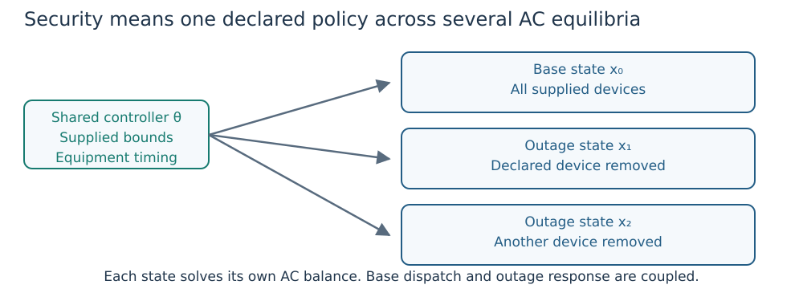
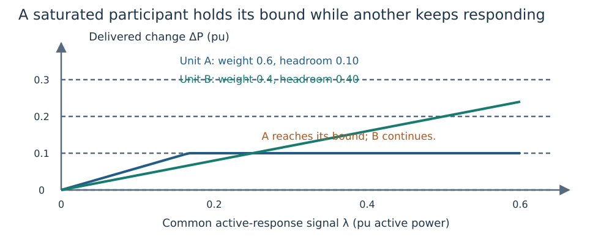
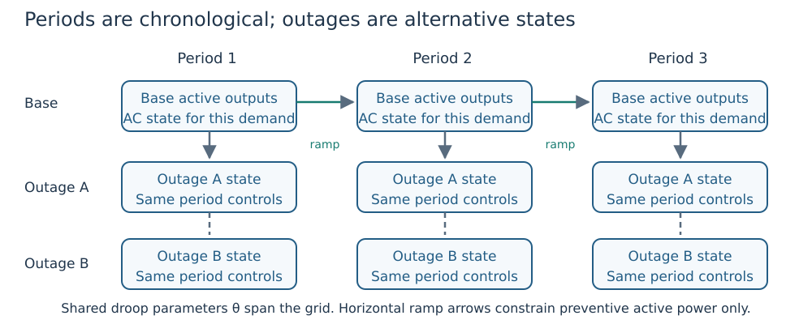

# From one equilibrium to secure and multi-period studies

**Goal:** choose what stays shared before choosing an optimization API.
The AC state is ``x=(v,\delta,P,Q)``: bus voltage magnitudes/angles and generator
active/reactive outputs. Let ``\theta`` denote selected curve/equipment design
parameters; these are distinct from the AC state. Subscript ``c`` identifies an
outage scenario, with ``c=0`` the base. Subscript ``k`` identifies a chronological
period. All powers are in pu unless stated otherwise.

## One case, several outage equilibria



*Figure 1. States differ by outage topology/availability, while parameter sharing
and the base-to-outage response policy constrain what can change.*

A fixed-curve `Study` has one base dispatch and a declared contingency list.
Each state ``x_c`` satisfies its own network equations, device bounds and reactive
law. Generator or branch unavailability removes that device's injection or flow.
A generator's curve can stay fixed while its Q output changes with voltage.

| Question | Choose explicitly |
|---|---|
| Which devices can fail? | The contingency catalogue, including excluded/unsupported islanding entries. |
| Which active units can respond? | Participation weights, effective capability and declared movement bounds. |
| Can equipment change after the outage? | Preventive/corrective timing, selected devices, absolute bounds and movement budgets. |
| Can the curve change? | A fixed curve stays fixed; shared design selects one parameter vector for the declared training states. |
| What counts as completion? | Required catalogue coverage, native convergence and independent state/policy replay. |

The [complete security example](first_security.md) runs this coupling on a
three-bus network. The [SCOPF guide](scopf.md) specifies exact API behavior. A ranking merely changes
execution order; an unassessed low-ranked outage is not an accepted AC equilibrium.

## Understand limit-aware active response

For generator ``g`` in scenario ``c``, ``P_{g,0}`` is base output,
``\alpha_{g,c}\ge0`` its normalized survivor weight, ``\lambda_c`` the common
request signal and ``L_{g,c},U_{g,c}`` effective active bounds, all power quantities
in pu. The preventive response law is

```math
P_{g,c}=\operatorname{clip}(P_{g,0}+\alpha_{g,c}\lambda_c,L_{g,c},U_{g,c}).
```

Clipping is ``\operatorname{clip}(z,L,U)=\min(U,\max(L,z))``. Here ``z`` is a real input and ``L,U`` its lower/upper bounds. Effective bounds
intersect equipment capability and declared base-to-outage movement restrictions.
Unavailable units have zero output. Zero-weight units hold their base output.
Default weights use nonzero effective active-capability ranges among eligible
survivors; actual supplied response weights take precedence.



*Figure 2. Illustrative upward response. ``\Delta P`` is actual output minus base
output; ``\lambda`` is the request signal. The optimizer can increase the signal
until remaining participants deliver the required balance, subject to their bounds.*

Once a unit clips, ``\lambda_c`` need not equal the sum of delivered changes.
Compute actual delivery from the output differences. If headroom is inadequate,
the model cannot create missing supply. The weights encode a steady-state sharing
assumption, not governor speed or calibrated frequency dynamics.

A **corrective active-redispatch** study instead bounds each generator's allowed
output change directly. Its symmetric limit is a movement allowance in pu, not a
ramp rate. Do not confuse this active policy with corrective tap/shunt timing.

## Preventive versus corrective equipment

A preventive selected tap has one setting shared across base/outage states where
it is available. A corrective selected tap can have a different post-outage
setting inside declared absolute and movement bounds. An unselected tap stays fixed.
The same distinction applies to selected shunt controls.

API defaults for selected equipment are documented in [SCOPF timing](scopf.md#Equipment-timing-and-movement-bounds).
Declare timing explicitly in a study protocol. A library's `nothing` movement map
and an empty map have different meanings: no extra movement cap versus no listed
corrective devices. Continuous settings and settled-state permission do not imply
physical delays, tap steps, discrete switching or a valid transition trajectory.

## Alternative demands versus chronological periods

Independent demand cases have no implied order or ramp relation. A multi-period
study has an ordered set ``\mathcal T`` of period starts. Each period ``k`` has a
positive duration ``\Delta t_k`` in hours and its own state. Supplied ramp rates
``r_g^{up},r_g^{down}`` are in pu/hour and constrain preventive dispatch as

```math
-r_g^{down}\Delta t_k\le P_{g,k+1}-P_{g,k}
\le r_g^{up}\Delta t_k.
```

``P_{g,k}`` is base active output in period ``k``. The final duration weights energy
only. Initial/terminal or cyclic ramp boundaries must not be inferred.



*Figure 3. Horizontal arrows impose planned base dispatch ramps. Vertical layouts
show alternative outages, not simulation time. Shared curves span the specified grid.*

The base-operation multi-period objective is active loss energy:

```math
E_{loss}=S_{base}\sum_{k\in\mathcal T}\Delta t_k
 \left(\sum_{g\in\mathcal G}P_{g,k}-\sum_{l\in\mathcal L}P^L_{l,k}\right).
```

Here ``S_{base}`` is the power base in MVA, ``\mathcal G`` the generator set,
``\mathcal L`` the load set and ``P^L_{l,k}`` the active consumption of load ``l``
in period ``k``. Per-unit active power times this base is MW; multiplying by hours
gives MWh. Loss includes shunt conductance. It is not fuel cost.

[`optimize_multi_period`](multi_period.md) is the fixed-equipment base-operation
slice. [`optimize_multi_period_security`](mixed_avr_droop.md#Shared-design-and-chronological-security)
adds declared outage recourse and its study policies. A base-only profile does not
establish security at every period or dynamic security between periods.

## A practical study sequence

1. Validate a single fixed-control operating point with the [worked tutorial](first_opf.md).
2. Write the control freedoms, capability, response weights and equipment timing.
3. Compare supplied curves with a bounded shared design under the same operating limits.
4. Freeze the design for the declared evaluation cases; keep any demand-specific
   preventive dispatch freedom explicit.
5. Run the complete required catalogue and [replay every accepted result](validation.md).
6. Report unresolved solves, exclusions and resource cost alongside accepted coverage.

These steps explain why adding scenarios changes the optimization problem without
turning it into a dynamic simulation or a global-optimality certificate.
