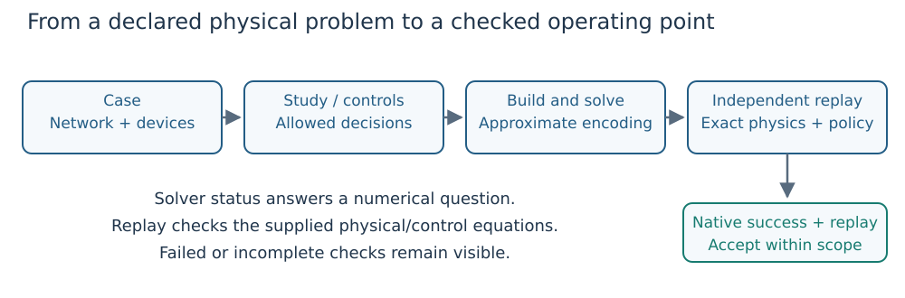

# Can I trust the operating point?

A solver can terminate successfully on its numerical encoding while the returned
state misses an exact physical curve or a declared policy. Conversely, a useful
physical point does not turn a timed-out solve into native convergence. Record
both kinds of evidence.



*Figure 1. Physical replay reconstructs branch currents, nodal balance, controls
and limits. The study validator additionally checks cross-state policy.*

## Check the right object

| Result being checked | Validator | Additional meaning |
|---|---|---|
| Base OPF state/result | `validate_equilibrium(case, result)` | AC equations, supplied controls and device limits. |
| Selected tap/shunt/droop design | Its `validate_*_design` function | Reconstructed physical settings and declared design bounds. |
| Coupled security study | `validate_equilibrium(study, result)` | Base/outage states plus response, sharing and equipment timing. |
| Base multi-period design | `validate_multi_period(study, result)` | Every period, shared curves, ramps, angle restrictions and energy objective. |
| Multi-period security | `validate_multi_period_security(studies, result)` | Period/scenario policy, physical replay and temporal coupling. |

The [first OPF](first_opf.md) is a complete executable example, including a
reactive-output corruption that the validator rejects. The following is an API
fragment: `case` and `result` must already come from the same solved problem.

```julia
validation = validate_equilibrium(case, result)
validation.valid
validation.power_balance_max
validation.droop_residual_max

report = equilibrium_report(case, result)
println(markdown_report(report))
```

For base OPF, `validation.valid` describes physical checks; inspect native status
as well. `equilibrium_report` combines numerical metadata with independent replay.
Passing the result instead of only `result.state` also carries its smoothing
metadata. If you used explicit `reactive_assignments`, pass the same assignments
to the relevant validator; a validator must check the problem you actually solved.

## Read residuals and margins differently

A **residual** measures disagreement with an equality: zero is the target. A
**margin** measures distance from a bound: a negative margin means a violation.
For a supplied upper limit ``u`` and value ``z``, margin is ``u-z``; for a lower
limit ``l``, margin is ``z-l``. Here ``u,l,z`` share the units of the checked quantity.

| Check | What is recomputed | Why it matters |
|---|---|---|
| Active/reactive balance | Generator injection minus load, shunt and branch consumption | A visually plausible voltage profile can still violate conservation. |
| Exact control relation | Delivered Q versus the exact supplied droop, AVR or fixed-Q relation | Smooth solver equations and physical corners differ. |
| Voltage/capability bounds | Limits on each available device/state, including supplied apparent ratings | A reference bus has no unlimited reserve. |
| Terminal loading | Apparent power at both branch ends | Charging and losses make the ends different. |
| Availability | Zero injection/flow for outaged devices | Removing a control equation is not enough if its injection remains. |
| Policy coupling | Shared settings and declared base-to-outage/period movement | Separate feasible points may belong to an impermissible policy. |

## Use the actual default tolerances

The base `validate_equilibrium` defaults below are implementation defaults, not
manufacturer data or permission to loosen a study's previously declared gates.

| Keyword | Default | Checked unit |
|---|---:|---|
| `power_tolerance` | `1e-6` | pu active/reactive power residual |
| `droop_tolerance` | `1e-5` | pu reactive-power residual |
| `limit_tolerance` | `1e-6` | Native pu unit of each device margin |
| `unavailable_tolerance` | `1e-8` | pu unavailable-device output |
| `avr_voltage_tolerance` | `1e-5` | pu measured-voltage residual |
| `avr_sharing_tolerance` | `1e-5` | Dimensionless normalized Q-position mismatch |

Smoothing widths belong to the numerical encoding. Tolerances belong to the
acceptance check. Capability bounds belong to the physical contract. Changing
one must not be described as changing another. Check the specific validator/API
for additional policy and complementarity tolerances.

## An unsuccessful search has several possible meanings

- **Accepted witness:** a returned point passes the applicable native, physical
  and policy gates for its declared coverage.
- **Rejected physical point:** replay identifies a particular violated equation or bound.
- **Unresolved numerical solve:** a timeout, error or failed local search supplies
  no proof that a valid operating point cannot exist.
- **Certified infeasibility:** an independently replayable contradiction excludes
  the declared feasible set; see [feasibility qualification](feasibility_gate.md)
  and [global certificates](global_feasibility.md).

For controller replacement, use the [feasibility precursor](feasibility_gate.md)
to freeze the equipment freedoms, source angle constraints and acceptance contract.
For repeated-start behavior and interpretation of local solutions, read
[robustness](robustness.md). Describe the required outage/period coverage explicitly when reporting results.
