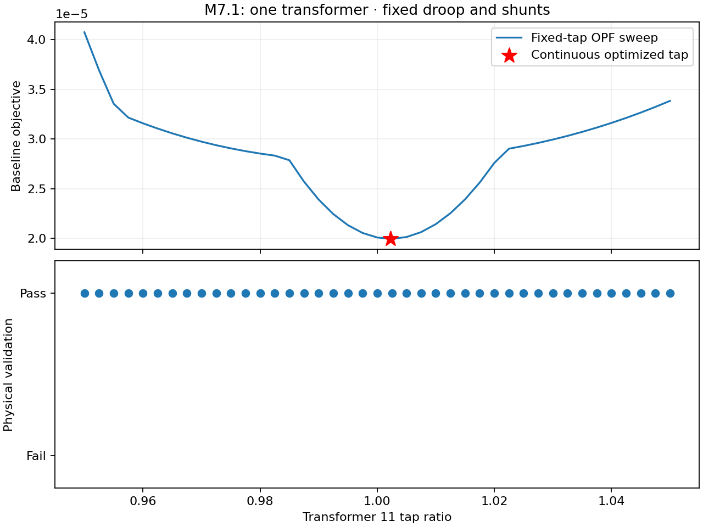
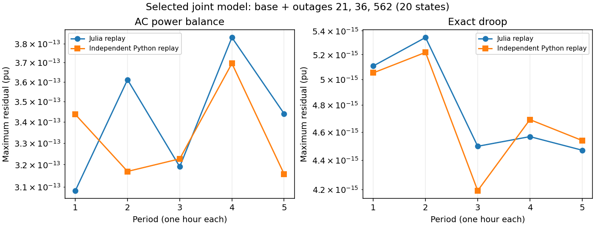
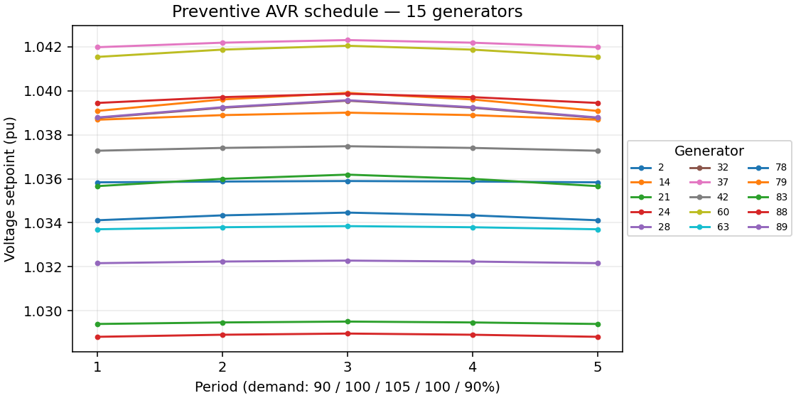

# Selected validation references

These compact references illustrate numerical verification of the implemented
steady-state equations and declared study policies. They are not field validation,
a guarantee for arbitrary networks, or certification of dynamic behavior.
Full research archives remain local. No large network inputs or solver logs are
included here.

## Transformer optimization: a small, interpretable check



This historical M7.1 sweep compares fixed and optimized continuous taps on a
synthetic three-bus system, with phase shifts, shunts and droops fixed. The objective
is dispatch deviation, not loss minimization. The fixed / one-free / two-free tap
solutions have maximum AC residuals of 2.43e-15 / 2.87e-13 / 5.83e-14 pu.
See the [equipment report tables](equipment_optimization.md) for settings,
objectives, acceptance tolerances and limitations. The figure is copied unchanged
from the archived report; its source path and SHA-256 are in the summary below.
A sweep supports this bounded comparison, not global optimality in larger models.

## Independent replay of the recovered 500-bus joint model



Each point is the largest residual among the base and outages 21, 36 and 562 at
that period. There are 20 states in this selected joint model. Julia and independent
Python replay evaluate the saved solution; the plot does not represent every
state in the subsequent full catalogue. Its small residuals demonstrate numerical
agreement with the equations. Acceptance also checks voltage, thermal and
capability limits, AVR behavior, response and equipment policy; those checks cannot
be replaced by a residual plot.

## Preventive AVR schedule



The schedule is optimized jointly with dispatch and shared droop curves, then
frozen across outages within each period. Fifteen generators use AVR and 36 use
generic volt-var droop. Maximum hourly target movement is 0.00052050 pu, below
the declared 0.01 pu/hour budget. Targets stay within nominal +/-0.02 pu clipped
to normal voltage bounds. These are steady-state operating setpoints, not a
simulation of excitation dynamics.

## Compact campaign report — 23 October 2026

| Check | Recorded result |
|---|---|
| Candidate / objective | `joint-five`; feasibility |
| Network / profile | 500 buses; five one-hour periods at 90/100/105/100/90% demand |
| Connected outage coverage | 389/389 accepted five-period trajectories |
| Remaining numerical failures | None in this connected catalogue |
| Final Julia replay | 390 selected result files; 3,910 state instances including repeated bases |
| Independent Python audit | Selected trajectories and frozen-policy identity passed |
| Load service / operating limits | Full load; no DR or shedding; normal voltage and original Rate A |
| Active response | Limit-aware capability-range participation with saturation redistribution |
| Capability | Existing P/Q boxes intersected with assumed S=Pmax/0.95 circles |
| Corrective equipment | 131 continuous taps, supplied +/-5% absolute bounds, <=0.025 supplied-ratio movement; 11 continuous banks within legal envelopes and <=two sections |
| Timing | Assumed 120-second settled sensitivity; not verified manufacturer timing |
| Physical/control limit relaxation | None |
| Five-hour base loss energy | 121.62343825 MWh; not a certified minimum-loss result |

The preceding candidate left outages 21, 36 and 562 numerically unresolved.
Reoptimizing preventive dispatch, shared curves and AVR targets recovered them;
it did not establish that their previous residuals proved physical infeasibility.
Rejected expanded masters and failed attempts remain in the full local report.
Islanding, dynamic security, discrete implementation, detailed GFL/GFM behavior
and full-catalogue resource/loss optimality are outside this qualification.
Original S2 remains paused and broader P2 is not closed.

## Provenance and reproduction

[Download the compact evidence summary](assets/validation/summary.json).
It includes the plotted residuals and AVR targets, coverage counts, and SHA-256
identities of the source report, result, replay records and sealed manifest.
Source campaign: `artifacts/p2_targeted_relaxations_20261023`.
The hashes identify local originals; they do not substitute for publishing those
originals or enable full independent reproduction from this small summary alone.

Regenerate the two new plots from the bundled summary, with Python and matplotlib:

```sh
python3 tools/release/plot_validation_references.py
```

The M7 image is an unchanged historical figure. Full campaign reproduction needs
the [locally archived inputs and evidence](research.md), appropriate solver
versions and computational resources. These documentation plots do not rerun
optimization or change any sealed result.

Software validation is separate: v0.10.0-rc1 passed 3,596 assertions on Julia
1.10/Linux, 1.12/Linux and 1.12/macOS, plus documentation and clean-install checks.
Those are release-time records, not newly executed campaign results.
