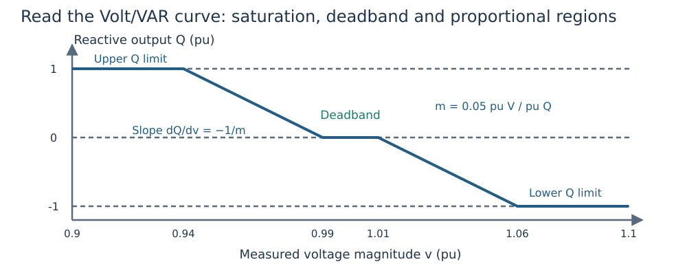

# Reading and designing a Volt/VAR curve

A Volt/VAR controller supplies a relation between **measured voltage** and generator
reactive output. Here VAR means reactive power; the code uses per-unit reactive
power on the case system base. Start with [the worked OPF](first_opf.md) if you
want to see how the curve enters a network solve.



*Figure 1. Illustrative exact curve: reference 1.0 pu, edges 0.99/1.01 pu,
zero deadband output, slope 0.05 pu voltage/pu reactive power, Q limits −1/+1 pu.
Positive output injects reactive power. The chart is a control law, not a trajectory.*

## Define every parameter

| Symbol | Meaning | Figure value |
|---|---|---:|
| ``v^m`` | Measured voltage magnitude, pu | Horizontal coordinate |
| ``v^{ref}`` | Reference voltage, pu | 1.0 |
| ``d^-,d^+`` | Lower/upper deadband widths, pu voltage | 0.01 each |
| ``v^-=v^{ref}-d^-``, ``v^+=v^{ref}+d^+`` | Deadband edges, pu voltage | 0.99, 1.01 |
| ``q^0`` | Reactive output inside the deadband, pu | 0 |
| ``m`` | Positive voltage-per-reactive-power slope | 0.05 |
| ``q^{raw}`` | Unsaturated reactive request, pu | Computed below |
| ``Q^-,Q^+`` | Effective reactive lower/upper limits, pu | −1, +1 |
| ``Q`` | Delivered equilibrium reactive output, pu | Vertical coordinate |

Define the positive part ``[z]_+=\max(z,0)`` and clipping
``\operatorname{clip}(z,L,U)=\min(U,\max(L,z))``. Here ``z`` is a real input, and ``L,U`` its lower/upper bounds in the same
units. The exact law is

```math
q^{raw}(v^m)=q^0+\frac{[v^- -v^m]_+}{m}
                  -\frac{[v^m-v^+]_+}{m},\qquad
Q=\operatorname{clip}(q^{raw},Q^-,Q^+).
```

Inside the deadband both hinge terms vanish. Below its lower edge the controller
injects more reactive power; above its upper edge it absorbs more. Clipping
prevents a request outside capability from becoming a delivered output.
In a proportional segment the derivative is ``dQ/dv^m=-1/m``. Therefore **smaller
positive `slope` means a stronger reactive response**; the stored slope is not
that derivative or its magnitude.

## Calculate one point by hand

With the figure's parameters, a measured voltage of ``v^m=0.97`` pu gives
``q^{raw}=(0.99-0.97)/0.05=0.4`` pu, and clipping leaves ``Q=0.4`` pu.
At ``v^m=0.90`` pu the raw request is 1.8 pu, so the delivered output is 1 pu.
On a 100 MVA base those outputs are 40 and 100 MVAr, respectively.

```@example curve_reading
using DroopOPF
schedule = VoltageSchedule(1.0; v_db_low=0.99, v_db_high=1.01)
cap = ReactiveCapability(p_min=0.0, p_max=2.0, q_min=-1.0, q_max=1.0)
curve = VoltVarDroop(schedule, 0.05, cap; q_ref=0.0)
@assert isapprox(droop_response(curve, 0.97; p=0.5), 0.4; atol=1e-12)
@assert droop_response(curve, 0.90; p=0.5) == 1.0
[(voltage=v, reactive_output=droop_response(curve, v; p=0.5))
 for v in (0.90, 0.97, 1.00, 1.03, 1.10)]
```

A deadband does not hold voltage at its center. It holds the requested reactive
output constant while the network equations determine voltage.

## Capability can depend on active output

If a generator has an explicitly supplied apparent rating ``S^{rated}``, active
output ``P`` leaves at most ``\sqrt{(S^{rated})^2-P^2}`` reactive magnitude, provided
``|P|\le S^{rated}``. That circle intersects the supplied Q box and any attached
control capability. Here ``P`` is active output, ``S^{rated}`` is apparent rating,
and ``|\cdot|`` is absolute value. All powers use the same system base.

Increasing active output can therefore clip the same curve at a different Q
limit. A clipped voltage-target AVR releases regulation; a clipped droop retains
its parameters and delivers the available limit. See [mixed controls](mixed_avr_droop.md).
A circle is not a full voltage-dependent converter-current model.

## Design a parameter, then freeze the result

A **fixed-curve OPF** solves for the operating point on supplied curves.
**Droop design** makes selected curve parameters additional optimization variables
inside explicit bounds. A reference shift translates the deadband edges if its
widths are fixed; slope changes alter proportional gain. Widths may be asymmetric.
The reactive deadband output and capability remain supplied in the standard design family.

Use the [bounded design API](droop_optimization.md) for a small parameter study,
or [shared contingency design](droop_security.md) for one controller across
training outages. Held-out conditions must use the frozen design according to
the declared dispatch/equipment policy. Retuning for each evaluation outage tests
a different policy.

## Smooth encoding versus the exact law

Smooth nonlinear programming (NLP) replaces the positive-part corners with smooth
approximations. Exact complementarity introduces inequalities and orthogonality
conditions to describe the same physical graph. Both need [independent validation](validation.md).
Numerical smoothing width, physical deadband width and acceptance tolerance are
three different quantities. See [solver formulations](solvers.md).
