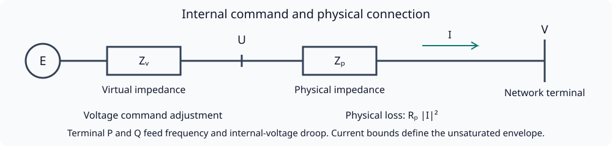
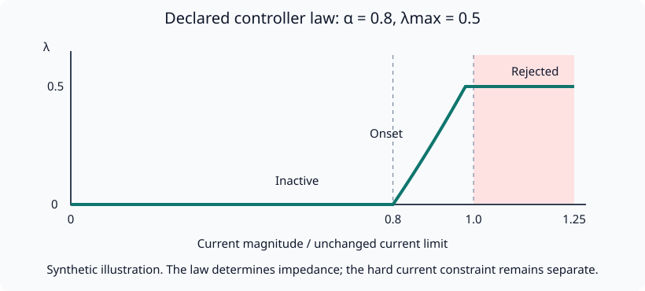

# Voltage-source grid-forming equilibrium

This optional refinement belongs to the [frequency-aware Q–V side study](frequency_aware_qv.md).
The main terminal Q–V study does not require internal impedance parameters.

A voltage-source grid-forming (GFM) controller specifies an internal voltage.
The network and connection impedance determine its current. This differs from
requesting terminal active/reactive powers and clipping those requests to a
capability circle, as in the [static inverter model](static_inverters.md).

This implementation describes a **balanced steady-state** controller, with an
optional threshold virtual-impedance limiter. It does not model fault ride-through,
synchronization transients or stability. Without the optional limiter, the model
remains unsaturated. In both modes the original hard current bound is enforced;
finite virtual impedance does not guarantee a feasible current-limited equilibrium.



## Voltages, current and power

All electrical quantities below use the plant MVA base and the network terminal
voltage base. Complex phasors are denoted with an underline; `j` is the imaginary
unit and a superscript `*` means complex conjugation.

```math
\underline I=\frac{\underline E-\underline V}{Z_v+Z_p},\qquad
\underline U=\underline E-Z_v\underline I,\qquad
P+jQ=\underline V\underline I^*.
```

| Symbol | Meaning | API field or result |
|:--|:--|:--|
| ``\underline E`` | Virtual internal voltage phasor, pu | `internal_voltage` |
| ``\underline U`` | Actual converter-side voltage phasor before the physical connection, pu | `converter_voltage` |
| ``\underline V`` | Network terminal voltage phasor, pu | Network `vm`, `va` |
| ``\underline I`` | Current toward the network, plant pu | `current` |
| ``Z_v`` | Fixed virtual impedance, plant pu | `z_virtual` |
| ``Z_p`` | Additional physical series connection impedance, plant pu | `z_physical` |
| ``P,Q`` | Terminal active and reactive injections, plant pu | `p`, `q` |

Impedances must be finite with nonnegative resistance and reactance; their sum
must be nonzero. This initial contract excludes capacitive series impedances,
LCL filter capacitors and remote voltage regulation. Physical impedance already
represented by a network branch must not also be included in `z_physical`.

The distinction between the two impedances matters for energy accounting:

```math
\operatorname{Re}(\underline U\underline I^*)=P+R_p|\underline I|^2,
\qquad R_p=\operatorname{Re}(Z_p).
```

Only ``R_p|\underline I|^2`` is physical connection loss. Virtual resistance changes
the command; it is not an energy-consuming network element. The existing AC state
stores **terminal injections**. Additional connection losses are reported separately
in MW and are not included in the native network branch-loss total. DC-side energy,
converter losses and converter-side power ratings are not inferred. Source P/Q and
apparent-power bounds, and `p_available`, are interpreted at the terminal.

## Terminal-feedback droop

```math
f=f_0-m_p(P-P_0),\qquad
|\underline E|=E_0-n_q(Q-Q_0).
```

Here ``f`` is the common settled frequency in Hz, ``f_0`` is `f_ref_hz`, ``m_p`` is
`p_droop_hz` in Hz per plant-pu active power, and ``P_0`` is `p_ref`. ``E_0`` is
`e_ref`, ``n_q`` is `q_droop` in voltage pu per plant-pu reactive power, and ``Q_0``
is `q_ref`. Both slopes must be positive. These equations use delivered terminal
powers, not virtual-source power or converter-side power. There is no deadband,
reference adaptation or integral controller in this version. Optional impedance
limiting changes the connection equation, not these outer droop laws.

Internal voltage is represented by real and imaginary components in the same
reference frame as the network. Moving the network angle reference rotates the
internal phasors without changing physical powers or voltage magnitudes.

## Operating bounds

The model enforces source P/Q boxes and source apparent ratings through the native
AC builder, plus these plant declarations:

```math
|\underline I|\le I_{\max},\quad
P^2+Q^2\le S_{\max}^2,\quad P\le P_{\mathrm{available}},
```

```math
E_{\min}\le|\underline E|\le E_{\max},\qquad
U_{\min}\le|\underline U|\le U_{\max}.
```

`i_max` is the continuous current envelope, `s_max` the terminal apparent-power
envelope and `p_available` the terminal active-power ceiling, all plant pu.
`e_bounds` and `u_bounds` are the respective positive voltage intervals. The second
interval is a declared converter-voltage envelope, not a derived DC modulation
model. Network voltage and thermal bounds remain unchanged. Offline generators
inject zero and have a zero internal-phasor sentinel; energized-source equations
are disabled for them.

## Threshold virtual-impedance limiter

`ThresholdVirtualImpedance` implements a declared finite-gain, memoryless controller:

```math
I_{\mathrm{on}}=\alpha I_{\max},\qquad
\lambda=\min\left(\lambda_{\max},\max\left(0,
\frac{|\underline I|^2}{I_{\mathrm{on}}^2}-1\right)\right),
```

```math
Z_v^{\mathrm{eff}}=Z_v+\lambda Z_g,\qquad
\underline E-\underline V=(Z_p+Z_v^{\mathrm{eff}})\underline I,\qquad
\underline U=\underline E-Z_v^{\mathrm{eff}}\underline I.
```

Here ``\alpha`` is `onset_fraction`, strictly between zero and one;
``I_{\mathrm{on}}`` is the current onset on the plant base;
``\lambda`` is the dimensionless impedance multiplier;
``\lambda_{\max}`` is the positive `max_multiplier` ceiling; and
``Z_g`` is `impedance_gain`, a nonzero passive complex impedance on the plant base.
Its resistance and reactance must be nonnegative. Settings are supplied once and
remain fixed; the optimizer cannot choose a different impedance independently
of the measured-current law. The squared-current law is the specific controller
implemented here; it is not a claim of equivalence to every threshold-impedance
controller or a manufacturer implementation.



The three algebraic regions are:

| Current condition | Controller action |
|:--|:--|
| ``|\underline I|\le I_{\mathrm{on}}`` | ``\lambda=0``; identical to the original voltage-source equations |
| ``I_{\mathrm{on}}<|\underline I|<I_{\mathrm{on}}\sqrt{1+\lambda_{\max}}`` | Added impedance follows squared-current excess |
| ``|\underline I|\ge I_{\mathrm{on}}\sqrt{1+\lambda_{\max}}`` | Added impedance is at its declared ceiling |

The **same** ``|\underline I|\le I_{\max}`` constraint remains active in every
region. If sufficient impedance is unavailable, the operating point is rejected.
There is no implicit clipping fallback, load shedding, widened P/Q capability,
or changed frequency/voltage bound. A ceiling may be unreachable inside the hard
current envelope for some parameter choices; that is permitted and reported.

Physical loss remains ``\operatorname{Re}(Z_p)|\underline I|^2``. Neither the fixed
nor the adaptive virtual resistance is counted as dissipated energy. The controller
reduces current for fixed internal and terminal phasors; this does **not** imply
monotonic current reduction in a coupled constant-power network where voltages move.

Limiter equations use exact `min`/`max`, without smoothing or enlarged tolerances.
They are continuous but nonsmooth at the two thresholds. Numerical failure is
reported as such, not as proof of infeasibility. Diagnostic modes `inactive`,
`active` and `ceiling` use the replay tolerance only to label proximity to a boundary.

For independent replay, the evaluator solves the scalar multiplier equation by
bracketed bisection. Passive impedances make current magnitude nonincreasing with
multiplier, giving a unique scalar controller response for fixed voltage phasors.
It compares this reconstructed response with stored powers **and** multiplier;
it does not repair the result. This local scalar uniqueness does not establish
uniqueness or stability of the coupled AC equilibrium.

```julia
# Synthetic settings; the plant's existing i_max and all other bounds stay fixed.
limiter = ThresholdVirtualImpedance(
    onset_fraction=0.8, impedance_gain=0.005+0.02im, max_multiplier=0.5)
result = solve_voltage_source_opf(case, [plant];
    limiters=Dict(plant.generator_id => limiter), frequency_hz=50.0)
report = validate_voltage_source_opf(case, result)
# report.plants records multiplier, mode, current and physical connection loss.
```

Offline sources have zero injection, internal-phasor and multiplier sentinels.
Their limiter settings remain stored but no energized-source law is imposed.
No time constants, anti-windup, hysteresis, state transitions or recovery trajectory
are implemented here. Those require a matching dynamic controller.

## Solving and checking

```julia
# Synthetic demonstration settings, not manufacturer data.
plant = VoltageSourceGFM(
    generator_id=1, terminal_bus=1, base_mva=100.0,
    z_physical=0.01+0.10im, z_virtual=0.02+0.05im,
    p_ref=0.5, q_ref=0.0, f_ref_hz=50.0, p_droop_hz=2.0,
    e_ref=1.0, q_droop=0.05,
    e_bounds=(0.8, 1.2), u_bounds=(0.8, 1.2),
    i_max=2.0, s_max=2.0, p_available=2.0)

# `case` must contain the declared generator and terminal bus.
result = solve_voltage_source_opf(case, [plant]; frequency_hz=50.0)
report = validate_voltage_source_opf(case, result)
```

With prescribed frequency, unassigned generators retain their native dispatch
freedom. To solve common frequency, supply `frequency_bounds=(48.0,52.0)` and
assign **every** other generator, including offline generators, either a
`StaticInverter` in `inverters` or a `GeneratorFrequencyResponse` in `responses`.
Duplicate generator controllers are rejected. Only connected networks are supported.
Supply `branch_angle_bounds=Dict(branch_id => (lower, upper))` to retain declared
branch angle-difference limits in radians. These are enforced in the native solve
and independent replay, and ignored only for branches removed by an outage.
All settings remain fixed and the solver uses a feasibility objective.

`initial_state` accepts a network AC state. The internal-voltage starting point is
reconstructed from its terminal power and voltage, without changing any equation.
This is not yet integration with preventive dispatch design, SCOPF or multi-period
builders, and there is no dynamic operating-point export adapter.

The validator recomputes complex currents and powers independently of JuMP,
checks droop and all added envelopes, then combines those results with native
convergence and independent network replay. Its default controller residual
threshold is ``10^{-6}`` in the respective pu/Hz units; native AC tolerances remain
unchanged. A failed nonlinear solve is not a proof of physical infeasibility.

Tests cover analytical voltage/frequency solutions, two-source active sharing,
physical versus virtual losses, system-base conversion, angle-reference changes,
offline units, conventional-response composition and corrupted result rejection.
A negative test checks that insufficient current capability does not silently
clip the requested controller response.

Additional limiter tests cover onset continuity, active and ceiling regions,
inactive equivalence, unchanged input data, physical-versus-virtual loss accounting,
base/gauge invariance, prescribed/common frequency, mixed GFL/conventional fleets,
offline units, warm starts and controller-contract corruption. A negative fixture
has load exceeding the necessary bound ``\sum_i V_{i,\max} I_{i,\max}`` (converted
to a common power base); its rejected result does not depend on a solver status
being interpreted as a general infeasibility certificate.
